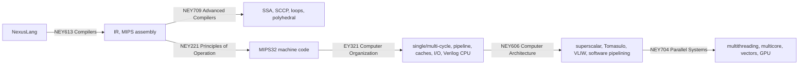

# NEXUS

**One path from a line of source code to a program running on many processors. Six computer-systems
courses are the steps of this path, and every step is code that runs and is checked against the others.
NEXUS is supporting material for these courses: what is taught in each one is here as working code.**

NEXUS (version 3.1.0) is a C++20 / Verilog project. A program written in its small language, NexusLang, is
compiled and optimised, becomes MIPS machine code, and runs on every processor model from a single-cycle
machine to an out-of-order core and a multicore, and on a pipelined MIPS CPU written in Verilog with its I/O
devices. Around this path sit the tools of each course: grammars, automata and attribute grammars for the
compiler, SSA, data flow and polyhedral transformations by linear programming for optimisation, ISA styles
and computer arithmetic, hardwired and microprogrammed control (also in Verilog), branch prediction, caches,
virtual memory and interrupts, non-blocking caches and prefetching, dynamic and static (software-pipelined)
scheduling, multithreading, vector processors, message passing, coherence, networks and a GPU model with
thread blocks and shared memory.

## The flow



One command follows a single program (`examples/flow/flow_demo.nx`, which prints `S=5913` on the console)
through the six courses and checks that every step gives the same result:

```bash
python scripts/nexus_flow.py build/bin      # CTest: nexus_full_flow
```

`docs/FLOW.md` walks through the path step by step and names the code at every step.

| course | step of the flow | what runs |
| --- | --- | --- |
| NEY613 Compilers | language to machine code | hand-written lexer and parser, Flex/Bison path, semantic analysis and attribute grammars (synthesized and inherited attributes, dependency graphs, L-attributed evaluation), three-address code and quadruples, MIPS code generation, linear-scan register allocation; regex to minimal DFA; LL(1), LR(0), SLR(1), LR(1), LALR(1); hash tables and symbol tables, tree traversals, DFS/BFS, topological order, SCCs, transitive closure |
| NEY709 Advanced Compiler Topics | analysis and optimisation of the code | Earley (ambiguous grammars) and parallel parsing; Hindley-Milner inference; SSA and SCCP; iterative and region-based data flow; symbolic, alias and interprocedural analysis; concrete unrolling and symbolic unrolling by any factor with a remainder loop; polyhedral dependence analysis and transformations, hyperplane schedules by integer linear programming (exact simplex, branch and bound) |
| NEY221 Principles of Computer Operation | instruction set and arithmetic | MIPS toolchain; stack (JVM-like), accumulator and IA-32-like back ends with interpreters; bit-exact IEEE-754 soft float; integer encodings; Booth, non-restoring division, carry lookahead; UTF-8 |
| EY321 Computer Organization | the CPU that executes it | single-cycle and multi-cycle CPUs (hardwired and microprogrammed control); 5-stage pipeline with hazards, forwarding, prediction; L1/L2 caches, virtual memory (TLB, page table, page replacement, disk), I/O, interrupts, DMA; Verilog datapath units, a multi-cycle CPU with hardwired and with microprogrammed control, and a pipelined CPU with branch prediction, a polled console and a timer interrupt on its I/O bus |
| NEY606 Computer Architecture | faster CPUs | superscalar, VLIW, scoreboard and Tomasulo scheduling with reorder buffer, register renaming, speculation and return-address stack; software pipelining by iterative modulo scheduling; non-blocking caches with MSHRs and next-line/stride prefetching; deeper pipelines; Amdahl studies; coherence and consistency |
| NEY704 Parallel Systems | many CPUs and GPUs | coarse-grained, fine-grained and simultaneous multithreading; distributed memory with message passing and collective operations on ring, mesh and hypercube networks; multicore with snooping/directory coherence, SC/weak consistency, locks, barriers, atomics; bus, switch, ring and 2-D mesh networks up to 64 cores; asymmetric cores; a vector processor with strip-mining, chaining and lanes; SIMT GPU model with thread blocks, shared memory, bank conflicts and barriers; OpenMP, MPI, SIMD and CUDA programs |

Every topic of the six University of Thessaly course outlines in `docs/course_outlines/` maps to code and an
automated test (`docs/reports/full_syllabus_checklist.md`); history, taxonomies and reading lists are notes.

## Main results

All numbers come from `ctest` and the commands in `docs/`; the full record is `docs/reports/validation_report.md`.

1. **One program gives the same result through the whole flow.** `flow_demo.nx` prints `S=5913` and exits
   with 25 on every CPU model, compiled with and without register allocation, and on the Verilog CPU, where
   it polls the console on the I/O bus; a timer interrupt gives the same result on the Verilog CPU and on the
   pipeline simulator (`nexus_full_flow`).
2. **Every timing model reproduces the reference result.** All 12 test programs, compiled with and without
   register allocation, give the functional interpreter's exit code on 12 CPU models (288 runs).
3. **The Verilog CPUs match the simulator instruction for instruction.** The pipelined core gives the same exit
   code and retired-instruction count in all 16 runs, with every branch predictor (two-bit counters cut
   mispredictions from 812 to 402 and cycles from 49,708 to 44,640 over these runs); the multi-cycle core does
   the same with hardwired and with microprogrammed control, in identical cycle counts (CPI 3.7-4.3). Yosys
   synthesises every core.
4. **The arithmetic is exact.** The software IEEE-754 add/sub/mul/div is bit-identical to the hardware FPU on
   2,000,000 random operand pairs, including subnormals, infinities, NaNs and rounding ties.
5. **The compiler tools agree with independent references.**
   - The regex engine agrees with `std::regex`; grammar 4.49 has 10 LALR(1) states against 14 LR(1).
   - Knuth's binary-number attribute grammar (not L-attributed) evaluates `1101.01` to 13.25 through its
     dependency graph and matches direct conversion on 500 random numbers; one left-to-right pass correctly
     refuses it, and gives the same attributes as the dependency graph on the L-attributed declaration grammar.
   - The hash table agrees with `std::unordered_map` over 20,000 random operations; Warshall's closure, Tarjan's
     SCCs and Kahn's order agree with reachability on 200 random graphs.
6. **The optimisations are checked by execution.**
   - Of 600 random polyhedral transformations, all 341 judged legal reproduce the original results exactly.
   - The integer program for hyperplane schedules finds pi = (1,1) for the wavefront nest (12 wavefronts, inner
     loop parallel) and pi = (0,0,1) for matrix multiplication; its optimum equals brute force on 120 random
     dependence sets, and the simplex and branch and bound agree with exhaustive search on 150 random programs.
   - Symbolic unrolling with a remainder loop gives the same result as the original on 160 random counted
     loops (factors 2-5, upward and downward, all comparisons).
   - Linear-scan allocation removes 21-58% of executed instructions.
7. **The architecture trade-offs come out as in the textbooks.**
   - On matrix multiplication a 4-wide Tomasulo core with a 2-bit predictor reaches IPC 1.76, against 0.95
     in order.
   - Iterative modulo scheduling reaches II = MII on the DAXPY (II 3, memory-bound) and dot-product (II 4,
     recurrence-bound) loops and on 396 of 400 random loop bodies; every schedule is verified.
   - The vector processor runs DAXPY in 3 convoys per strip with chaining and 4 without (784 against 1164
     cycles for n = 256); every additional strip costs the same in steady state.
   - Four memory-bound threads take 20,024 cycles one after another, 6,433 coarse-grained and 7,424
     fine-grained with 20-cycle misses, but 4,224 fine-grained against 6,433 coarse-grained with 4-cycle
     misses; SMT with two issue slots finishes a mixed workload in 5,280 cycles against 6,331.
   - Next-line prefetching halves the misses of a stream and a stride prefetcher removes almost all of them;
     8 MSHRs make the same stream more than 4x faster than a blocking cache.
   - Page replacement shows Belady's anomaly for FIFO (9 faults with 3 frames, 10 with 4); OPT is a lower bound
     and LRU keeps the stack property on 300 random reference strings.
   - Broadcast, reduce and allreduce match their cost formulas exactly on 2-16 nodes; linear broadcast wins for
     one-word messages and the binomial tree for 1000-word messages.
   - A shared-memory block reduction with __syncthreads() is correct for warp sizes 4, 8 and 32, and bank
     conflicts cost exactly their extra cycles.
   - JVM-like stack code is the densest; divergent GPU kernels drop to 14% SIMD efficiency.
8. **OpenMP, MPI and CUDA run on real toolchains.** On Google Colab (Tesla T4) the OpenMP and MPI benchmarks
   and the CUDA demo passed, with GPU checksums equal to the CPU (`results/colab/`, run with version 2.0.0).
9. **Two defects in an earlier version were found and fixed** (`STATUS.md`), and version 3.0.0 fixed loop
   detection for loops whose bound is the left operand (`while (n > i)`).

## Limitations (reported as such)

- The simulators are teaching models. The Tomasulo core and the multithreading model are trace-driven; the
  vector processor has one memory pipeline and no bank conflicts; the non-blocking cache assumes loads are not
  used immediately; the message-passing model has no link contention; cycle counts are model metrics, not measurements of real hardware.
- The Verilog CPUs are verified in simulation and synthesised with Yosys; they have not run on a board.
- NexusLang has `int`, `bool` and arrays only. The IA-32 and JVM back ends are faithful subsets.
- The polyhedral tool handles perfect loop nests with concrete parameters and does not generate tiled code; the
  linear programs are solved exactly but are meant for small problems.
- The OpenMP, MPI and CUDA programs need their toolchains; they were run on Google Colab, not on the Windows host.

## Folder map

```
nexus-platform/
  README.md, LICENSE (MIT), CITATION.cff, CHANGELOG.md, STATUS.md, ARCHITECTURE.md
  src/
    compiler/   foundations (hash tables, trees, graphs), frontend, semantics, ir, analysis (incl. SSA/SCCP),
                passes (unrolling, modulo scheduling, ...), backend_mips (incl. register allocation),
                isa_styles, formal (automata, grammars, attribute grammars), types (Hindley-Milner),
                polyhedral (incl. linear programming), experimental_parallel_parsing (parallel + Flex/Bison)
    sim/        functional, single_cycle, multi_cycle, pipeline, memory (caches, virtual memory, non-blocking
                caches), io, advanced (Tomasulo, SMT, multithreading), parallel (coherence, NoC, manycore, message
                passing), vector, simt (GPU with blocks), metrics
    mips/       ISA tables, assembly printer, loader, MIPS32 encoder
    hdl/        Verilog units, CPU slice, cpu_pipeline (5-stage CPU with branch prediction, I/O devices),
                cpu_multicycle (hardwired and microprogrammed control), testbenches
    common/     arithmetic, FPU-lite, IEEE-754 soft float, number systems
    nexusc_main.cpp, nexusc_course_tools.cpp, mips_sim_main.cpp, mips_sim_course_tools.cpp
  benchmarks/   OpenMP, MPI, SIMD, optional CUDA
  examples/     flow/ (the program of the full flow), source_lang/, grammars/, loops/, graphs/, schedules/,
                vector/, multithreading/, gpu/, parallel/, formal/
  tests/        unit/, integration/, golden/, programs/ (shared test programs)
  notebooks/    Colab notebook for the OpenMP, MPI and CUDA runs
  results/colab/  output of that notebook on a Tesla T4
  docs/
    course_outlines/   the six course outlines (PDF)
    reports/           full_syllabus_checklist.md, course_mapping.md, validation_report.md, studies
    architecture/ compiler/ microarchitecture/ parallel/ hdl/   one note per topic
    literature/        reading notes per course area
    history/           phase-by-phase roadmap and the 0.11 audit
  scripts/, tools/     nexus_flow.py (the full flow), benchmark, HDL and toolchain helpers
```

## Building and running

Requirements: CMake 3.25+, a C++20 compiler, Python 3, Flex and Bison. Optional: Icarus Verilog and Yosys (HDL
tests), an OpenMP compiler, MPI, CUDA, clang.

```bash
cmake -S . -B build -G Ninja -DCMAKE_BUILD_TYPE=Release
cmake --build build
cd build && ctest --output-on-failure
```

A few entry points (more in each `docs/` note):

| task | command |
| --- | --- |
| the full flow | `python scripts/nexus_flow.py build/bin` (see `docs/FLOW.md`) |
| compile and run | `nexusc compile prog.nx -S --regalloc linear-scan -o prog.s` then `mips-sim run prog.s --mode pipeline --cache assoc --stats` |
| data structures | `nexusc graph examples/graphs/loop_nest.graph`, `nexusc tree "+(a *(b c))"`, `nexusc hash if else while` |
| grammars and automata | `nexusc grammar examples/grammars/lvalue.g lalr "* id = id"`, `nexusc regex '(a|b)*abb'` |
| attribute grammars | `nexusc attr knuth 1101.01`, `nexusc attr decl "float a, b, c"` |
| type inference | `nexusc infer "fun f -> fun x -> f (f x)"` |
| SSA / SCCP | `nexusc analysis sccp tests/programs/constant_branches.nx` |
| loop unrolling | `nexusc opt examples/source_lang/symbolic_unroll.nx --pass unroll-remainder --factor 4` |
| polyhedral | `nexusc poly examples/loops/wavefront.loop skew 2 1 1 interchange 1 2`, `nexusc poly examples/loops/wavefront.loop schedule` |
| compare ISAs | `nexusc isa prog.nx` |
| arithmetic | `mips-sim arith float 0.1 add 0.2`, `mips-sim arith booth -3 5 4` |
| Verilog CPU | `mips-sim encode prog.s -o prog.hex`, then see `docs/hdl/pipelined_cpu.md` |
| out-of-order core | `mips-sim run prog.s --mode advanced --scheduler tomasulo --issue-width 4 --predictor 2bit` |
| software pipelining | `nexusc modsched examples/schedules/daxpy.ddg` |
| multithreading | `mips-sim mt coarse examples/multithreading/stream.s examples/multithreading/stream.s` |
| vector processor | `mips-sim vector examples/vector/daxpy.vasm --lanes 4` |
| virtual memory | `mips-sim vm examples/multithreading/stream.s --page 1024 --frames 4 --policy clock` |
| non-blocking cache | `mips-sim cache examples/multithreading/stream.s --mshr 4 --prefetch stride` |
| message passing | `mips-sim msg allreduce-rd --nodes 16 --topology hypercube --words 4` |
| GPU blocks | `mips-sim run examples/gpu/block_reduce.s --mode simt --threads 64 --warp-size 8 --block 16 --stats` |
| GPU / manycore | `mips-sim run examples/gpu/strided.s --mode simt --threads 64`, `mips-sim run examples/parallel/spmd_sum.s --mode parallel --cores 64 --interconnect mesh` |

## Status and what remains

Version 3.1.0 covers the six course outlines and is tested; version 2.0.0 also covered Embedded Systems, VLSI
Design, Logic Design and Operating Systems, which 3.0.0 removed to focus on these six courses. Possible
extensions:
- add tiled code generation to the polyhedral tool;
- model link contention in the message-passing network;
- run a Verilog core on an FPGA board.

## Citation and license

George David Tsitlauri, Department of Informatics and Telecommunications, University of Thessaly, Greece. MIT license ([LICENSE](LICENSE)); citation metadata in
[CITATION.cff](CITATION.cff).
