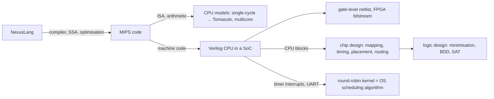

# NEXUS

**One path from a line of source code down to transistors, and back up to an operating system running on
that hardware. Ten computer-systems courses are the layers of this path, and every layer is code that
runs and is checked against the others.**

NEXUS (version 2.0.0) is a C++20 / Verilog project. A program written in its small language,
NexusLang, is compiled to MIPS, runs on every CPU model from a single-cycle machine to an out-of-order
core, runs on a pipelined MIPS CPU written in Verilog inside a system on chip, on the gate-level
netlist of that SoC and through an FPGA flow to a bitstream. The CPU's own blocks go through the
chip-design tools (synthesis, technology mapping, timing, placement, routing), which rest on the
logic-design library (minimisation, BDDs, SAT). On top of the hardware runs a small preemptive
kernel whose decisions are checked against the operating-system algorithms.

## The flow



One command follows a single program (`examples/flow/flow_demo.nx`, which prints `S=5913` through the
UART) through every layer and checks that each one gives the same result:

```bash
python scripts/nexus_flow.py build/bin --gates --fpga      # CTest: nexus_full_flow
```

`docs/FLOW.md` walks through the path step by step and names the code at every layer.

| course | layer of the flow | what runs |
| --- | --- | --- |
| NEY613 Compilers | language to machine code | hand-written lexer and parser, Flex/Bison path, semantic analysis, three-address code and quadruples, MIPS code generation, linear-scan register allocation; regex to minimal DFA; LL(1), LR(0), SLR(1), LR(1), LALR(1) with attribute evaluation |
| NEY709 Advanced Compiler Topics | analysis and optimisation of the code | Earley (ambiguous grammars) and parallel parsing; Hindley-Milner inference; SSA and SCCP; iterative and region-based data flow; symbolic, alias and interprocedural analysis; loop unrolling; polyhedral dependence analysis and transformations |
| NEY221 Principles of Computer Operation | instruction set and arithmetic | MIPS toolchain; stack (JVM-like), accumulator and IA-32-like back ends with interpreters; bit-exact IEEE-754 soft float; integer encodings; Booth, non-restoring division, carry lookahead; UTF-8 |
| EY321 Computer Organization | the CPU that executes it | single-cycle and multi-cycle CPUs (hardwired and microprogrammed control); 5-stage pipeline with hazards, forwarding, prediction; L1/L2 caches, I/O, interrupts, DMA; Verilog datapath units and a full pipelined CPU |
| NEY606 Computer Architecture | faster CPUs | superscalar, VLIW, scoreboard and Tomasulo scheduling with reorder buffer, register renaming, speculation and return-address stack; deeper pipelines; Amdahl studies; coherence and consistency |
| NEY704 Parallel Systems | many CPUs and GPUs | SMT; multicore with snooping/directory coherence, SC/weak consistency, locks, barriers, atomics; bus, switch, ring and 2-D mesh networks up to 64 cores; asymmetric cores; SIMT GPU model; OpenMP, MPI, SIMD and CUDA programs |
| NEY604 Embedded Systems and Microprocessors | the CPU as a system on chip | SoC: the pipelined CPU with memory-mapped UART, timer interrupts and GPIO; the same programs on simulator, RTL and gate-level netlist; ECP5 place and route and bitstream; real-time scheduling (RM, DM, EDF, response-time analysis, priority inheritance), dataflow and Petri nets |
| NEY705 VLSI Design | the chip below the RTL | switch-level CMOS simulation with a 6T SRAM; complex gates, Euler-path layout and DRC; logical effort; AIG synthesis, technology mapping and SAT equivalence; static timing and power; stuck-at fault simulation and ATPG; KL/FM partitioning, floorplanning, placement, Lee/A*/negotiated-congestion and channel routing, Steiner trees |
| EY121 Logic Design | the logic below the cells | Quine-McCluskey with Petrick's method, Karnaugh maps, BDDs, Tseitin CNF and a CDCL SAT solver; PLA/PAL/ROM programming with shared product terms; Gray and Hamming codes; gate-level latches and flip-flops; FSM minimisation, analysis and synthesis with D/T/JK flip-flops to Verilog; combinational and sequential blocks in Verilog |
| EY517 Operating Systems | software on the hardware | process states and seven schedulers; model checker for concurrent programs (Peterson, semaphores, dining philosophers); Banker's algorithm; allocation, buddy system, paging with TLB, page replacement; disk scheduling, RAID 5, an inode file system with fsck; a round-robin kernel on the CPU; POSIX lab programs |

Every topic of the ten University of Thessaly course outlines in `docs/course_outlines/` maps to code
and an automated test (`docs/reports/full_syllabus_checklist.md`). The only exceptions are reading
lists and history.

## Main results

All numbers come from `ctest` and the commands in `docs/`; the full record is `docs/reports/validation_report.md`.

1. **One program gives the same result through the whole flow.** `flow_demo.nx` prints `S=5913` and
   exits with 25 on 10 CPU models, compiled with and without register allocation, on the Verilog SoC
   and on its gate-level netlist; the same run maps, proves, places and routes the CPU's control unit
   and builds the FPGA bitstream with the program in ROM (`nexus_full_flow`).
2. **Every timing model reproduces the reference result.** All 12 test programs, compiled with and
   without register allocation, give the functional interpreter's exit code on 12 CPU models: single
   and multi-cycle, the pipeline with and without caches, scoreboard, Tomasulo, dual issue and
   multicore. That is 288 runs.
3. **The Verilog CPU matches the simulator instruction for instruction.** The compiler's output runs
   on the 5-stage RTL core (`nexusc` -> `mips-sim encode` -> Icarus Verilog). It gives the same exit
   code and the same retired-instruction count as the simulator in all 16 runs, and Yosys synthesises
   the core.
4. **The arithmetic is exact.** The software IEEE-754 add/sub/mul/div is bit-identical to the
   hardware FPU on 2,000,000 random operand pairs, including subnormals, infinities, NaNs and rounding
   ties.
5. **The theory tools agree with independent references.**
   - The regex engine agrees with `std::regex` and reproduces the Dragon-book results: (a|b)*abb
     gives a 4-state minimal DFA; grammar 4.49 has 10 LALR(1) states against 14 LR(1).
   - The Earley parser counts Catalan-number parse trees.
   - Hindley-Milner infers the principal types and rejects `fun x -> x x` by the occurs check.
   - Of 600 random polyhedral transformations, all 341 judged legal reproduce the original results
     exactly, and Fourier-Motzkin never misses a dependence.
6. **The architecture trade-offs come out as in the textbooks.**
   - Linear-scan allocation removes 21-58% of executed instructions.
   - On matrix multiplication, a 4-wide Tomasulo core with a 2-bit predictor reaches IPC 1.76,
     against 0.95 for the in-order core.
   - JVM-like stack code is the densest; MIPS with allocation moves 13x less data than stack-frame
     MIPS.
   - Divergent GPU kernels drop to 14% SIMD efficiency; strided accesses need 32 memory transactions
     per warp request against 1.
7. **OpenMP, MPI and CUDA run on real toolchains.** On Google Colab (Tesla T4) the complete suite
   of 68 tests ran, including the OpenMP and MPI benchmarks and the CUDA demo, whose GPU checksums
   match the CPU (`results/colab/`). The run also exposed one portability bug, now fixed: GCC named
   type variables in a different order than Clang.
8. **Two defects in the earlier version were found and fixed** (`STATUS.md`):
   - the cached pipeline returned wrong results for programs with calls;
   - passing a row of a 2-D array used the wrong address.
9. **The logic and EDA tools are checked against exact methods and against Yosys.**
   - Quine-McCluskey covers, logical-effort sizing, static timing and Banker's safety match
     exhaustive search or numerical optima on random cases.
   - The technology mapper's output is proved equivalent to its input by the project's own SAT solver
     and, independently, by Yosys (c17 and the CPU control unit).
   - On the control unit (303 AND nodes, 263 cells) Fiduccia-Mattheyses cuts 20 nets against 158 for a
     random bisection, quadratic placement with annealing reduces wirelength from 5120 to 1584, and the
     router finishes with zero overflow.
   - Every synthesised state machine (2 machines, 4 encoding/flip-flop choices) behaves as its state
     table in Icarus Verilog.
10. **The SoC gives the same result at every level where it runs.** `HELLO NEXUS` over the UART and
   exit code 12 on the ISA-level and pipeline models, the Verilog SoC and its gate-level netlist; the round-robin
   kernel runs three tasks over 9 timer interrupts and its dispatch order on the RTL, `012012121`,
   is the Gantt chart that the OS scheduling library computes for the same jobs. The
   SoC is placed and routed on a Lattice ECP5-85F (5983 logic cells, 1592 flip-flops) and the
   bitstream is read back correctly.
11. **The real-time tests are exact where theory says so.** On 400 random task sets, response-time
    analysis and the EDF test agree with simulation; the Liu-Layland and hyperbolic bounds never
    accept an unschedulable set. Priority inheritance cuts the finish time of the high-priority task
    from 9 to 4 in the inversion example.

## Limitations (reported as such)

- The simulators are teaching models. The Tomasulo core is trace-driven; the SIMT model has no thread
  blocks, shared memory or latency hiding; cycle counts are model metrics, not measurements of real
  hardware.
- The Verilog CPU and SoC are verified in simulation (RTL and gate level). On the ECP5 the SoC reaches
  only 6.8 MHz because multiply and divide are single-cycle combinational blocks. No board pin
  constraints are given and the bitstream has not been run on a board.
- The VLSI tools are teaching-scale: global routing on a coarse grid, no detailed routing and no
  GDSII; delays are in logical-effort units, not from a process library; the flow skips routing above
  1500 cells.
- The POSIX lab programs build and run only on Linux or macOS; their test is skipped on Windows. They
  passed on Google Colab (Linux, GCC), together with the complete suite (`results/colab/linux_gcc_2.0.0.md`).
- NexusLang has `int`, `bool` and arrays only (no floating point, pointers or globals). The IA-32 and
  JVM back ends are faithful subsets, not complete instruction sets.
- The polyhedral tool handles perfect loop nests with concrete parameter values and does not generate
  tiled code.
- The OpenMP, MPI and CUDA programs need their toolchains. They were skipped on the Windows host and run
  on Google Colab (Tesla T4, CUDA 13.0, GCC 13.3, OpenMPI) instead: all their tests passed there
  (`results/colab/`). These are small correctness demos, not performance studies.

## Folder map

```
nexus-platform/
  README.md, LICENSE (MIT), CITATION.cff, CHANGELOG.md, STATUS.md, ARCHITECTURE.md
  src/
    compiler/   frontend, semantics, ir, analysis (incl. SSA/SCCP), passes, backend_mips (incl. register
                allocation), isa_styles, formal (automata, grammars), types (Hindley-Milner), polyhedral,
                experimental_parallel_parsing (parallel + Flex/Bison)
    sim/        functional, single_cycle, multi_cycle, pipeline, memory, io, advanced (incl. Tomasulo/SMT),
                parallel (coherence, NoC, manycore), simt (GPU), metrics
    mips/       ISA tables, assembly printer, loader, MIPS32 encoder
    hdl/        Verilog units, CPU slice, cpu_pipeline (5-stage CPU + testbench), logic (EY121 blocks),
                soc (SoC, FPGA top level, testbench)
    logic/      Boolean functions, minimisation, BDD, SAT, codes, FSMs, gate-level simulation
    vlsi/       switch-level CMOS, logical effort, AIG, mapping, timing/power/faults, partitioning,
                floorplanning, placement, routing; the nexus-eda commands
    os/         scheduling, concurrency and model checking, deadlock, memory, disks, file system
    embedded/   real-time scheduling, dataflow, Petri nets
    common/     arithmetic, FPU-lite, IEEE-754 soft float, number systems
    nexusc_main.cpp, mips_sim_main.cpp, eda_main.cpp, os_main.cpp, embedded_main.cpp
  benchmarks/   OpenMP, MPI, SIMD, optional CUDA
  examples/     flow/ (the program of the full flow), source_lang/ (NexusLang), grammars/, loops/, gpu/,
                parallel/, formal/, eda/, os/, embedded/
  tests/        unit/, integration/, golden/, programs/ (shared test programs)
  notebooks/    Colab notebook for the OpenMP, MPI and CUDA runs
  results/colab/  output of that notebook on a Tesla T4 (ctest log, benchmark outputs, environment)
  docs/
    course_outlines/   the ten course outlines (PDF)
    reports/           full_syllabus_checklist.md, course_mapping.md, validation_report.md, studies
    architecture/ compiler/ microarchitecture/ parallel/ hdl/   one note per topic
    logic/ vlsi/ os/ embedded/   one note per course added in 2.0.0
    literature/        reading notes per course area
    history/           phase-by-phase roadmap and the 0.11 audit
  scripts/, tools/     nexus_flow.py (the full flow), SoC/FPGA flow, benchmark, HDL and toolchain helpers
```

## Building and running

Requirements: CMake 3.25+, a C++20 compiler, Python 3, Flex and Bison. Optional: Icarus Verilog and
Yosys (HDL tests), nextpnr-ecp5 and ecppack (FPGA flow), an OpenMP compiler, MPI, CUDA, clang, a POSIX
system (lab programs).

```bash
cmake -S . -B build -G Ninja -DCMAKE_BUILD_TYPE=Release
cmake --build build
cd build && ctest --output-on-failure
```

A few entry points (more in each `docs/` note):

| task | command |
| --- | --- |
| the full flow | `python scripts/nexus_flow.py build/bin --gates --fpga` (see `docs/FLOW.md`) |
| compile and run | `nexusc compile prog.nx -S --regalloc linear-scan -o prog.s` then `mips-sim run prog.s --mode pipeline --cache assoc --stats` |
| out-of-order core | `mips-sim run prog.s --mode advanced --scheduler tomasulo --issue-width 4 --predictor 2bit` |
| compare ISAs | `nexusc isa prog.nx` |
| grammars and automata | `nexusc grammar examples/grammars/lvalue.g lalr "* id = id"`, `nexusc regex '(a|b)*abb'` |
| type inference | `nexusc infer "fun f -> fun x -> f (f x)"` |
| SSA / SCCP | `nexusc analysis sccp tests/programs/constant_branches.nx` |
| polyhedral | `nexusc poly examples/loops/wavefront.loop skew 2 1 1 interchange 1 2` |
| arithmetic | `mips-sim arith float 0.1 add 0.2`, `mips-sim arith booth -3 5 4` |
| Verilog CPU | `mips-sim encode prog.s -o prog.hex`, then see `docs/hdl/pipelined_cpu.md` |
| logic design | `nexus-eda minimize -n 4 -m 4,8,10,11,12,15 -d 9,14`, `nexus-eda fsm synth examples/eda/traffic.fsm --ff JK` |
| VLSI flow | `nexus-eda cmos "a b + c"`, `nexus-eda flow examples/eda/c17.blif`, `nexus-eda faults examples/eda/c17.blif` |
| operating systems | `nexus-os schedule examples/os/stallings.jobs`, `nexus-os check examples/os/peterson.conc` |
| SoC and FPGA | `python scripts/soc_flow.py build/bin/mips-sim --gates --fpga` (see `docs/embedded/embedded_soc.md`) |
| real-time | `nexus-embedded rt examples/embedded/tasks.rt`, `nexus-embedded inversion` |
| GPU / manycore | `mips-sim run examples/gpu/strided.s --mode simt --threads 64`, `mips-sim run examples/parallel/spmd_sum.s --mode parallel --cores 64 --interconnect mesh` |

## Status and what remains

Version 2.0.0 is complete for its purpose: the ten course outlines are covered and tested. Possible
extensions:
- run the SoC on an ECP5 board, with pin constraints and the iterative divider for a higher clock;
- add thread blocks and shared memory to the SIMT model;
- add tiled code generation to the polyhedral tool.

## Citation and license

George David Tsitlauri, Department of Informatics and Telecommunications, University of Thessaly. MIT license ([LICENSE](LICENSE)); citation metadata in
[CITATION.cff](CITATION.cff).
