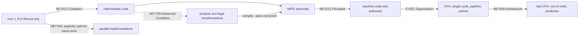

# NEXUS

**How does a line of source code become machine instructions that one processor, or many, can execute, and why is
each step built the way it is?**

NEXUS is study material for six courses of the Department of Informatics and Telecommunications, University of
Thessaly. The guides explain the mechanisms and connect the theory to runnable
examples. Start with short programs and hand calculations, then inspect the relevant part of the full
implementation. The simulators deliberately simplify hardware; each guide identifies the important limits.

For the whole picture, read [one computation through all six courses](docs/FLOW.md).
For a particular topic, choose its course below.

## Start here: pick your course

| course | study guide | you will see |
| --- | --- | --- |
| NEY221 Principles of Computer Operation | [docs/courses/NEY221.md](docs/courses/NEY221.md) | MIPS assembly, instruction set styles, two's complement and IEEE-754, adders, Booth, division |
| EY321 Computer Organization | [docs/courses/EY321.md](docs/courses/EY321.md) | single-cycle, multi-cycle and pipelined CPUs, hazards, caches, virtual memory, I/O, Verilog |
| NEY606 Computer Architecture | [docs/courses/NEY606.md](docs/courses/NEY606.md) | Amdahl, superscalar, scoreboard, Tomasulo, branch prediction, predication, VLIW, software pipelining |
| NEY704 Parallel Systems and Programming | [docs/courses/NEY704.md](docs/courses/NEY704.md) | multithreading, coherence (also in Verilog), consistency, OpenMP, MPI, vectors, GPUs, networks |
| NEY613 Compilers | [docs/courses/NEY613.md](docs/courses/NEY613.md) | automata, lexer, LL and LR parsing, type checking, quadruples, code generation |
| NEY709 Advanced Compiler Topics | [docs/courses/NEY709.md](docs/courses/NEY709.md) | SSA, data flow, constant propagation, common subexpressions, unrolling, polyhedral transformations, tiling, points-to analysis, an LLVM pass |

How the guides fit together: [docs/courses/README.md](docs/courses/README.md).

New to the material? Start with the [small examples](examples/basics/README.md).
The [glossary](docs/courses/GLOSSARY.md) explains the terminology.

## The big picture

The same computation connects the courses. Translation changes its representation; architecture
changes how instructions execute; parallel programming explicitly divides its work:



`python scripts/nexus_flow.py build/bin` follows [sum.nx](examples/flow/sum.nx), checks result 36 on
the CPU models, including code generated after CSE/unrolling, and checks the same fixed sum with
1, 2, 4 and 8 parallel workers. It needs only the
two built NEXUS tools and Python. [docs/FLOW.md](docs/FLOW.md) explains the connections and distinguishes
analysis reports, generated code and the separate parallel implementation. The longer console/Verilog
program runs with `--console`; missing Verilog tools skip only that optional part.

## Building and running

You need CMake (3.25 or newer), Ninja, a C++20 compiler (a recent gcc or clang), Python 3, Flex and Bison.
Optional: Icarus Verilog (the Verilog examples), an OpenMP compiler, MPI, CUDA, LLVM (the LLVM pass).

```bash
# Ubuntu / WSL:  sudo apt install cmake ninja-build g++ python3 flex bison iverilog
git clone https://github.com/gdtsitlauri/nexus-platform.git
cd nexus-platform
cmake -S . -B build -G Ninja -DCMAKE_BUILD_TYPE=Release
cmake --build build --parallel 2
```

On Windows the easiest way is WSL (Ubuntu) with the same commands. The build makes two programs in `build/bin`:

| tool | what it does | example |
| --- | --- | --- |
| `nexusc` | the compiler and the compiler-course tools | `build/bin/nexusc --help` |
| `mips-sim` | the processors, memories and parallel machines | `build/bin/mips-sim --help` |

Run four instructions before a whole compiler-generated program:

```bash
build/bin/mips-sim run examples/basics/mips/01_add.s --mode functional --trace --stats
```

It returns 12 by adding 5 and 7. [NEY221](docs/courses/NEY221.md#write-your-first-instructions) explains every
instruction. `python examples/basics/full_adder.py 7 1` shows individual carry bits and needs no build.

Check that everything works (one test at a time keeps a laptop cool):

```bash
ctest --test-dir build --output-on-failure -j1
```

## Folder map

```
src/compiler/   the compiler: frontend (lexer, parser), semantics, ir, analysis, passes, backend_mips,
                formal (automata, grammars), types, polyhedral, isa_styles
src/sim/        the processors: functional, single_cycle, multi_cycle, pipeline, memory, io,
                advanced (scoreboard, Tomasulo), parallel (multicore, messages, networks), vector, simt (GPU)
src/hdl/        Verilog: ALU, register file, control unit, multi-cycle and pipelined MIPS CPUs, a 4-core MSI
                memory system (+ testbenches)
src/llvm_pass/  two passes for the LLVM compiler (built on Linux/macOS when LLVM is installed)
src/common/     computer arithmetic: number systems, IEEE-754, adders, multipliers, dividers
benchmarks/     OpenMP, MPI, SIMD and CUDA programs
examples/       small inputs used by the guides (programs, grammars, loops, assembly, GPU kernels)
examples/basics/ numbered first lessons, complete OpenMP/MPI examples, small executable explanations
docs/courses/   the six study guides (start here)
docs/           the connected flow, deeper notes per topic and reading lists
tests/          automatic checks that keep every example correct
```

## Limitations (reported as such)

- The simulators are teaching models: they show *why* a design is faster, and their cycle counts are model
  numbers, not measurements of a real chip.
- NexusLang is deliberately small: `int`, `bool`, arrays, functions, `if`, `while`.
- The Verilog CPUs run in simulation (Icarus Verilog); they have not been put on an FPGA board.
- OpenMP, MPI and CUDA programs need those toolchains (CUDA also an NVIDIA GPU, e.g. Google Colab).

## Author and license

George David Tsitlauri, Department of Informatics and Telecommunications, University of Thessaly, Greece. MIT license ([LICENSE](LICENSE)).
