# NEXUS

**Learn how computers work by running every step yourself:** from a line of source code, through the compiler,
to machine code, to the processor that executes it, to many processors working together.

NEXUS is study material for six courses of the Department of Informatics and Telecommunications, University of
Thessaly. Every topic of these courses is here as small, readable code that you can run, with a study guide
that explains the point, shows a picture and a real example, and asks you a few questions.

## Start here: pick your course

| course | study guide | you will see |
| --- | --- | --- |
| NEY221 Principles of Computer Operation | [docs/courses/NEY221.md](docs/courses/NEY221.md) | MIPS assembly, instruction set styles, two's complement and IEEE-754, adders, Booth, division |
| EY321 Computer Organization | [docs/courses/EY321.md](docs/courses/EY321.md) | single-cycle, multi-cycle and pipelined CPUs, hazards, caches, virtual memory, I/O, Verilog |
| NEY606 Computer Architecture | [docs/courses/NEY606.md](docs/courses/NEY606.md) | Amdahl, superscalar, scoreboard, Tomasulo, branch prediction, VLIW, software pipelining |
| NEY704 Parallel Systems and Programming | [docs/courses/NEY704.md](docs/courses/NEY704.md) | multithreading, coherence (also in Verilog), consistency, OpenMP, MPI, vectors, GPUs, networks |
| NEY613 Compilers | [docs/courses/NEY613.md](docs/courses/NEY613.md) | automata, lexer, LL and LR parsing, type checking, quadruples, code generation |
| NEY709 Advanced Compiler Topics | [docs/courses/NEY709.md](docs/courses/NEY709.md) | SSA, data flow, constant propagation, common subexpressions, unrolling, polyhedral transformations, tiling, an LLVM pass |

How the guides fit together: [docs/courses/README.md](docs/courses/README.md).

## The big picture

One small program can travel the whole way, and every course is one step of the trip:

```mermaid
flowchart LR
  A[program in NexusLang] -->|NEY613 Compilers| B[intermediate code]
  B -->|NEY709 Advanced Compilers| C[optimised code]
  C --> D[MIPS assembly]
  D -->|NEY221 Principles| E[machine code and arithmetic]
  E -->|EY321 Organization| F[CPU: single-cycle, pipeline, caches]
  F -->|NEY606 Architecture| G[fast CPU: out of order, prediction]
  G -->|NEY704 Parallel Systems| H[many cores, vectors, GPU]
```



`python scripts/nexus_flow.py build/bin` sends [examples/flow/flow_demo.nx](examples/flow/flow_demo.nx) through
all of these steps and checks that every one prints the same result; [docs/FLOW.md](docs/FLOW.md) explains each step.

## Build it (once)

You need CMake (3.25 or newer), Ninja, a C++20 compiler (a recent gcc or clang), Python 3, Flex and Bison.
Optional: Icarus Verilog (the Verilog exercises), an OpenMP compiler, MPI, CUDA, LLVM (the LLVM pass).

```bash
# Ubuntu / WSL:  sudo apt install cmake ninja-build g++ python3 flex bison iverilog
git clone https://github.com/gdtsitlauri/nexus-platform.git
cd nexus-platform
cmake -S . -B build -G Ninja -DCMAKE_BUILD_TYPE=Release
cmake --build build --parallel 2
```

On Windows the easiest way is WSL (Ubuntu) with the same commands. The build makes two programs in `build/bin`:

| tool | what it does | try |
| --- | --- | --- |
| `nexusc` | the compiler and the compiler-course tools | `build/bin/nexusc --help` |
| `mips-sim` | the processors, memories and parallel machines | `build/bin/mips-sim --help` |

Check that everything works (one test at a time keeps a laptop cool):

```bash
ctest --test-dir build --output-on-failure -j1
```

## What is where

```
src/compiler/   the compiler: frontend (lexer, parser), semantics, ir, analysis, passes, backend_mips,
                formal (automata, grammars), types, polyhedral, isa_styles
src/sim/        the processors: functional, single_cycle, multi_cycle, pipeline, memory, io,
                advanced (scoreboard, Tomasulo), parallel (multicore, messages, networks), vector, simt (GPU)
src/hdl/        Verilog: ALU, register file, control unit, multi-cycle and pipelined MIPS CPUs, a 4-core MSI
                memory system (+ testbenches)
src/llvm_pass/  two passes for the LLVM compiler (built on Linux/macOS when LLVM is installed)
src/common/     computer arithmetic: number systems, IEEE-754, adders, multipliers, dividers
benchmarks/     OpenMP, MPI, SIMD and CUDA programs
examples/       small inputs used by the guides (programs, grammars, loops, assembly, GPU kernels)
docs/courses/   the six study guides (start here)
docs/           deeper notes per topic, the course outlines (PDF), reading lists
tests/          automatic checks that keep every example correct
```

## Good to know

- The simulators are teaching models: they show *why* a design is faster, and their cycle counts are model
  numbers, not measurements of a real chip.
- NexusLang is deliberately small: `int`, `bool`, arrays, functions, `if`, `while`.
- The Verilog CPUs run in simulation (Icarus Verilog); they have not been put on an FPGA board.
- OpenMP, MPI and CUDA programs need those toolchains (CUDA also an NVIDIA GPU, e.g. Google Colab).

## License

MIT ([LICENSE](LICENSE)). George David Tsitlauri, University of Thessaly.
