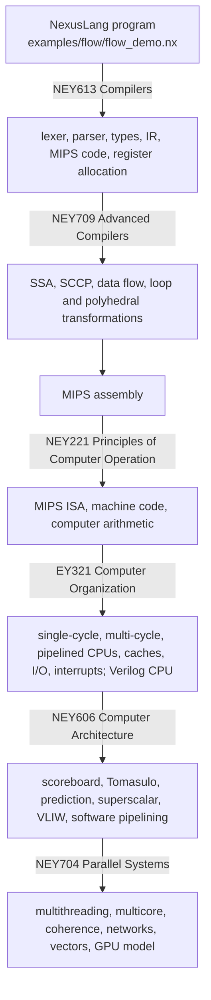

# The NEXUS Flow

NEXUS is one path from a line of source code to a program running on many processors. Each of the six
courses is one step of that path, and each step uses the step before it. This page follows the path once and
names the course and the code at every step. One command runs the whole path and checks every step:

```bash
python scripts/nexus_flow.py build/bin      # CTest: nexus_full_flow
```

## The path



## Step by step, with one program

The program is `examples/flow/flow_demo.nx`: it adds 1! + 2! + ... + 7!, prints `S=5913` on the console with
the built-in `putc`, and exits with 5913 mod 256 = 25. Every step below must reproduce exactly that output.

### 1. Language to machine code — NEY613 Compilers

`nexusc` lexes and parses the program, checks its types, lowers it to three-address IR and generates MIPS
assembly, once with stack slots and once with linear-scan register allocation. The data structures under the
compiler (hash tables for the symbol table, trees, graphs with their traversals and closures) and the theory
of parsing and attribute grammars are tools of their own (`nexusc graph|tree|hash`, `nexusc grammar`,
`nexusc attr`). `putc` becomes a call to a small runtime routine that polls the console status register and
writes one byte to address 0x10000.

### 2. Analysis and optimisation — NEY709 Advanced Compiler Topics

The same IR is what the advanced analyses work on: SSA form with phi nodes, sparse conditional constant
propagation, iterative and region-based data flow, symbolic, alias and interprocedural analysis
(`docs/compiler/`). Loops are unrolled concretely or symbolically (by any factor, with a remainder loop), and
perfect loop nests go to the polyhedral tool, whose hyperplane schedules come from an integer linear program.

### 3. Machine code — NEY221 Principles of Computer Operation

The assembly is MIPS, the instruction set of the course. `mips-sim encode` turns it into real MIPS32 machine
words. The arithmetic the program needs (multiplication, division, the remainder used to print digits) is the
arithmetic of the course: two's complement, Booth, non-restoring division, carry lookahead, all available as
tools (`mips-sim arith`) and as Verilog units.

### 4. Executing it — EY321 Computer Organization

The same binary runs on the ISA-level interpreter, the single-cycle and multi-cycle CPUs (hardwired and
microprogrammed control) and the 5-stage pipeline with forwarding, prediction and caches. All of them share
one memory map, so the program's console bytes appear in every model. The machine words are also loaded into
the pipelined MIPS CPU written in Verilog, whose I/O bus carries a console (the program polls its status
register) and a timer that interrupts the CPU; a timer-interrupt program gives the same result on the Verilog
CPU and on the pipeline simulator.

### 5. Faster CPUs — NEY606 Computer Architecture

The same binary runs on the in-order, scoreboard and Tomasulo cores, with a reorder buffer, register renaming,
branch prediction and up to four instructions per cycle. The models differ only in time (cycles, stalls,
IPC), never in the result. Static scheduling for VLIW machines is shown by software pipelining
(`nexusc modsched`).

### 6. Many CPUs — NEY704 Parallel Systems

The same binary runs on the multicore model; SPMD programs run on up to 64 cores with snooping or directory
coherence, sequential or weak consistency and bus, switch, ring or mesh networks. Several programs share one
core under coarse-grained, fine-grained or simultaneous multithreading (`mips-sim mt`), the vector processor
runs strip-mined loops with chaining (`mips-sim vector`), and the SIMT model runs GPU kernels.

## What checks the connections

| connection | check |
| --- | --- |
| program -> every CPU model -> Verilog CPU with its console | `nexus_full_flow` (same console text and exit code everywhere) |
| timer interrupt on the Verilog CPU against the pipeline simulator | `nexus_full_flow` |
| compiler output on the RTL CPU, instruction by instruction | `nexus_hdl_pipeline_cosim` |
| all test programs on all CPU models | `nexus_cross_model_differential` (288 runs) |

## Around the path

Some tools of the courses are not a step of the single program's path but work on the same objects: the
formal-language tools behind the parser and the attribute grammars (NEY613), type inference and the polyhedral
tool (NEY709), the ISA-style back ends (NEY221), the modulo scheduler (NEY606), and the OpenMP, MPI, SIMD and
CUDA programs, the vector processor and the multithreading model (NEY704). Each has its own note under `docs/`.
