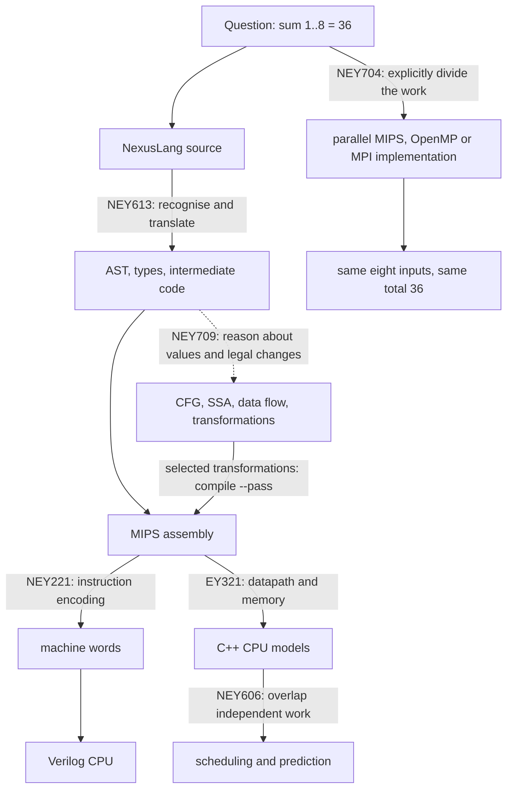

# One computation through the six courses

Start with a question small enough to hold in your head: **what is 1 + 2 + ... + 8?**
The answer is 36. NEXUS shows what that question becomes at each level, why each level exists,
and which parts of the computer can change while the answer stays the same.

After the [one-time build](../README.md#build-it-once), run:

```bash
python scripts/nexus_flow.py build/bin
```

This first path needs the two NEXUS executables and Python. It does not require Verilog, MPI,
OpenMP, LLVM or a GPU. Each stage prints what it checks. Start by understanding one row of output;
you do not need to learn every simulator option at once.

## The connections



There are two different kinds of connection here. Compiling produces a representation that the next
stage consumes. Studying architecture changes the machine used to execute a program. Parallel
programming deliberately changes how the work is divided; running an unchanged serial binary on a
multicore machine does not automatically divide its loop. The diagram keeps that branch explicit.

The order for learning prerequisites is [NEY221 → EY321 → NEY606 → NEY704, and NEY613 → NEY709](courses/README.md#the-order-that-makes-sense).
The execution path above follows a program instead, so it begins at the compiler.

## 1. Express the computation — NEY613

The complete [sum.nx](../examples/flow/sum.nx) is:

```text
fn main() -> int {
  var i: int = 1;
  var total: int = 0;
  while (i < 9) {
    total = total + i;
    i = i + 1;
  }
  return total;
}
```

The successive `(i,total)` pairs before the loop test are `(1,0), (2,1), (3,3), ... , (9,36)`.
This is the meaning that later representations must preserve. The compiler makes that meaning
explicit in smaller operations; it does not know it merely because the source resembles English.

```bash
build/bin/nexusc lex examples/flow/sum.nx
build/bin/nexusc ast examples/flow/sum.nx
build/bin/nexusc check examples/flow/sum.nx
build/bin/nexusc ir examples/flow/sum.nx
build/bin/nexusc compile examples/flow/sum.nx -S --regalloc linear-scan -o flow.s
```

| Representation | What to look for | Why it exists |
| --- | --- | --- |
| tokens | `while`, identifier `i`, comparison `<`, integer `9` | separate meaningful spellings from characters |
| AST | condition and loop body grouped together | make nesting and operation order explicit |
| type checking | integer arithmetic and a boolean condition | reject operations that do not have the required meaning |
| IR | loads/stores, adds, comparison, branches | give analyses and code generation a small, regular vocabulary |
| MIPS assembly | real registers, instructions and stack locations | describe operations the target machine can execute |

Read the [frontend, IR and code-selection fragments](courses/NEY613.md), then open their named functions.
A 500-line parser is a reference implementation; its `parse_additive` function is a manageable first read.

## 2. Reason about the loop — NEY709

```bash
build/bin/nexusc cfg examples/flow/sum.nx
build/bin/nexusc analysis ssa examples/flow/sum.nx
build/bin/nexusc opt examples/flow/sum.nx --analysis regions
build/bin/nexusc opt examples/flow/sum.nx --pass unroll
```

The CFG exposes the back edge. SSA distinguishes the initial values of `i` and `total` from values
coming back from the body; phi nodes connect those possibilities at the loop header. Data flow asks
which definitions can reach each read. These are answers about **all possible iterations**, not just
one observed execution trace.

For this fixed loop, unrolling can copy the eight iterations while keeping the additions in their
original order. A legal transformation preserves the result; it may change instruction count, memory
traffic and code size. The `opt` command prints transformed IR. SSA/SCCP commands print analysis views.
Reports do not automatically change generated code; choose an implemented transformation explicitly:

```bash
build/bin/nexusc compile examples/flow/sum.nx -S --pass cse --regalloc linear-scan -o flow-cse.s
build/bin/nexusc compile examples/flow/sum.nx -S --pass unroll --regalloc linear-scan -o flow-unrolled.s
```

These commands apply the existing local value-numbering or concrete-unrolling pass **before MIPS
generation**. `--pass` selects one of these two passes at a time. Unrolling a source with no supported
fixed counted loop reports an error instead of claiming a transformation happened. Other analyses
remain reports, and the CLI does not treat arbitrary printed IR as a new source file.

The [small diamond example](courses/NEY709.md#use-the-same-four-blocks-first) makes joins easier to
understand before returning to this loop. Polyhedral scheduling has a separate `.loop` frontend;
it is connected by the same dependence/locality questions, not by an automatic conversion of this file.

## 3. Give instructions a bit pattern — NEY221

```bash
build/bin/mips-sim encode flow.s -o flow.hex
build/bin/mips-sim run flow.s --mode functional --trace --stats
```

`addu` adds register values, `lw`/`sw` transfer words, and a branch changes the next instruction.
The functional model checks these operations without a detailed hardware timeline. It returns 36.
Machine encoding gives each instruction a 32-bit pattern, such as opcode and register-number fields.
The C++ models load assembly into decoded instruction records; the optional Verilog CPU below loads
encoded words. This is why both assembly and the encoder appear in the path.

Underneath addition are [number representations and adders](courses/NEY221.md#5-arithmetic-circuits-adders-multipliers-dividers).
Carry bits explain how addition is built, while signed overflow explains when a bit pattern no longer
represents the intended mathematical result. Here all intermediates fit, so overflow does not obscure the lesson.

## 4. Build a machine that executes it — EY321

```bash
build/bin/mips-sim run flow.s --mode single-cycle --stats
build/bin/mips-sim run flow.s --mode multi-cycle --control microcode --stats
build/bin/mips-sim run flow.s --mode pipeline --stats
```

All return 36. The CPU's datapath and control determine when an instruction reads, computes and
writes. A pipeline overlaps stages of neighbouring instructions; hazards determine when it waits.
Register allocation also reduces stack traffic, so a compiler decision changes the workload seen
by the memory system. This is one direct connection between the compiler and organisation courses.

Run `flow-cse.s` and `flow-unrolled.s` with the same pipeline options. Selected results for this
program in the default pipeline model, without caches:

| Generated version | Executed instructions | Pipeline cycles | Result |
| --- | --- | --- | --- |
| stack slots | 280 | 400 | 36 |
| linear-scan allocation | 125 | 159 | 36 |
| linear-scan + local CSE | 117 | 151 | 36 |
| linear-scan + unrolling | 88 | 112 | 36 |

Allocation removes stack traffic; local value numbering reuses values and forwards eligible loads;
unrolling removes repeated loop control. The last two rows are separate transformations of the
allocated baseline, not a chain of both passes. Larger code and register pressure can reverse a
benefit on another program, which is why the unchanged result and the cost both matter.

A cache can change access cost while retaining the same memory values. More cycles do not alone
mean a slower physical CPU: clock period also matters. Start with [one load's journey](courses/EY321.md#follow-one-load-all-the-way-through)
before comparing the longer loop's statistics.

## 5. Find available overlap — NEY606

```bash
build/bin/mips-sim run flow.s --mode advanced --scheduler scoreboard --trace --stats
build/bin/mips-sim run flow.s --mode advanced --scheduler tomasulo --predictor 2bit --trace --stats
```

Independent instructions can move around waiting ones. The update of `total` still depends on the
previous iteration's total; no scheduler can discard that true dependence. A predictor guesses the
loop branch to keep useful work flowing. Speculation must discard a wrong path without changing 36.
Read [the six-instruction scheduling example](courses/NEY606.md#dependencies-before-scheduling) before
trying to interpret the entire loop trace.

Compiler scheduling and hardware scheduling address the same dependency graph at different times.
Unrolling may expose more independent operations; actual benefit depends on resources and dependencies.
The simple in-order mode and the scoreboard/Tomasulo modes have different timing assumptions, so
raw totals from unlike models are not a calibrated comparison of commercial processors.

## 6. Divide the same work explicitly — NEY704

Now keep the eight inputs fixed and use [sum_parallel.s](../examples/flow/sum_parallel.s).
With P workers, worker k adds `k+1, k+1+P, ...` up to 8:

| Workers | Assignment | Combined total |
| --- | --- | --- |
| 1 | 1,2,3,4,5,6,7,8 | 36 |
| 2 | worker 0: 1,3,5,7; worker 1: 2,4,6,8 | 16+20 = 36 |
| 4 | (1,5), (2,6), (3,7), (4,8) | 6+8+10+12 = 36 |

```bash
build/bin/mips-sim run examples/flow/sum_parallel.s --mode parallel --cores 2 --stats
build/bin/mips-sim run examples/flow/sum_parallel.s --mode parallel --cores 4 --coherence directory-lite --stats
```

Each worker has private register state and a partial sum. A lock protects updates to the shared
result; a barrier ensures core 0 reads it after everyone has contributed. Coherence invalidates old
copies of that shared word. The result is 36 for 1, 2, 4 and 8 workers with snooping or directory-lite.
This is a separate hand-written parallel implementation, not compiler-generated parallel MIPS.

The same computation is also written with actual parallel-programming APIs:

```bash
gcc -std=c11 -fopenmp examples/basics/parallel/sum_openmp.c -o sum-openmp
./sum-openmp 2
mpicc examples/flow/sum_mpi.c -o sum-mpi
mpiexec -n 2 ./sum-mpi
```

Both print `sum=36`. OpenMP combines private subtotals in shared memory; MPI combines process-local
subtotals with `MPI_Reduce`. SIMD/vector and GPU examples extend this idea to groups of elements or
threads, with different execution/memory rules. They use separate examples in [NEY704](courses/NEY704.md).

More workers are not automatically faster. The parallel simulator's default snooping run takes
58, 51, 59 and 90 cycles for 1, 2, 4 and 8 workers respectively. The tiny loop quickly becomes dominated
by lock/barrier costs. Those numbers belong to this teaching model and program, not real CPU measurements.

## A longer program: console I/O and the Verilog CPU

After understanding the sum, follow [flow_demo.nx](../examples/flow/flow_demo.nx), which sums factorials,
prints `S=5913` and returns 25 (`5913 % 256`). It adds recursive frames, decimal printing and a polled device.

```bash
python scripts/nexus_flow.py build/bin --console
```

Compiler and CPU checks still run if Icarus Verilog is absent; only the optional RTL part is skipped.
When `iverilog` and `vvp` are installed, the script also executes encoded instructions on the pipelined
Verilog CPU, checks its console output, and compares a timer-interrupt program with the C++ simulator.

## What is checked and where to go next

| Connection | Automated check |
| --- | --- |
| source, allocation and selected transformed IR → generated MIPS → CPU models | `nexus_full_flow` |
| fixed sum → participating parallel workers, two coherence policies | `nexus_full_flow` |
| longer recursive/console program → CPU models | `nexus_console_flow` |
| encoded words → RTL console and timer interrupt | `nexus_full_flow_rtl` (requires Icarus; otherwise skipped) |
| more compiled programs → multiple CPU models | `nexus_cross_model_differential` |

The default script checks the connected core, not every topic in six courses. Formal-language tools,
type inference, polyhedral transformations, vector/GPU kernels and real API programs have their own
lessons and tests, linked from the [study guides](courses/README.md).
The [predication model](../examples/basics/predication.py) explains guarded effects, while the
[points-to solver](../examples/basics/compiler/points_to.py) explains pointer information used to
reason about memory dependencies. They are separate small models, not added MIPS instructions or
a new pointer language in the NexusLang compiler.
How to read a mechanism together with its code: [studying with NEXUS](STUDYING.md).
