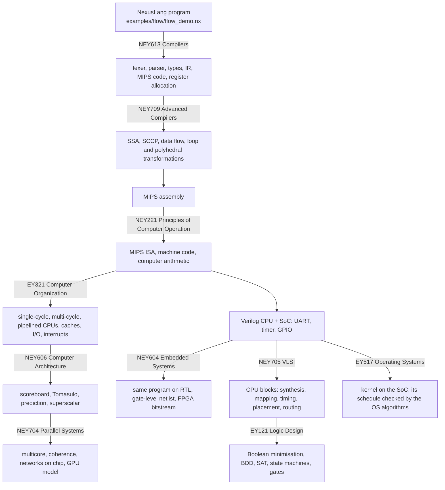

# The NEXUS Flow

NEXUS is one path from a line of source code down to transistors, and back up to an operating system
that runs on the hardware it describes. Each of the ten courses is one layer of that path, and each
layer uses the layer below it. This page follows the path once, top to bottom, and names the course
and the code at every step. One command runs the whole path and checks every step:

```bash
python scripts/nexus_flow.py build/bin --gates --fpga      # CTest: nexus_full_flow
```

## The path



## Step by step, with one program

The program is `examples/flow/flow_demo.nx`: it adds 1! + 2! + ... + 7!, prints `S=5913` through the
UART with the built-in `putc`, and exits with 5913 mod 256 = 25. Every step below must reproduce
exactly that output.

### 1. Language to machine code — NEY613 Compilers, NEY709 Advanced Compiler Topics

`nexusc` lexes and parses the program, checks its types, lowers it to three-address IR and generates
MIPS assembly, once with stack slots and once with linear-scan register allocation. The same IR is
what the advanced analyses work on: SSA form with phi nodes, constant propagation (SCCP), data-flow and
alias analysis, unrolling and polyhedral loop transformations (`docs/compiler/`). `putc` becomes a call
to a small runtime routine that waits for the UART and writes one byte to address 0x10000.

### 2. Machine code — NEY221 Principles of Computer Operation

The assembly is MIPS, the instruction set of the course. `mips-sim encode` turns it into real MIPS32
machine words. The arithmetic the program needs (multiplication, division, the remainder used to print
digits) is the arithmetic of the course: two's complement, Booth, non-restoring division, carry
lookahead, all available as tools (`mips-sim arith`) and as Verilog units.

### 3. Executing it — EY321 Computer Organization, NEY606 Computer Architecture, NEY704 Parallel Systems

The same binary runs on every execution model, from the simplest to the most aggressive:
the ISA-level interpreter, the single-cycle and multi-cycle CPUs (hardwired and microprogrammed
control), the 5-stage pipeline with forwarding, prediction and caches, the in-order, scoreboard and
Tomasulo cores, and the multicore model. All of them share one memory map, so the program's UART
bytes appear in every model. The models differ only in time (cycles, stalls, IPC), never in the result.

### 4. Hardware — NEY604 Embedded Systems and Microprocessors

The machine words are loaded into the pipelined MIPS CPU written in Verilog, inside a system on chip
with a UART, a timer with interrupts and GPIO. The program runs on the RTL, then on the gate-level
netlist that Yosys synthesises from the same RTL, then the SoC with this program in its boot ROM is
placed and routed on a Lattice ECP5 FPGA and turned into a bitstream. The UART line of the RTL and of
the netlist carries the same `S=5913`.

### 5. Inside the chip — NEY705 VLSI Design, EY121 Logic Design

The CPU's own control unit goes through the chip-design tools: Yosys produces a BLIF netlist, and
`nexus-eda` maps it onto static CMOS cells, proves the mapped circuit equivalent to the original,
computes its timing, partitions, places and routes it (`nexus-eda synth` adds the power analysis). The equivalence proof uses the SAT solver
and the and-inverter graphs of the logic-design library, which also holds Boolean minimisation, BDDs,
state-machine synthesis and gate-level simulation. One level further down, the switch-level simulator
works with transistors: static CMOS complex gates with their layout, and the 6T SRAM cell
(`nexus-eda cmos`, `nexus-eda sram`).

### 6. Software on the hardware — EY517 Operating Systems

`examples/os/rr_kernel.s` is a preemptive round-robin kernel for the same CPU. The SoC timer interrupts
it, it saves and restores process control blocks, and it writes the number of every task it dispatches
to the UART. The scheduling library (`nexus-os schedule`) computes the round-robin Gantt chart for the
same three jobs (`examples/os/rr_kernel.jobs`). The kernel on the RTL prints `012012121`, and the
library computes `0 1 2 0 1 2 1 2 1`: the algorithm of the course and the kernel on the hardware make
the same decisions.

## What checks the connections

| connection | check |
| --- | --- |
| program -> every CPU model -> RTL -> gate level | `nexus_full_flow` (same UART text and exit code everywhere) |
| compiler output on the RTL CPU, instruction by instruction | `nexus_hdl_pipeline_cosim` |
| all test programs on all CPU models | `nexus_cross_model_differential` (288 runs) |
| CPU blocks through the chip-design tools, proved equivalent | `nexus_full_flow`, `nexus_eda_cli` (also proved by Yosys) |
| SoC programs at every level, FPGA bitstream | `nexus_soc_levels`, `nexus_soc_fpga` |
| kernel on the SoC against the scheduling algorithm | `nexus_full_flow`, `nexus_os_cli` |

## Around the path

Some tools of the courses are not a stage of the single program's path but analyse the same objects:
the concurrency model checker and the memory, disk and file-system algorithms (EY517), the real-time
schedulability tests, dataflow graphs and Petri nets (NEY604), the formal-language tools behind the
parser (NEY613) and the OpenMP, MPI and CUDA programs (NEY704). Each has its own note under `docs/`.
