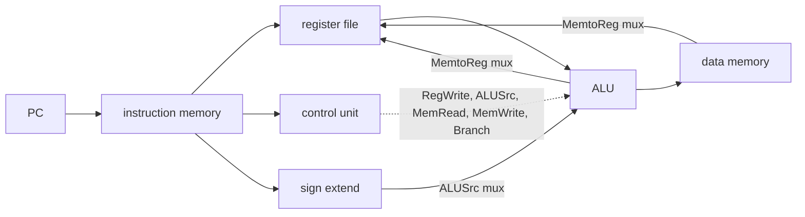
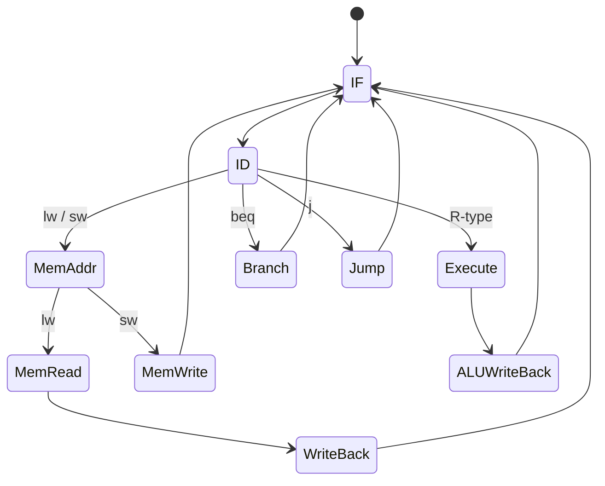
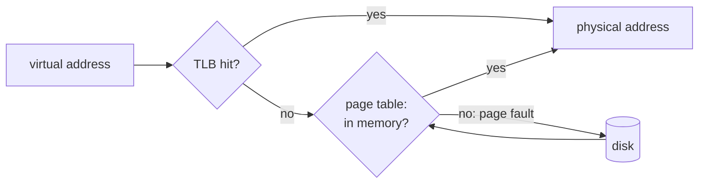

# EY321 Computer Organization: study guide

**What this course is about:** how a CPU is *built* to execute MIPS instructions: the datapath, the control
unit (in one cycle, in many cycles, and pipelined), the memory hierarchy and input/output.

Each section: **the point**, a **picture**, a **real example** (the output is what the tools print), **where the
code is**, **check yourself**. Commands are run from the repository folder after building (see the
[README](../../README.md)).

---

## 0. A short history

**The point:** the ideas are old; the technology made them cheap. The *stored program* (instructions in the same
memory as data, von Neumann, 1945) is still how every computer works.

| period | technology | idea that stayed |
| --- | --- | --- |
| 1940s | relays, vacuum tubes (ENIAC, EDSAC) | the stored program |
| 1950s-60s | transistors (IBM 7090), then integrated circuits | an instruction set family that outlives the hardware (IBM System/360, 1964); microprogrammed control |
| 1970s | microprocessor (Intel 4004, 1971; 8086, 1978) | a whole CPU on one chip |
| 1980s | RISC (MIPS, SPARC, ARM) | simple instructions + pipelining + compilers |
| 1990s | superscalar, out of order (Pentium Pro), caches on chip | instruction-level parallelism |
| 2005 on | multicore, GPUs | the clock stopped getting faster (power wall), so performance comes from parallelism |

*Moore's law*: the number of transistors on a chip doubled about every two years for five decades. This course
follows the same path: a simple CPU, then a pipelined one; [NEY606](NEY606.md) and [NEY704](NEY704.md) continue it.

---

## 1. Performance: the equation behind everything

**The point:** `time = instructions x CPI x clock period`. Every design below trades one factor for another.

| design | CPI | clock period | idea |
| --- | --- | --- | --- |
| single-cycle | 1 | long (the slowest instruction, `lw`) | every instruction in one long cycle |
| multi-cycle | 3-5 | short (one step) | each instruction uses only the steps it needs |
| pipeline | ~1 | short (one stage) | five instructions overlap, one in each stage |

**Example:** the same program (`tests/programs/gcd_and_primes.nx`, 5432 instructions) on the three CPUs.

```bash
build/bin/nexusc compile tests/programs/gcd_and_primes.nx -S --regalloc linear-scan -o gcd.s
build/bin/mips-sim run gcd.s --mode single-cycle --stats
build/bin/mips-sim run gcd.s --mode multi-cycle --stats
build/bin/mips-sim run gcd.s --mode pipeline --stats
```

| CPU | cycles | CPI |
| --- | --- | --- |
| single-cycle | 5432 | 1.00 |
| multi-cycle | 20300 | 3.74 |
| pipeline | 6933 | 1.28 |

The single-cycle CPU has the fewest cycles, but each cycle must be as long as a whole `lw`. The pipeline keeps
the short cycle of the multi-cycle CPU *and* a CPI close to 1: that is why every modern CPU is pipelined.

---

## 2. The single-cycle datapath

**The point:** one instruction flows left to right through fetch, register read, ALU, memory and write-back in a
single clock cycle. The *control unit* reads the opcode and sets the multiplexers and write enables.



| instruction | RegDst | ALUSrc | MemtoReg | RegWrite | MemRead | MemWrite | Branch |
| --- | --- | --- | --- | --- | --- | --- | --- |
| R-type (`add`) | 1 | 0 | 0 | 1 | 0 | 0 | 0 |
| `lw` | 0 | 1 | 1 | 1 | 1 | 0 | 0 |
| `sw` | x | 1 | x | 0 | 0 | 1 | 0 |
| `beq` | x | 0 | x | 0 | 0 | 0 | 1 |

**Where the code is:** C++ model [src/sim/single_cycle/src/model.cpp](../../src/sim/single_cycle/src/model.cpp) and its
control table [control.cpp](../../src/sim/single_cycle/src/control.cpp); in Verilog the
[control unit](../../src/hdl/control/nexus_control_unit.v), [register file](../../src/hdl/register_file/nexus_register_file.v),
[ALU](../../src/hdl/alu/nexus_alu.v) and a [datapath slice](../../src/hdl/cpu_slice/nexus_cpu_slice.v).
Add `--trace` to the run command to see every instruction's control signals.

**Check yourself**
<details><summary>Why is the single-cycle clock as long as lw?</summary>
The clock period must fit the slowest instruction, and <code>lw</code> uses every unit: instruction memory,
registers, ALU, data memory and the write back.
</details>

---

## 3. The multi-cycle CPU: hardwired and microprogrammed control

**The point:** split each instruction into steps (IF, ID, EX, MEM, WB), one per short cycle, and let a finite
state machine drive the datapath. That FSM can be built as logic (*hardwired*) or as a table in a small memory
read step by step (*microprogrammed*): the same states, a different implementation.



`lw` takes 5 cycles, R-type and `sw` 4, `beq` 3; that is where the average CPI of 3-5 comes from.

```bash
build/bin/mips-sim run gcd.s --mode multi-cycle --control hardwired --stats
build/bin/mips-sim run gcd.s --mode multi-cycle --control microcode --stats
```

Both report `Cycles: 20300`: microprogramming changes *how* the control is built, not the timing.
With `--trace` you see every state of the FSM:

```bash
build/bin/mips-sim run examples/cpu/hazards.s --mode multi-cycle --trace
```

```text
cycle=5 state=fetch          opcode=addu signals={ir_write, mem_read, pc_write}
cycle=6 state=decode         opcode=addu signals={reg_read}
cycle=7 state=execute-alu    opcode=addu signals={alu}
cycle=8 state=writeback-reg  opcode=addu signals={reg_write}
```

(shortened; the real lines also print the PC and a description of each step).

**Where the code is:** [src/sim/multi_cycle/src/control.cpp](../../src/sim/multi_cycle/src/control.cpp) (both
controls); the Verilog CPU [nexus_mips_multicycle.v](../../src/hdl/cpu_multicycle/nexus_mips_multicycle.v) with
`MICROCODE=0` (FSM) or `MICROCODE=1` (control store).

**Check yourself**
<details><summary>Why can the multi-cycle CPU share one ALU and one memory?</summary>
Each unit is used in a different cycle of the instruction (e.g. the ALU computes PC+4 in IF and the address in
EX), so one copy is enough.
</details>

---

## 4. Pipelining and hazards

**The point:** overlap instructions like an assembly line. Problems (*hazards*) appear when an instruction needs
something not ready yet:

- **data hazard:** a result is needed before it is written back. Solved by **forwarding** (bypass the result
  from EX/MEM straight into the ALU). Exception: a value *loaded* from memory is ready one cycle too late, so a
  **load-use** pair needs one **stall** (bubble) even with forwarding.
- **control hazard:** after a branch we do not yet know the next PC. Guess (*predict*); if wrong, **flush** the
  wrongly fetched instructions.

**Example:** [examples/cpu/hazards.s](../../examples/cpu/hazards.s) has all of these in eight instructions.

```bash
build/bin/mips-sim run examples/cpu/hazards.s --mode pipeline --timeline --stats
```

```text
instruction  | 1    | 2    | 3    | 4    | 5    | 6    | 7    | 8    | 9    | 10   | 11   | 12   | 13
I0@pc0:addiu | IF   | ID   | EX   | MEM  | WB   | .    | .    | .    | .    | .    | .    | .    | .
I1@pc1:addu  | .    | IF   | ID   | EX   | MEM  | WB   | .    | .    | .    | .    | .    | .    | .
I2@pc2:sw    | .    | .    | IF   | ID   | EX   | MEM  | WB   | .    | .    | .    | .    | .    | .
I3@pc3:lw    | .    | .    | .    | IF   | ID   | EX   | MEM  | WB   | .    | .    | .    | .    | .
I4@pc4:addu  | .    | .    | .    | .    | IF   | ID*  | ID   | EX   | MEM  | WB   | .    | .    | .
I5@pc5:beq   | .    | .    | .    | .    | .    | .    | IF   | ID   | EX   | MEM  | WB   | .    | .
...
Cycles: 13   CPI: 1.62   Stalls: 1   Load-use stalls: 1   Forwardings: 7
```

- `I1` uses `$t0` one cycle after `I0` computes it: forwarding, no stall.
- `I4` uses the value `I3` loads: `ID*` is the one-cycle stall (load-use).
- 8 instructions in 13 cycles = 4 cycles to fill the pipeline + 1 stall + 8.

**Branch prediction:** a loop branch is taken every time except the last.

```bash
build/bin/mips-sim run examples/multithreading/compute.s --mode pipeline --predictor static-not-taken --stats
build/bin/mips-sim run examples/multithreading/compute.s --mode pipeline --predictor static-btfnt --stats
```

| predictor | mispredictions | cycles |
| --- | --- | --- |
| always not taken | 199 | 1407 |
| backward taken, forward not taken (BTFNT) | 1 | 1011 |

The loop branch jumps *backwards*, so BTFNT predicts it right 199 times out of 200.

**Where the code is:** [src/sim/pipeline/src/model.cpp](../../src/sim/pipeline/src/model.cpp) (hazard detection,
forwarding, flush); the Verilog pipelined CPU [nexus_mips_pipeline.v](../../src/hdl/cpu_pipeline/nexus_mips_pipeline.v),
which runs the same programs as the simulator (`ctest -R nexus_hdl_pipeline_cosim`).

**Check yourself**
<details><summary>Can forwarding remove the load-use stall?</summary>
No. The loaded value exists only at the end of MEM, but the next instruction needs it at the start of its EX
in the same cycle. One bubble is unavoidable (the compiler can hide it by placing an independent instruction
in between).
</details>
<details><summary>An ideal 5-stage pipeline runs 1000 instructions. How many cycles?</summary>
1000 + 4 = 1004: four cycles to fill the pipeline, then one instruction finishes every cycle.
</details>

---

## 5. Memory hierarchy: caches

**The point:** programs reuse data (*temporal locality*) and touch neighbours (*spatial locality*), so a small
fast cache in front of a big slow memory catches most accesses.
`average access time = hit time + miss rate x miss penalty`.

```
address = | tag | index | offset |
              |      |       '-- which byte in the line
              |      '-- which set
              '-- compared with the stored tag: equal and valid = hit
```

Misses come in three kinds (the *3 Cs*): **compulsory** (first touch), **capacity** (the data does not fit),
**conflict** (too many lines map to the same set). Associativity removes conflict misses.

**Example:** matrix multiplication with a direct-mapped and a 4-way set-associative cache.

```bash
build/bin/nexusc compile tests/programs/matrix_multiply.nx -S --regalloc linear-scan -o mm.s
build/bin/mips-sim run mm.s --mode pipeline --cache direct --stats
build/bin/mips-sim run mm.s --mode pipeline --cache assoc --ways 4 --stats
```

| cache | miss rate | cycles |
| --- | --- | --- |
| direct-mapped | 20.00% | 2572 |
| 4-way set associative | 7.06% | 2418 |

Same size, but the direct-mapped cache keeps throwing out lines that collide in one set (conflict misses).

**Where the code is:** [src/sim/memory/src/system.cpp](../../src/sim/memory/src/system.cpp) (L1/L2 caches).

**Check yourself**
<details><summary>A 4 KiB direct-mapped cache with 16-byte lines and 32-bit addresses: how many offset, index and tag bits?</summary>
Offset 4 bits (16 bytes), 256 lines so index 8 bits, tag 32 - 8 - 4 = 20 bits.
</details>

---

## 6. Virtual memory

**The point:** every program sees its own big address space; the OS maps its *pages* to physical *frames*.
The page table holds the mapping, the **TLB** caches recent translations, and a **page fault** brings a page from
disk, evicting another one chosen by a replacement policy.



```bash
build/bin/mips-sim vm mm.s --page 16 --frames 4 --tlb 4 --policy fifo
```

| policy | page faults (4 frames) |
| --- | --- |
| FIFO | 80 |
| Clock (second chance) | 76 |
| LRU | 69 |
| OPT (knows the future, the lower bound) | 46 |

LRU is close to OPT because recently used pages tend to be used again; Clock approximates LRU cheaply.

**Where the code is:** [src/sim/memory/src/virtual_memory.cpp](../../src/sim/memory/src/virtual_memory.cpp).

**Check yourself**
<details><summary>Why is a page fault so expensive compared with a cache miss?</summary>
It goes to the disk: millions of cycles instead of tens to hundreds, so the OS runs another process meanwhile.
</details>

---

## 7. Input/output: polling, interrupts, DMA

**The point:** three ways for the CPU to talk to devices.

| method | who waits | when to use |
| --- | --- | --- |
| **polling** | the CPU keeps reading the device status | simple, fast devices |
| **interrupt** | the device signals; the CPU jumps to a handler and returns | rare or slow events (timer, keyboard) |
| **DMA** | a controller copies whole blocks to memory by itself | disks, network: big transfers |

```bash
build/bin/mips-sim run tests/golden/interrupt_demo.s --mode pipeline --interrupt-demo
build/bin/mips-sim run tests/golden/dma_demo.s --mode pipeline --dma-demo
```

```text
timer(interrupt-pending @ cycle 11)
interrupt[timer]: dispatch -> pc=9 return=6
interrupt:return -> pc=6
...
dma(copy 0 -> 64)
dma(copy 4 -> 68)
dma(complete @ cycle 19)
```

The interrupt saves the return address (pc 6), runs the handler at pc 9 and comes back.

**Where the code is:** [src/sim/io/src/system.cpp](../../src/sim/io/src/system.cpp); the Verilog console and timer on
the CPU's bus: [nexus_io_devices.v](../../src/hdl/cpu_pipeline/nexus_io_devices.v).

---

## 8. Hardware description lab (Verilog)

The `src/hdl` folder has every unit as Verilog with a testbench (`*_tb.v`): adder, ALU, multiplier, divider,
register file, control unit, pipeline register, a datapath slice, the multi-cycle CPU and the pipelined CPU.
With Icarus Verilog installed:

```bash
python scripts/test_hdl.py alu      # or adder, multiplier, divider, register-file, control, all
```

```text
== alu: PASS
```

A good order to read them: [adder](../../src/hdl/alu/nexus_adder.v) -> [ALU](../../src/hdl/alu/nexus_alu.v) ->
[register file](../../src/hdl/register_file/nexus_register_file.v) -> [control](../../src/hdl/control/nexus_control_unit.v) ->
[multi-cycle CPU](../../src/hdl/cpu_multicycle/nexus_mips_multicycle.v) -> [pipelined CPU](../../src/hdl/cpu_pipeline/nexus_mips_pipeline.v).

---

**Previous:** [NEY221](NEY221.md) · **Next:** [NEY606 Computer Architecture](NEY606.md) makes the CPU faster.
