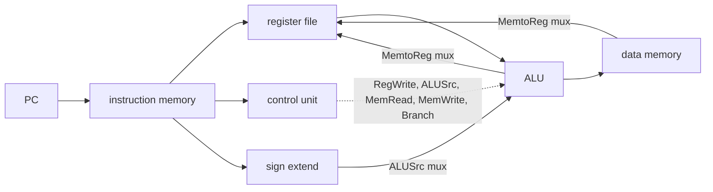
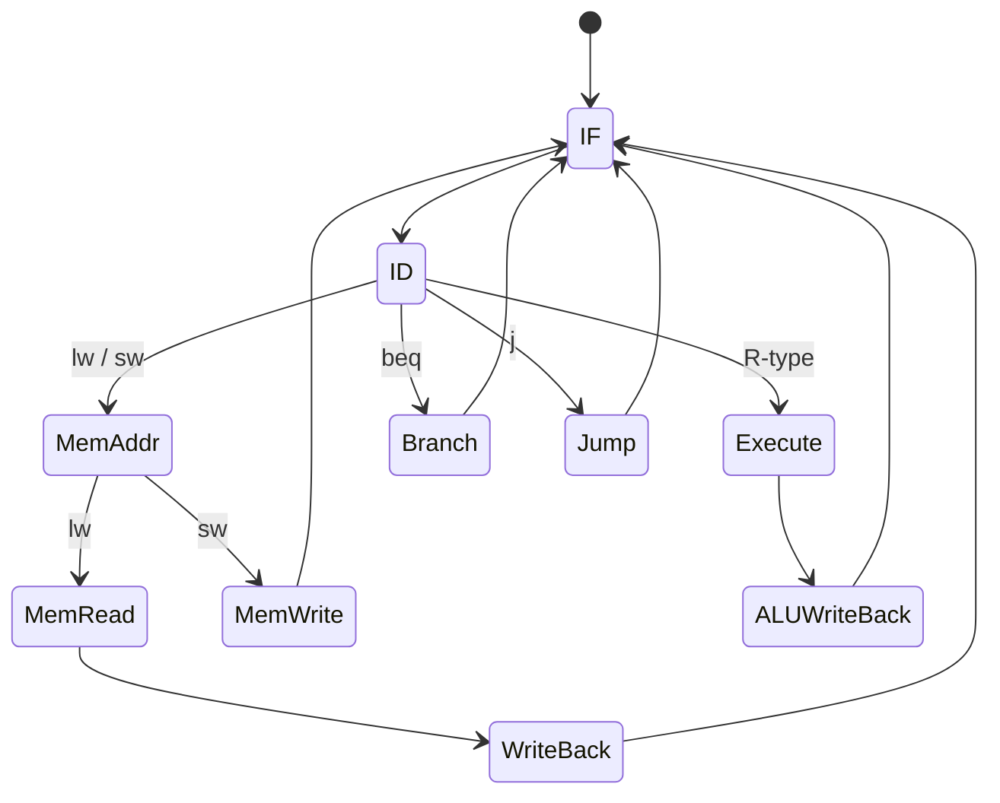
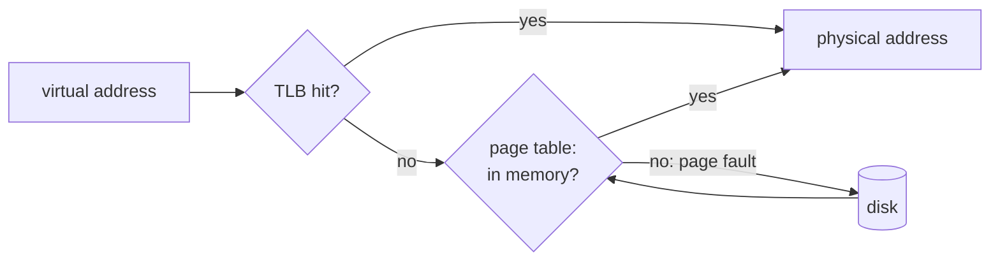

# EY321 Computer Organization: study guide

**What this course is about:** how a CPU is *built* to execute MIPS instructions: the datapath, the control
unit (in one cycle, in many cycles, and pipelined), the memory hierarchy and input/output.

Each section: **the point**, a **picture**, a **real example** (the output is what the tools print), **where the code is**. Commands are run from the repository folder after building (see the
[README](../../README.md)).

Before starting, run [NEY221's six small assembly programs](NEY221.md#write-your-first-instructions).
You should be able to explain a register, a byte address, `lw`, `sw`, `beq`, and `jal`.
Here we keep the program's answer fixed and change the hardware that produces it.

**Connection to the whole:** NEY221 defines what an instruction means; this course connects it to
control signals, stored state and memory accesses. NEY606 asks which execution steps can overlap.
See [the same sum on different CPUs](../FLOW.md#4-build-a-machine-that-executes-it--ey321).

---

## 0. A short history

**The point:** the ideas are old; technology changed their cost. A *stored-program* computer represents
instructions in memory. Many machines use separate instruction/data caches or memories while keeping
this principle; sharing a single physical memory is not a requirement for every computer.

| period | technology | idea that stayed |
| --- | --- | --- |
| 1940s | relays, vacuum tubes (ENIAC, EDSAC) | the stored program |
| 1950s-60s | transistors (IBM 7090), then integrated circuits | an instruction set family that outlives the hardware (IBM System/360, 1964); microprogrammed control |
| 1970s | microprocessor (Intel 4004, 1971; 8086, 1978) | a whole CPU on one chip |
| 1980s | RISC (MIPS, SPARC, ARM) | simple instructions + pipelining + compilers |
| 1990s | superscalar, out of order (Pentium Pro), caches on chip | instruction-level parallelism |
| 2005 on | multicore, GPUs | the clock stopped getting faster (power wall), so performance comes from parallelism |

*Moore's law*: the number of transistors on a chip doubled about every two years for five decades. This course
follows the same path: a simple CPU, then a pipelined one; [NEY606](NEY606.md) and [NEY704](NEY704.md) continue it.

---

## 1. Performance: the equation behind everything

**The point:** `time = instructions x CPI x clock period`. Every design below trades one factor for another.

| design | CPI | clock period | idea |
| --- | --- | --- | --- |
| single-cycle | 1 | long (the slowest instruction, `lw`) | every instruction in one long cycle |
| multi-cycle | 3-5 | short (one step) | each instruction uses only the steps it needs |
| pipeline | ~1 | short (one stage) | five instructions overlap, one in each stage |

### Compare four instructions first

```bash
build/bin/mips-sim run examples/basics/mips/01_add.s --mode single-cycle --stats
build/bin/mips-sim run examples/basics/mips/01_add.s --mode multi-cycle --stats
build/bin/mips-sim run examples/basics/mips/01_add.s --mode pipeline --stats
```

All must return 12. `Instructions` counts completed work; `Cycles` counts clock ticks; CPI divides
the second by the first. A pipeline needs time to fill, so a four-instruction program does not
reach its long-run throughput. Latency is the time for one instruction; throughput is how many
instructions finish per unit time. Pipelining improves throughput without making every instruction faster.

<details><summary>Larger example: a longer compiled program</summary>

**Example:** the same program (`tests/programs/gcd_and_primes.nx`, 5432 instructions) on the three CPUs.

```bash
build/bin/nexusc compile tests/programs/gcd_and_primes.nx -S --regalloc linear-scan -o gcd.s
build/bin/mips-sim run gcd.s --mode single-cycle --stats
build/bin/mips-sim run gcd.s --mode multi-cycle --stats
build/bin/mips-sim run gcd.s --mode pipeline --stats
```

| CPU | cycles | CPI |
| --- | --- | --- |
| single-cycle | 5432 | 1.00 |
| multi-cycle | 20300 | 3.74 |
| pipeline | 6933 | 1.28 |

The single-cycle CPU has the fewest cycles, but each cycle must be as long as a whole `lw`. The pipeline keeps
the short cycle of the multi-cycle CPU *and* a CPI close to 1. These models illustrate the design tradeoff;
the reported cycle counts are not physical clock-frequency measurements.
</details>

---

## 2. The single-cycle datapath

**The point:** one instruction flows left to right through fetch, register read, ALU, memory and write-back in a
single clock cycle. The *control unit* reads the opcode and sets the multiplexers and write enables.



| instruction | RegDst | ALUSrc | MemtoReg | RegWrite | MemRead | MemWrite | Branch |
| --- | --- | --- | --- | --- | --- | --- | --- |
| R-type (`add`) | 1 | 0 | 0 | 1 | 0 | 0 | 0 |
| `lw` | 0 | 1 | 1 | 1 | 1 | 0 | 0 |
| `sw` | x | 1 | x | 0 | 0 | 1 | 0 |
| `beq` | x | 0 | x | 0 | 0 | 0 | 1 |

### Follow one load all the way through

A **multiplexer** chooses one input; a **register** remembers its input at a clock edge.
Combinational logic computes from current inputs without remembering the previous cycle.
The control bits select the paths and enable state changes. In the table, `x` means "does not matter".

For `lw $t1, 0($zero)` after storing 12 at address 0:

| Step | Data | Control decision |
| --- | --- | --- |
| Fetch | instruction bits at PC | instruction memory supplies the opcode and register fields |
| Decode/read | base `$zero = 0`, immediate `0` | select base register; sign-extend immediate |
| Address calculation | ALU computes `0 + 0 = 0` | `ALUSrc = 1`, addition |
| Memory read | word at address 0 is 12 | `MemRead = 1`, `MemWrite = 0` |
| Write-back | `$t1 = 12` | `MemtoReg = 1`, `RegWrite = 1`, destination is `rt` |

These are parts of the same cycle on the single-cycle CPU. Observe them using:

```bash
build/bin/mips-sim run examples/basics/mips/02_memory.s --mode single-cycle --trace
```

The `lw` case of `decode_control` in [control.cpp](../../src/sim/single_cycle/src/control.cpp) is:

```cpp
case Opcode::Lw:
  signals.reg_write = true;
  signals.mem_read = true;
  signals.mem_to_reg = true;
  signals.uses_immediate = true;
  signals.alu_control = ALUControl::Add;
  return signals;
```

Each assignment corresponds to one row in the load's journey. `sw` follows the same path up to the ALU, which computes the address, but then enables memory writing
instead of register writing: its result is a memory word, not a register value.

**Where the code is:** C++ model [src/sim/single_cycle/src/model.cpp](../../src/sim/single_cycle/src/model.cpp) and its
control table [control.cpp](../../src/sim/single_cycle/src/control.cpp); in Verilog the
[control unit](../../src/hdl/control/nexus_control_unit.v), [register file](../../src/hdl/register_file/nexus_register_file.v),
[ALU](../../src/hdl/alu/nexus_alu.v) and a [datapath slice](../../src/hdl/cpu_slice/nexus_cpu_slice.v).
Add `--trace` to the run command to see every instruction's control signals.

---

## 3. The multi-cycle CPU: hardwired and microprogrammed control

**The point:** split each instruction into steps (IF, ID, EX, MEM, WB), one per short cycle, and let a finite
state machine drive the datapath. That FSM can be built as logic (*hardwired*) or as a table in a small memory
read step by step (*microprogrammed*): the same states, a different implementation.



`lw` takes 5 cycles, R-type and `sw` 4, `beq` 3; that is where the average CPI of 3-5 comes from.

For the same load, the five ticks are **fetch → decode → address → memory → write-back**.
Intermediate registers preserve the instruction, address and loaded data between ticks. A micro-operation
is one such register transfer or computation, e.g. `MAR <- base + offset`. Hardwired control derives
signals from state and opcode; microcode looks them up in a control store and selects the next microaddress.
The NEXUS versions implement the same state sequence, hence the same timing for a given program.

```bash
build/bin/mips-sim run examples/basics/mips/02_memory.s --mode multi-cycle --control hardwired --trace
build/bin/mips-sim run examples/basics/mips/02_memory.s --mode multi-cycle --control microcode --trace
```

A store omits the fifth step of a load, register write-back, and writes memory in its memory step. That is why it needs four rather than five ticks in this design.

<details><summary>Larger comparison using gcd.s from section 1's longer experiment</summary>

```bash
build/bin/mips-sim run gcd.s --mode multi-cycle --control hardwired --stats
build/bin/mips-sim run gcd.s --mode multi-cycle --control microcode --stats
```

Both report `Cycles: 20300`: microprogramming changes *how* the control is built, not the timing.
</details>
With `--trace` you see every state of the FSM:

```bash
build/bin/mips-sim run examples/cpu/hazards.s --mode multi-cycle --trace
```

```text
cycle=5 state=fetch          opcode=addu signals={ir_write, mem_read, pc_write}
cycle=6 state=decode         opcode=addu signals={reg_read}
cycle=7 state=execute-alu    opcode=addu signals={alu}
cycle=8 state=writeback-reg  opcode=addu signals={reg_write}
```

(shortened; the real lines also print the PC and a description of each step).

**Where the code is:** [src/sim/multi_cycle/src/control.cpp](../../src/sim/multi_cycle/src/control.cpp) (both
controls); the Verilog CPU [nexus_mips_multicycle.v](../../src/hdl/cpu_multicycle/nexus_mips_multicycle.v) with
`MICROCODE=0` (FSM) or `MICROCODE=1` (control store).

---

## 4. Pipelining and hazards

**The point:** overlap instructions like an assembly line. Problems (*hazards*) appear when an instruction needs
something not ready yet:

- **data hazard:** a result is needed before it is written back. Solved by **forwarding** (bypass the result
  from EX/MEM straight into the ALU). Exception: a value *loaded* from memory is ready one cycle too late, so a
  **load-use** pair needs one **stall** (bubble) even with forwarding.
- **control hazard:** after a branch we do not yet know the next PC. Guess (*predict*); if wrong, **flush** the
  wrongly fetched instructions.

### Isolate the three effects

```bash
build/bin/mips-sim run examples/basics/mips/07_forwarding.s --mode pipeline --timeline --stats
build/bin/mips-sim run examples/basics/mips/08_load_use.s --mode pipeline --timeline --stats
build/bin/mips-sim run examples/basics/mips/09_flush.s --mode pipeline --timeline --stats
```

| Example | Result | What to observe |
| --- | --- | --- |
| Forwarding | 10 | a dependent ALU instruction runs with 0 load-use stalls |
| Load-use | 10 | `lw` immediately followed by its consumer causes 1 load-use stall |
| Flush | 7 | a taken `beq` is mispredicted once; the assignment of 99 must not execute |

For an ALU producer followed by its consumer, the key stages are:

```text
cycle        1   2   3   4   5   6
producer    IF  ID  EX MEM  WB
consumer        IF  ID  EX MEM  WB
                        ^ receives the previous EX result by forwarding
```

A **structural hazard** is competition for one hardware resource, such as a single memory port needed
for both fetch and a data load. Separate instruction/data paths avoid that particular conflict in the
five-stage teaching pipeline. A bubble holds no useful instruction; a flush discards wrong-path work.

**What if** an independent instruction sits between the `lw` and the `addu`? It fills the waiting cycle:
the result is still 10, with zero load-use stalls. This is why compilers reorder instructions. Likewise,
with `--predictor static-taken` the taken branch of `09_flush.s` is predicted correctly and nothing is flushed.
NEXUS has no architectural branch delay slot. Its printed PC is an instruction index, as explained in NEY221.

**Combined example:** [examples/cpu/hazards.s](../../examples/cpu/hazards.s) shows forwarding and a load-use
stall in eight instructions. Its branch is not taken, so it does **not** demonstrate a wrong-path flush.

```bash
build/bin/mips-sim run examples/cpu/hazards.s --mode pipeline --timeline --stats
```

```text
instruction  | 1    | 2    | 3    | 4    | 5    | 6    | 7    | 8    | 9    | 10   | 11   | 12   | 13
I0@pc0:addiu | IF   | ID   | EX   | MEM  | WB   | .    | .    | .    | .    | .    | .    | .    | .
I1@pc1:addu  | .    | IF   | ID   | EX   | MEM  | WB   | .    | .    | .    | .    | .    | .    | .
I2@pc2:sw    | .    | .    | IF   | ID   | EX   | MEM  | WB   | .    | .    | .    | .    | .    | .
I3@pc3:lw    | .    | .    | .    | IF   | ID   | EX   | MEM  | WB   | .    | .    | .    | .    | .
I4@pc4:addu  | .    | .    | .    | .    | IF   | ID*  | ID   | EX   | MEM  | WB   | .    | .    | .
I5@pc5:beq   | .    | .    | .    | .    | .    | .    | IF   | ID   | EX   | MEM  | WB   | .    | .
...
Cycles: 13   CPI: 1.62   Stalls: 1   Load-use stalls: 1   Forwardings: 7
```

- `I1` uses `$t0` one cycle after `I0` computes it: forwarding, no stall.
- `I4` uses the value `I3` loads: `ID*` is the one-cycle stall (load-use).
- 8 instructions in 13 cycles = 4 cycles to fill the pipeline + 1 stall + 8.

**Branch prediction:** a loop branch is taken every time except the last.

```bash
build/bin/mips-sim run examples/multithreading/compute.s --mode pipeline --predictor static-not-taken --stats
build/bin/mips-sim run examples/multithreading/compute.s --mode pipeline --predictor static-btfnt --stats
```

| predictor | mispredictions | cycles |
| --- | --- | --- |
| always not taken | 199 | 1407 |
| backward taken, forward not taken (BTFNT) | 1 | 1011 |

The loop branch jumps *backwards*, so BTFNT predicts it right 199 times out of 200.

**Where the code is:** [src/sim/pipeline/src/model.cpp](../../src/sim/pipeline/src/model.cpp) (hazard detection,
forwarding, flush); the Verilog pipelined CPU [nexus_mips_pipeline.v](../../src/hdl/cpu_pipeline/nexus_mips_pipeline.v),
which runs the same programs as the simulator (`ctest -R nexus_hdl_pipeline_cosim`).

---

## 5. Memory hierarchy: caches

**The point:** programs reuse data (*temporal locality*) and touch neighbours (*spatial locality*), so a small
fast cache in front of a big slow memory catches most accesses.
`average access time = hit time + miss rate x miss penalty`.

```
address = | tag | index | offset |
              |      |       '-- which byte in the line
              |      '-- which set
              '-- compared with the stored tag: equal and valid = hit
```

Misses come in three kinds (the *3 Cs*): **compulsory** (first touch), **capacity** (the data does not fit),
**conflict** (too many lines map to the same set). Greater associativity can reduce conflict misses;
finite associativity does not eliminate every conflict.

### Work out three accesses by hand

With 16-byte lines, byte addresses 0 and 4 belong to line 0; address 16 belongs to line 1.
Starting empty, the sequence `0, 4, 16` gives **miss, hit, miss**. The hit at address 4 demonstrates
spatial locality: loading a line also brings neighbouring words.

```bash
build/bin/mips-sim run examples/basics/mips/11_cache.s --mode pipeline --cache direct --stats
```

Expect three memory reads and two misses. A direct-mapped cache has one possible slot per line;
set-associative caches allow several lines per set, with a replacement rule such as LRU.
A write-through policy updates lower memory on each store; write-back marks a dirty line and writes
it later. Write-allocate fetches a missing line before storing into it; no-write-allocate bypasses it.
L1 is small and fast, L2 larger and slower, DRAM larger again; backing storage trades far more latency
for capacity and persistence. Each level tries to serve requests before they reach the next one.

**What if** the third address were 8 instead of 16? All reads would fall in line 0: one miss only.
The average memory access time combines the two cases: with hit time 1 ns, miss rate 10% and extra miss
penalty 50 ns, AMAT is `1 + 0.1 x 50 = 6 ns`.

<details><summary>Larger example: locality in matrix multiplication</summary>

**Example:** matrix multiplication with a direct-mapped and a 4-way set-associative cache.

```bash
build/bin/nexusc compile tests/programs/matrix_multiply.nx -S --regalloc linear-scan -o mm.s
build/bin/mips-sim run mm.s --mode pipeline --cache direct --stats
build/bin/mips-sim run mm.s --mode pipeline --cache assoc --ways 4 --stats
```

| cache | miss rate | cycles |
| --- | --- | --- |
| direct-mapped | 20.00% | 2572 |
| 4-way set associative | 7.06% | 2418 |

Same size, but the direct-mapped cache keeps throwing out lines that collide in one set (conflict misses).
</details>

**Where the code is:** [src/sim/memory/src/system.cpp](../../src/sim/memory/src/system.cpp) (L1/L2 caches).

---

## 6. Virtual memory

**The point:** every program sees its own big address space; the OS maps its *pages* to physical *frames*.
The page table holds the mapping, the **TLB** caches recent translations, and a **page fault** brings a page from
backing storage or allocates a new page, possibly evicting a resident page chosen by a replacement policy.

For 16-byte pages, virtual address 36 is page 2, offset 4 (`36 = 2 x 16 + 4`). If page 2 maps to
physical frame 7, the physical address is `7 x 16 + 4 = 116`. The page offset is unchanged.
A TLB miss requires a page-table lookup; it is **not automatically a page fault**. A cache miss,
TLB miss and page fault refer to different missing information.

```bash
build/bin/mips-sim vm examples/basics/mips/11_cache.s --page 16 --frames 1 --tlb 1 --policy fifo
```

Only one page frame is available: references to page 0, page 0 and page 1 produce two page faults.
If the last address were 8 instead of 16, all references would use one page: one fault. FIFO evicts the oldest arrival, LRU the least recently used page, Clock approximates
recent use with reference bits, and OPT evicts the page needed furthest in the future (a comparison bound).

<details><summary>Larger example: compare policies on a matrix access stream</summary>

First create `mm.s` with the compilation command in section 5's matrix experiment.



```bash
build/bin/mips-sim vm mm.s --page 16 --frames 4 --tlb 4 --policy fifo
```

| policy | page faults (4 frames) |
| --- | --- |
| FIFO | 80 |
| Clock (second chance) | 76 |
| LRU | 69 |
| OPT (knows the future, the lower bound) | 46 |

LRU is close to OPT because recently used pages tend to be used again; Clock approximates LRU cheaply.
</details>

**Where the code is:** [src/sim/memory/src/virtual_memory.cpp](../../src/sim/memory/src/virtual_memory.cpp).

---

## 7. Input/output: polling, interrupts, DMA

**The point:** three ways for the CPU to talk to devices.

| method | who waits | when to use |
| --- | --- | --- |
| **polling** | the CPU keeps reading the device status | simple, fast devices |
| **interrupt** | the device signals; the CPU jumps to a handler and returns | rare or slow events (timer, keyboard) |
| **DMA** | a controller copies whole blocks to memory by itself | disks, network: big transfers |

A **bus** carries addresses, data and control signals between units. In memory-mapped I/O, a device's
status and data registers occupy addresses: a load reads status and a store writes a device.
Polling repeats a status read until ready. An interrupt transfers control to a handler, preserving
enough state to resume the interrupted instruction stream. DMA needs a source, destination and length;
the CPU starts it and can do other work while the controller transfers the data.

For 100 words, programmed I/O makes the CPU copy all 100; DMA transfers them in the controller. DMA still uses the memory/interconnect and can compete with CPU accesses.

```bash
build/bin/mips-sim run tests/golden/interrupt_demo.s --mode pipeline --interrupt-demo
build/bin/mips-sim run tests/golden/dma_demo.s --mode pipeline --dma-demo
```

```text
timer(interrupt-pending @ cycle 11)
interrupt[timer]: dispatch -> pc=9 return=6
interrupt:return -> pc=6
...
dma(copy 0 -> 64)
dma(copy 4 -> 68)
dma(complete @ cycle 19)
```

The interrupt saves the return address (pc 6), runs the handler at pc 9 and comes back.

The handler's assembly is in `tests/golden/interrupt_demo.s`: the trace shows its entry, its work and the
return. For DMA, each copied address appears in the trace, and the "complete" event matters because software
may use the copied block only after the transfer has finished.

**Where the code is:** [src/sim/io/src/system.cpp](../../src/sim/io/src/system.cpp); the Verilog console and timer on
the CPU's bus: [nexus_io_devices.v](../../src/hdl/cpu_pipeline/nexus_io_devices.v).

---

## 8. Hardware description (Verilog)

The `src/hdl` folder has every unit as Verilog with a testbench (`*_tb.v`): adder, ALU, multiplier, divider,
register file, control unit, pipeline register, a datapath slice, the multi-cycle CPU and the pipelined CPU.
With Icarus Verilog installed:

```bash
python scripts/test_hdl.py alu      # or adder, multiplier, divider, register-file, control, all
```

```text
== alu: PASS
```

Read these actual assignments from [nexus_adder.v](../../src/hdl/alu/nexus_adder.v):

```verilog
assign wide_sum = {1'b0, a} + {1'b0, b} + {32'd0, cin};
assign sum = wide_sum[31:0];
assign cout = wide_sum[32];
assign overflow = (a[31] == b[31]) && (sum[31] != a[31]);
```

`wire` describes a connection; `assign` describes continuously active combinational logic. The extra
bit retains unsigned carry-out; the last line detects signed overflow separately. Clocked `always`
blocks and nonblocking assignments (`<=`) model registers. A testbench supplies inputs, advances time,
and checks outputs; it is simulation code rather than the CPU circuit itself.

For example, `7 + 1` fits in a signed 32-bit result, while `0x7fffffff + 1` overflows: both operands are
positive and the sum's sign bit is 1. The adder and the register file are the easiest place to start
before reading a complete CPU.

A good order to read them: [adder](../../src/hdl/alu/nexus_adder.v) -> [ALU](../../src/hdl/alu/nexus_alu.v) ->
[register file](../../src/hdl/register_file/nexus_register_file.v) -> [control](../../src/hdl/control/nexus_control_unit.v) ->
[multi-cycle CPU](../../src/hdl/cpu_multicycle/nexus_mips_multicycle.v) -> [pipelined CPU](../../src/hdl/cpu_pipeline/nexus_mips_pipeline.v).

---

## How this course connects

- **Before it:** [NEY221](NEY221.md) defines the instructions and the arithmetic circuits used here.
- **After it:** [NEY606](NEY606.md) keeps this pipeline and makes it faster (several instructions per cycle,
  out-of-order execution, better prediction, non-blocking caches); [NEY704](NEY704.md) puts several such CPUs
  together, and their private caches then need coherence.
- **On the compiler side:** forwarding and load-use stalls explain why compilers reorder instructions, and the
  cache explains why they optimise loops for locality ([NEY709](NEY709.md), tiling).

---

**Previous:** [NEY221](NEY221.md)  /  **Next:** [NEY606 Computer Architecture](NEY606.md) makes the CPU faster.
