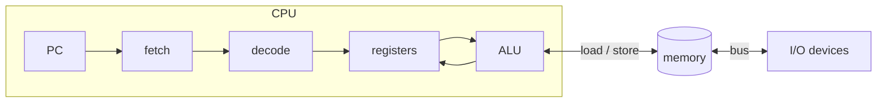
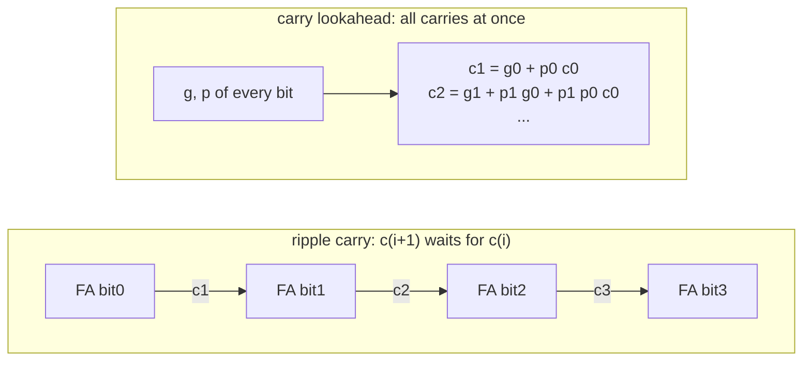

# NEY221 Principles of Computer Operation: study guide

**What this course is about:** what the machine actually sees. A program becomes a list of simple instructions
(an *instruction set*), numbers become bit patterns, and arithmetic becomes circuits of gates.

How to read each section: **the point** (one sentence to remember), a **picture**, a **real example** you can run
(the output shown is what the tools print), **where the code is**, and **check yourself** (click to see the answer).

> Build once (see the [README](../../README.md)), then run the examples from the repository folder.
> On Windows use `build\bin\mips-sim.exe`; the guide writes `build/bin/mips-sim`.

---

## 1. The organisation of a computer

**The point:** the CPU repeats one loop forever: *fetch* the instruction at PC, *decode* it, *execute* it, update PC.
Everything else (memory, I/O) is reached through loads, stores and buses.



**Check yourself**
<details><summary>Why does a 32-bit MIPS add PC + 4 and not PC + 1?</summary>
Memory is addressed in bytes and every MIPS instruction is 4 bytes long.
</details>

---

## 2. MIPS assembly: registers, memory, procedures

**The point:** MIPS is a *load/store* machine. Arithmetic works only on the 32 registers; memory is reached only
with `lw`/`sw`. A procedure call is `jal` (saves the return address in `$ra`), the return is `jr $ra`, and local
data lives in a *stack frame* below `$sp`.

| register | use |
| --- | --- |
| `$zero` | always 0 |
| `$a0-$a3` | arguments |
| `$v0` | return value |
| `$t0-$t9` | temporaries (caller saves) |
| `$s0-$s7` | saved (callee saves) |
| `$sp`, `$fp`, `$ra` | stack pointer, frame pointer, return address |

The frame of `factorial` below (56 bytes):

```
          higher addresses
   +---------------------------+
   | caller's frame            |
   +---------------------------+ <- old $sp
   | saved $ra       52($sp)   |
   | saved $fp       48($sp)   |
   | temporaries     4..44     |
   | parameter n      0($fp)   |
   +---------------------------+ <- $sp = $fp  (addiu $sp,$sp,-56; the stack grows downwards)
          lower addresses
```

**Example:** compile the recursive factorial and run it.

```bash
build/bin/nexusc compile examples/source_lang/factorial.nx -S -o fact.s
build/bin/mips-sim run fact.s --mode functional --stats
```

```text
factorial:
  addiu $sp, $sp, -56  # allocate 56-byte frame
  sw $ra, 52($sp)
  sw $fp, 48($sp)
  ...
  jal factorial
...
Program exited with code 120
Instructions: 203
```

Every recursive call pushes a new frame; `$ra` must be saved because the inner `jal` overwrites it.

**Where the code is:** the assembler/loader [src/mips/loader/src/parser.cpp](../../src/mips/loader/src/parser.cpp),
the instruction semantics [src/sim/functional/src/interpreter.cpp](../../src/sim/functional/src/interpreter.cpp),
the code generator that writes the frames [src/compiler/backend_mips/src/codegen.cpp](../../src/compiler/backend_mips/src/codegen.cpp).

**Check yourself**
<details><summary>A leaf procedure (it calls nothing) uses only $t registers. Does it need a stack frame?</summary>
No. It does not overwrite <code>$ra</code> and the <code>$t</code> registers are not preserved across calls, so it can
run without touching the stack.
</details>

---

## 3. Instruction set styles: accumulator, stack, register-memory, load/store

**The point:** the same program can be written for very different instruction sets. Fewer registers mean
shorter programs but more memory traffic; load/store needs more instructions but each one is simple and fast.

| style | example: `c = a + b` | real machines |
| --- | --- | --- |
| accumulator | `load a; add b; store c` | early computers, microcontrollers |
| stack | `push a; push b; add; pop c` | Java bytecode (`iload`, `iadd`, `istore`) |
| register-memory | `mov eax,[a]; add eax,[b]; mov [c],eax` | IA-32 (x86) |
| load/store | `lw $t0,a; lw $t1,b; add $t2,$t0,$t1; sw $t2,c` | MIPS, ARM, RISC-V |

**Example:** compile one program for all four styles and compare.

```bash
build/bin/nexusc isa examples/source_lang/factorial.nx
```

```text
style                         exit   static   bytes   dynamic    reads   writes
stack                          120       26      42        89       26       18
accumulator                    120       24      63        85       31       23
register-memory                120       38     128       126       43       34
load-store (MIPS)              120       60     240       203       67       59
load-store (MIPS+regalloc)     120       45     180       145       17       17
All ISA styles agree on the program result.
```

Read it like this: the stack code is the *smallest* (42 bytes), but MIPS with register allocation makes by far
the *fewest memory accesses* (17 reads instead of 67). That is why RISC machines with many registers won.

**Where the code is:** [src/compiler/isa_styles/src/isa_styles.cpp](../../src/compiler/isa_styles/src/isa_styles.cpp)
(add `--listing` to the command to see the generated code of each style).

**Check yourself**
<details><summary>Why is the stack code so short?</summary>
Its instructions have no operand fields: <code>add</code> takes both inputs from the top of the stack, so most
instructions are one byte.
</details>

---

## 4. Representing numbers

**The point:** the same bits mean different numbers under different conventions. Computers use **two's
complement** for integers because addition and subtraction then need one adder for both signs.

**Example:** -6 in 8 bits.

```bash
build/bin/mips-sim arith repr -6 8
```

```text
-6 in 8 bits:
  sign-magnitude   10000110
  one's complement 11111001
  two's complement 11111010
  excess-127        01111001
```

Two's complement trick: invert the bits of +6 (`00000110` -> `11111001`) and add 1 -> `11111010`.

**Floating point (IEEE-754, 32 bits):** `sign | exponent (8 bits, excess-127) | fraction (23 bits)`,
value = (-1)^s x 1.fraction x 2^(exponent-127).

```bash
build/bin/mips-sim arith float 0.1 add 0.2
```

```text
a        = 0 01111011 10011001100110011001101  (normal, 0.100000001)
b        = 0 01111100 10011001100110011001101  (normal, 0.200000003)
software = 0 01111101 00110011001100110011010  (normal, 0.300000012)
hardware = 0 01111101 00110011001100110011010  (normal, 0.300000012)
bit-exact match
```

0.1 has no exact binary form (like 1/3 in decimal), so 0.1 + 0.2 is not exactly 0.3. The software adder
(align exponents, add, normalise, round to nearest even) gives exactly the same bits as the real FPU.

**Characters:** text is numbers too. UTF-8 stores a character in 1 to 4 bytes; ASCII characters keep their
one-byte code, so old ASCII text is already valid UTF-8.

| character | code point | UTF-8 bytes |
| --- | --- | --- |
| `A` | U+0041 | `01000001` |
| `α` | U+03B1 | `11001110 10110001` |
| `€` | U+20AC | `11100010 10000010 10101100` |

**Where the code is:** [src/common/src/number_systems.cpp](../../src/common/src/number_systems.cpp) (encodings,
software IEEE-754, UTF-8), [src/common/src/fpu_lite.cpp](../../src/common/src/fpu_lite.cpp) (fixed point).

**Check yourself**
<details><summary>What is the range of 8-bit two's complement, and why one more negative number?</summary>
-128 to +127. Zero takes one of the 128 non-negative patterns, so only 127 positive numbers remain.
</details>
<details><summary>Why is the exponent stored in excess-127 and not two's complement?</summary>
So that floating-point numbers compare like unsigned integers: a bigger exponent field means a bigger number.
</details>

---

## 5. Arithmetic circuits: adders, multipliers, dividers

**The point:** a ripple-carry adder waits for the carry to travel through every bit (slow, linear depth); carry
lookahead computes the carries in parallel from *generate* `g = a·b` and *propagate* `p = a+b` (fast,
logarithmic depth). Multiplication and division are repeated add/subtract and shift.



```bash
build/bin/mips-sim arith cla 11 6
```

```text
sum = 17 (carry out 0)
gate depth: carry-lookahead 10 vs ripple-carry 65
```

**Booth's multiplication** looks at pairs of bits of the multiplier: `10` subtract M, `01` add M, `00`/`11`
just shift. Runs of 1s cost one subtraction and one addition instead of one addition per bit.

```bash
build/bin/mips-sim arith booth 7 -3 8
```

```text
  A=00000000 Q=11111101 Q-1=0  init
  A=11111100 Q=11111110 Q-1=1  10: A -= M, shift
  A=00000001 Q=11111111 Q-1=0  01: A += M, shift
  A=11111101 Q=01111111 Q-1=1  10: A -= M, shift
  A=11111110 Q=10111111 Q-1=1  11: no op, shift
  ...
product = -21
```

**Non-restoring division:** subtract the divisor; if the remainder goes negative, do *not* restore it, add the
divisor in the next step instead. One add or subtract per bit.

```bash
build/bin/mips-sim arith divide 13 4 4
```

```text
  step 1: A -= M -> A=-3 Q=1010
  step 2: A += M -> A=-1 Q=0100
  step 3: A += M -> A=2 Q=1001
  step 4: A -= M -> A=1 Q=0011
quotient = 3, remainder = 1
```

**Where the code is:** C++ [src/common/src/arithmetic.cpp](../../src/common/src/arithmetic.cpp); the same units in
Verilog: [adder](../../src/hdl/alu/nexus_adder.v), [ALU](../../src/hdl/alu/nexus_alu.v),
[multiplier](../../src/hdl/alu/nexus_iterative_multiplier.v), [divider](../../src/hdl/alu/nexus_iterative_divider.v)
(simulate them with `python scripts/test_hdl.py alu`, needs Icarus Verilog).

**Check yourself**
<details><summary>How does the ALU subtract with an adder?</summary>
a - b = a + (~b) + 1: invert b and set the carry-in to 1 (look at <code>sub_adder</code> in nexus_alu.v).
</details>
<details><summary>When does signed addition overflow?</summary>
When both operands have the same sign and the result has the other sign (carry into the sign bit differs from
the carry out).
</details>

---

**Next course:** [EY321 Computer Organization](EY321.md) builds the CPU that runs these instructions.
