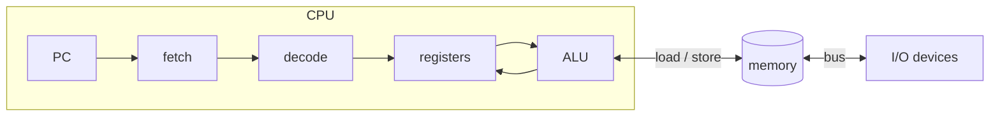
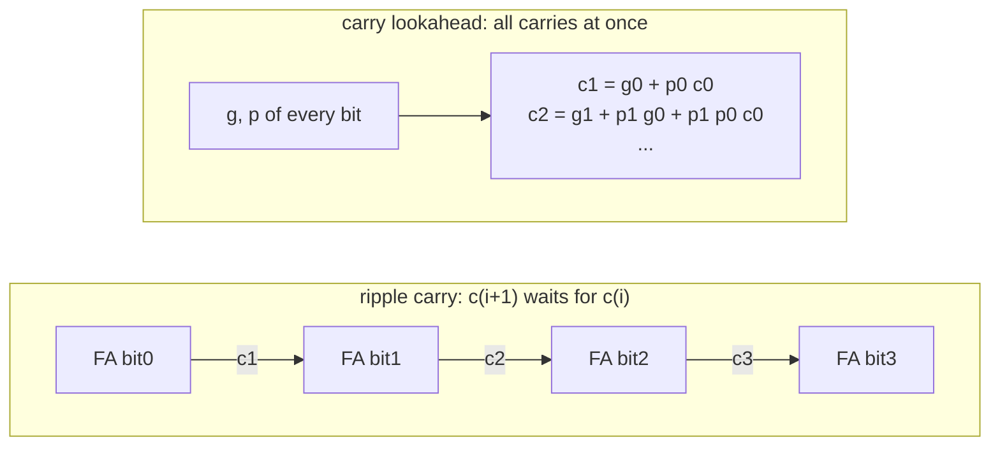

# NEY221 Principles of Computer Operation: study guide

**What this course is about:** what the machine actually sees. A program becomes a list of simple instructions
(an *instruction set*), numbers become bit patterns, and arithmetic becomes circuits of gates.

How to read each section: **the point** (one sentence to remember), a **picture**, a **real example** you can run
(the output shown is what the tools print), **where the code is**.

> Build once (see the [README](../../README.md)), then run the examples from the repository folder.
> On Windows use `build\bin\mips-sim.exe`; the guide writes `build/bin/mips-sim`.

Start with sections 1 and 2 and the numbered [small examples](../../examples/basics/README.md):
each one shows a single idea, and the output it prints is given next to it.
The [glossary](GLOSSARY.md) explains the terms used across the six courses.

**Connection to the whole:** the compiler produces instructions; this course explains their operands,
bit patterns and arithmetic. EY321 builds a datapath that performs them. Follow
[the same sum at this level](../FLOW.md#3-give-instructions-a-bit-pattern--ney221).

---

## 1. The organisation of a computer

### Bits, bytes, words and addresses

A **bit** is 0 or 1. Eight bits make a **byte**; a MIPS32 **word** has four bytes, or 32 bits.
The bit pattern `00001101` means `8 + 4 + 1 = 13` as an unsigned integer. Each position has a weight
`1, 2, 4, 8, ...`, starting at the right. Four bits fit one hexadecimal digit: `1101 = D`, so
`00001101 = 0x0D`. Hexadecimal is a shorter way to write the same bits.

Memory is a sequence of addressed bytes. Consecutive aligned words start at byte addresses 0, 4, 8, ... .
A **register** is a small storage location inside the CPU; it has a name such as `$t0`. An address such
as 4 identifies a location in memory. The number in a register can itself be used as an address.
**Endianness** specifies the order of bytes within a word: `0x12345678` has byte `78` at its lowest
address in little endian, and byte `12` there in big endian. These lessons use aligned word loads/stores;
the C++ functional model stores whole words and does not expose byte order through byte-load instructions.

```text
CPU register $t0 = 12       memory byte address 0: [32-bit word]
CPU register $t1 = 4        memory byte address 4: [32-bit word]
```

**The point:** the CPU repeats one loop forever: *fetch* the instruction at PC, *decode* it, *execute* it, update PC.
Everything else (memory, I/O) is reached through loads, stores and buses.



The **PC** selects the next instruction. Instructions and data are both bit patterns, but instruction
decoding gives the patterns their meaning. The ALU computes; registers and memory retain results.
Input/output connects the machine to devices. In NEXUS a device can be selected by a memory address.

**Trace convention:** NEXUS C++ traces print an *instruction index*: `pc=0`, `pc=1`, `pc=2`.
The corresponding byte addresses are 0, 4, 8. Thus `next_pc = state.pc + 1` in the interpreter and
the architectural rule `PC = PC + 4` describe the same sequential step at different units.

---

## 2. MIPS assembly: registers, memory, procedures

**The point:** MIPS is a *load/store* machine. Arithmetic works only on the 32 registers; memory is reached only
with `lw`/`sw`. A procedure call is `jal` (saves the return address in `$ra`), the return is `jr $ra`, and local
data lives in a *stack frame* below `$sp`.

| register | use |
| --- | --- |
| `$zero` | always 0 |
| `$a0-$a3` | arguments |
| `$v0` | return value |
| `$t0-$t9` | temporaries (caller saves) |
| `$s0-$s7` | saved (callee saves) |
| `$sp`, `$fp`, `$ra` | stack pointer, frame pointer, return address |

### Write your first instructions

Read the first operand as the destination: `addu $v0, $t0, $t1` means `$v0 = $t0 + $t1`.
`addiu $t0, $zero, 5` adds the immediate number 5 to the permanently zero register.
The `u` in `addiu` means no signed-overflow trap; its immediate is still sign-extended.
NEXUS runs a teaching subset of MIPS: aligned `lw`/`sw`, no architectural branch delay slots,
and no complete MIPS exception model. These examples use small values that do not overflow.
The runner starts at `main`, initialises `$sp`, and gives `$ra` a special halt value;
`jr $ra` at the end returns to the runner. `$v0` is printed as the program's result.

```asm
main:
  addiu $t0, $zero, 5
  addiu $t1, $zero, 7
  addu  $v0, $t0, $t1
  jr    $ra
```

```bash
build/bin/mips-sim run examples/basics/mips/01_add.s --mode functional --trace --stats
```

| After instruction | What changed |
| --- | --- |
| `addiu $t0,...,5` | `$t0 = 5` |
| `addiu $t1,...,7` | `$t1 = 7` |
| `addu $v0,...` | `$v0 = 12` |
| `jr $ra` | execution ends with result 12 |

Here is the corresponding case from `run_program` in the
[functional interpreter](../../src/sim/functional/src/interpreter.cpp):

```cpp
case Opcode::Addiu:
  reg(state, instruction.rt) = reg(state, instruction.rs) + instruction.immediate;
  break;
```

The parser has already identified the registers and immediate. `reg` selects a register by index;
the assignment implements the instruction. Other CPU models add timing around the same operation.

Follow these files in order. Each is short enough to read in full:

| File under `examples/basics/mips/` | Mechanism | Result |
| --- | --- | --- |
| [02_memory.s](../../examples/basics/mips/02_memory.s) | `sw` copies a register to memory; `lw` copies memory to a register | 13 |
| [03_if.s](../../examples/basics/mips/03_if.s) | `slt` produces 0/1; `beq` chooses the next instruction | 1 (with `x = 7` it would be 0) |
| [04_sum.s](../../examples/basics/mips/04_sum.s) | a backward branch repeats instructions | 10 (with bound 6 it would be 15) |
| [05_call.s](../../examples/basics/mips/05_call.s) | `jal` overwrites `$ra`; arguments use `$a0`, result uses `$v0` | 9 |
| [06_stack.s](../../examples/basics/mips/06_stack.s) | the caller saves `$ra` in memory, then restores it; `$sp` is restored too, so the caller's frame is intact | 9 |

Run any of them by replacing `01_add.s` in the command above. For the loop, write the successive
`(i, sum)` pairs: `(1,0) -> (2,1) -> (3,3) -> (4,6) -> (5,10)`. The last branch is not taken.
For the call, trace `main -> increment -> main`: removing the saved return address makes `main`
return to its own continuation instead of to the runner.

`0($t0)` means **memory at address `$t0 + 0`**. It does not mean the contents of `$t0` itself.
An `lw` from address 2 is rejected because a word must be aligned to a multiple of four.

### From one call to recursion

A stack frame reserves separate storage for each call. Decreasing `$sp` allocates space;
increasing it by the same amount frees that space. Saved registers belong to the caller and
must have their original values when the callee returns. Only save what a procedure actually needs.

<details><summary>Larger example: inspect compiler-generated recursive factorial</summary>

The frame of `factorial` below (56 bytes):

```
          higher addresses
   +---------------------------+
   | caller's frame            |
   +---------------------------+ <- old $sp
   | saved $ra       52($sp)   |
   | saved $fp       48($sp)   |
   | temporaries     4..44     |
   | parameter n      0($fp)   |
   +---------------------------+ <- $sp = $fp  (addiu $sp,$sp,-56; the stack grows downwards)
          lower addresses
```

**Example:** compile the recursive factorial and run it.

```bash
build/bin/nexusc compile examples/source_lang/factorial.nx -S -o fact.s
build/bin/mips-sim run fact.s --mode functional --stats
```

```text
factorial:
  addiu $sp, $sp, -56  # allocate 56-byte frame
  sw $ra, 52($sp)
  sw $fp, 48($sp)
  ...
  jal factorial
...
Program exited with code 120
Instructions: 203
```

Every recursive call pushes a new frame; `$ra` must be saved because the inner `jal` overwrites it.
</details>

**Where the code is:** the assembler/loader [src/mips/loader/src/parser.cpp](../../src/mips/loader/src/parser.cpp),
the instruction semantics [src/sim/functional/src/interpreter.cpp](../../src/sim/functional/src/interpreter.cpp),
the code generator that writes the frames [src/compiler/backend_mips/src/codegen.cpp](../../src/compiler/backend_mips/src/codegen.cpp).

---

## 3. Instruction set styles: accumulator, stack, register-memory, load/store

**The point:** an instruction set defines operations and where their operands live. An accumulator uses
one implicit result register; a stack uses its top entries; register machines name registers explicitly.
Encoding size, instruction count and memory traffic are separate quantities: compare all three.

| style | example: `c = a + b` | real machines |
| --- | --- | --- |
| accumulator | `load a; add b; store c` | early computers, microcontrollers |
| stack | `push a; push b; add; pop c` | Java bytecode (`iload`, `iadd`, `istore`) |
| register-memory | `mov eax,[a]; add eax,[b]; mov [c],eax` | IA-32 (x86) |
| load/store | `lw $t0,a; lw $t1,b; add $t2,$t0,$t1; sw $t2,c` | MIPS, ARM, RISC-V |

**Start small:** trace `c = a + b` in the table above with `a = 5`, `b = 7`. For the stack, write
`[] -> [5] -> [5,7] -> [12] -> []`; `pop c` stores 12. In a register-memory machine an arithmetic
operand may come directly from memory. A load/store machine requires a separate load first.
RISC and CISC describe ISA design choices; one short example cannot establish which machine is faster.

For `c = a + b + d`, the stack machine keeps the intermediate `a + b` on the stack, the accumulator machine
keeps it in the accumulator, and a load/store machine keeps it in a register. These NEXUS styles are teaching
machines, not complete IA-32 or JVM emulators.

<details><summary>Larger example: compare generated code sizes and traffic</summary>

**Example:** compile one program for all four styles and compare.

```bash
build/bin/nexusc isa examples/source_lang/factorial.nx
```

```text
style                         exit   static   bytes   dynamic    reads   writes
stack                          120       26      42        89       26       18
accumulator                    120       24      63        85       31       23
register-memory                120       38     128       126       43       34
load-store (MIPS)              120       60     240       203       67       59
load-store (MIPS+regalloc)     120       45     180       145       17       17
All ISA styles agree on the program result.
```

Read it like this: in this example the stack encoding uses the fewest bytes, while register allocation
reduces MIPS memory traffic. Runtime also depends on the processor and memory system.
</details>

**Where the code is:** [src/compiler/isa_styles/src/isa_styles.cpp](../../src/compiler/isa_styles/src/isa_styles.cpp)
(add `--listing` to the command to see the generated code of each style).

---

## 4. Representing numbers

### Integers and fixed point before floating point

With `n` bits an **unsigned** integer ranges from 0 to `2^n - 1`. In **two's complement** the top
bit has weight `-2^(n-1)` instead of `+2^(n-1)`. Thus `11111010` is either unsigned 250 or signed -6.
Sign magnitude keeps a sign bit and magnitude; one's complement inverts positive bits for a negative
value. Both have two encodings of zero; two's complement has one and allows ordinary binary addition.

In four bits, `0111 + 0001 = 1000`: unsigned 7 + 1 = 8 fits, but signed 7 + 1 overflows to the bit
pattern for -8. Conversely, `1111 + 0001` has carry-out 1 but means signed -1 + 1 = 0, with no signed
overflow. **Carry-out and signed overflow answer different questions.**

**Fixed point** reserves an agreed number of fractional bits: with four fractional bits, raw integer
24 represents `24 / 16 = 1.5`; raw 4 represents 0.25. Add their raw integers to obtain 28, or 1.75.
The spacing is always `1/16`. Multiplication produces twice as many fractional bits and needs rescaling.
Floating point instead stores an exponent and trades uniform spacing for a much wider range.

```bash
build/bin/mips-sim fp-demo 1.5 0.25
```

Look for the fixed-point values 1.5, 0.25 and 1.75. The demo uses eight fractional bits
(`raw / 256`). Its storage is a signed 32-bit integer, despite the legacy `fixed-q8.8` output label.
Neither 0.1 nor 0.2 is exact in this fixed-point format, while 1.5 and 0.25 are: every stored value is a
multiple of `1/256`. Floating-point spacing, in contrast, depends on the exponent.

**The point:** the same bits mean different numbers under different conventions. Computers use **two's
complement** for integers because addition and subtraction then need one adder for both signs.

**Example:** -6 in 8 bits.

```bash
build/bin/mips-sim arith repr -6 8
```

```text
-6 in 8 bits:
  sign-magnitude   10000110
  one's complement 11111001
  two's complement 11111010
  excess-127        01111001
```

Two's complement trick: invert the bits of +6 (`00000110` -> `11111001`) and add 1 -> `11111010`.

**Floating point (IEEE-754, 32 bits):** `sign | exponent (8 bits, excess-127) | fraction (23 bits)`.
For **normal** numbers (exponent field 1 to 254),
`value = (-1)^s x 1.fraction x 2^(exponent-127)`.
Exponent 0 denotes zero or subnormal values (no implicit leading 1); exponent 255 denotes infinity
or NaN. Rounding is necessary when the exact result needs more fraction bits than the format has.
For example, 1.5 is `1.1` in binary: sign 0, exponent 127, fraction starting with 1 then zeros.

```bash
build/bin/mips-sim arith float 0.1 add 0.2
```

```text
a        = 0 01111011 10011001100110011001101  (normal, 0.100000001)
b        = 0 01111100 10011001100110011001101  (normal, 0.200000003)
software = 0 01111101 00110011001100110011010  (normal, 0.300000012)
hardware = 0 01111101 00110011001100110011010  (normal, 0.300000012)
bit-exact match
```

0.1 has no exact binary form (like 1/3 in decimal), so 0.1 + 0.2 is not exactly 0.3. The software adder
(align exponents, add, normalise, round to nearest even) gives exactly the same bits as the real FPU.

**Characters:** text is numbers too. UTF-8 stores a character in 1 to 4 bytes; ASCII characters keep their
one-byte code, so old ASCII text is already valid UTF-8.

| character | code point | UTF-8 bytes |
| --- | --- | --- |
| `A` | U+0041 | `01000001` |
| `¢` | U+00A2 | `11000010 10100010` |
| `€` | U+20AC | `11100010 10000010 10101100` |

**Where the code is:** [src/common/src/number_systems.cpp](../../src/common/src/number_systems.cpp) (encodings,
software IEEE-754, UTF-8), [src/common/src/fpu_lite.cpp](../../src/common/src/fpu_lite.cpp) (fixed point).

---

## 5. Arithmetic circuits: adders, multipliers, dividers

### Start with one bit

AND (`&`) is 1 when both inputs are 1, OR (`|`) when either is 1, and XOR (`^`) when they differ.
A full adder consumes bits `a`, `b` and carry-in `c`; it produces a sum bit and a carry-out.

| a | b | c | sum | carry-out |
| --- | --- | --- | --- | --- |
| 0 | 0 | 0 | 0 | 0 |
| 0 | 0 | 1 | 1 | 0 |
| 0 | 1 | 0 | 1 | 0 |
| 0 | 1 | 1 | 0 | 1 |
| 1 | 0 | 0 | 1 | 0 |
| 1 | 0 | 1 | 0 | 1 |
| 1 | 1 | 0 | 0 | 1 |
| 1 | 1 | 1 | 1 | 1 |

This is the complete working function in [full_adder.py](../../examples/basics/full_adder.py):

```python
def full_adder(a, b, carry):
    return a ^ b ^ carry, (a & b) | ((a ^ b) & carry)
```

```bash
python examples/basics/full_adder.py 7 1
```

It connects four copies and prints each carry: `0111 + 0001 = 1000`.
For `15 + 1` the low bits become `0000` with carry-out 1: the carry has to travel from bit 0 to bit 3
before the final result is known. This chain is exactly what makes ripple-carry addition slow.

Subtraction uses `a + (~b) + 1` within the chosen width. An unsigned shift/add multiplier tests
each multiplier bit and adds a shifted multiplicand when it is 1: `3 x 5 = 3 + (3 << 2) = 15`.
Long division similarly builds one quotient bit at a time; restoring division undoes a negative
trial subtraction, while non-restoring division corrects it in the following step.

**The point:** a ripple-carry adder waits for the carry to travel through every bit (slow, linear depth); carry
lookahead computes the carries in parallel from *generate* `g = a & b` and *propagate* `p = a+b` (fast,
logarithmic depth). Multiplication and division are repeated add/subtract and shift.



```bash
build/bin/mips-sim arith cla 11 6
```

```text
sum = 17 (carry out 0)
gate depth: carry-lookahead 10 vs ripple-carry 65
```

**Booth's multiplication** looks at pairs of bits of the multiplier: `10` subtract M, `01` add M, `00`/`11`
just shift. Runs of 1s cost one subtraction and one addition instead of one addition per bit.

```bash
build/bin/mips-sim arith booth 7 -3 8
```

```text
  A=00000000 Q=11111101 Q-1=0  init
  A=11111100 Q=11111110 Q-1=1  10: A -= M, shift
  A=00000001 Q=11111111 Q-1=0  01: A += M, shift
  A=11111101 Q=01111111 Q-1=1  10: A -= M, shift
  A=11111110 Q=10111111 Q-1=1  11: no op, shift
  ...
product = -21
```

**Non-restoring division:** subtract the divisor; if the remainder goes negative, do *not* restore it, add the
divisor in the next step instead. One add or subtract per bit.

```bash
build/bin/mips-sim arith divide 13 4 4
```

```text
  step 1: A -= M -> A=-3 Q=1010
  step 2: A += M -> A=-1 Q=0100
  step 3: A += M -> A=2 Q=1001
  step 4: A -= M -> A=1 Q=0011
quotient = 3, remainder = 1
```

**Where the code is:** C++ [src/common/src/arithmetic.cpp](../../src/common/src/arithmetic.cpp); the same units in
Verilog: [adder](../../src/hdl/alu/nexus_adder.v), [ALU](../../src/hdl/alu/nexus_alu.v),
[multiplier](../../src/hdl/alu/nexus_iterative_multiplier.v), [divider](../../src/hdl/alu/nexus_iterative_divider.v)
(simulate them with `python scripts/test_hdl.py alu`, needs Icarus Verilog).

---

## How this course connects

- **Before it:** a program in a high-level language; [NEY613](NEY613.md) shows how a compiler turns it into the
  MIPS instructions of this course.
- **After it:** [EY321](EY321.md) builds the hardware that executes these instructions: the adders and the ALU of
  section 5 become parts of its datapath, and the instruction formats decide what its control unit does.
- **Further:** the instruction-set styles of section 3 return in [NEY606](NEY606.md) (RISC pipelines, VLIW) and
  the arithmetic in [NEY704](NEY704.md) (vector and SIMD units do the same operations on many values).

---

**Next course:** [EY321 Computer Organization](EY321.md) builds the CPU that runs these instructions.
