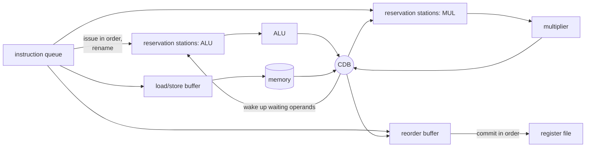

# NEY606 Computer Architecture: study guide

**What this course is about:** how a modern core runs *faster than one instruction per cycle* and hides slow
operations: superscalar issue, dynamic scheduling (scoreboard, Tomasulo), speculation, static scheduling
(VLIW, software pipelining) and smarter memory.

Each section: **the point**, a **picture**, a **real example** (output from the tools), **where the code is**,
**check yourself**. Build first (see the [README](../../README.md)); commands run from the repository folder.

---

## 1. Measuring performance and Amdahl's law

**The point:** speeding up one part helps only as much as that part matters. If a fraction `f` of the time is
sped up `s` times:

```
speedup = 1 / ((1 - f) + f / s)        and never more than 1 / (1 - f)
```

| f (part we speed up) | s = 2 | s = 10 | s = infinity |
| --- | --- | --- | --- |
| 50% | 1.33 | 1.82 | 2 |
| 90% | 1.82 | 5.26 | 10 |
| 99% | 1.98 | 9.17 | 100 |

Use benchmarks (real programs), not peak numbers, and compare with `time = instructions x CPI x clock`
(see [EY321 section 1](EY321.md#1-performance-the-equation-behind-everything)). Every run below prints cycles,
CPI and IPC with `--stats`.

**Check yourself**
<details><summary>80% of a program can run on 4 cores, the rest is serial. Best speedup?</summary>
1 / (0.2 + 0.8/4) = 1 / 0.4 = 2.5, and never more than 1/0.2 = 5 however many cores.
</details>

---

## 2. Superscalar issue

**The point:** fetch and issue two or more instructions per cycle when they are independent. The limit is
*instruction-level parallelism* (ILP): dependent instructions still wait.

```bash
build/bin/nexusc compile tests/programs/matrix_multiply.nx -S --regalloc linear-scan -o mm.s
build/bin/mips-sim run mm.s --mode advanced --scheduler inorder --issue-width 1 --stats
build/bin/mips-sim run mm.s --mode advanced --scheduler inorder --issue-width 2 --stats
```

| issue width | cycles | IPC |
| --- | --- | --- |
| 1 | 2144 | 0.95 |
| 2 | 1776 | 1.15 |

Doubling the width gives only ~20% here: much of the code is chains of dependent instructions.
(This in-order model charges no extra latency for operands, so use it to compare widths, not against
the scoreboard and Tomasulo below.)

---

## 3. Dynamic scheduling: scoreboard and Tomasulo

**The point:** let independent instructions go *around* a stalled one. The **scoreboard** issues in order and
executes out of order, but stops on WAR/WAW name conflicts. **Tomasulo** renames registers into *reservation
stations*, so only true (RAW) dependences remain; results are broadcast on the *common data bus* (CDB), and a
**reorder buffer** (ROB) commits them in program order so exceptions and mispredictions stay precise.



**Example:** [examples/cpu/out_of_order.s](../../examples/cpu/out_of_order.s): a slow `mult` followed by work that
does not depend on it.

```bash
build/bin/mips-sim run examples/cpu/out_of_order.s --mode advanced --scheduler scoreboard --stats
build/bin/mips-sim run examples/cpu/out_of_order.s --mode advanced --scheduler tomasulo --stats
build/bin/mips-sim run examples/cpu/out_of_order.s --mode advanced --scheduler tomasulo --predictor 2bit --stats
```

| core | cycles | CPI |
| --- | --- | --- |
| scoreboard | 809 | 1.99 |
| Tomasulo | 657 | 1.62 |
| Tomasulo + 2-bit branch predictor | 419 | 1.03 |

With `--trace` you can watch it happen (shortened):

```text
cycle=8   cdb(I4 mult)
cycle=9   commit(I4 mult), ex(I5 mflo), ex(I7 addiu)      <- I7 executes before I6
cycle=11  commit(I5 mflo), cdb(I7 addiu), ex(I6 addu)
cycle=13  commit(I6 addu)                                  <- but commits in order
cycle=14  commit(I7 addiu)
```

**Where the code is:** [src/sim/advanced/src/model.cpp](../../src/sim/advanced/src/model.cpp) (scoreboard, Tomasulo,
ROB, renaming, CDB, speculation).

**Check yourself**
<details><summary>Which hazards does register renaming remove?</summary>
WAR and WAW (name dependences). RAW (true data dependences) cannot be removed, only waited for.
</details>
<details><summary>Why commit in order if execution is out of order?</summary>
So the architectural state always looks as if instructions ran one by one: a mispredicted branch or an
exception can throw away everything younger in the ROB.
</details>

---

## 4. Branch prediction and speculation

**The point:** a deep pipeline fetches many instructions before a branch is resolved, so it must guess.
A **2-bit saturating counter** per branch changes its prediction only after two wrong guesses, so a loop
branch mispredicts once per loop exit instead of twice.


In the example above the 2-bit predictor cuts mispredictions from 49 to 2 and cycles from 657 to 419.
Speculative instructions sit in the ROB until the branch resolves; a misprediction flushes them. A
*return-address stack* predicts `jr $ra` the same way.

**Where the code is:** [src/sim/advanced/src/predictor.cpp](../../src/sim/advanced/src/predictor.cpp).

---

## 5. Static scheduling: VLIW and software pipelining

**The point:** let the *compiler* find the parallelism. A VLIW machine issues one long word of independent
operations per cycle, filled by the compiler. **Software pipelining** overlaps iterations of a loop: a new
iteration starts every **II** cycles (*initiation interval*), long before the previous one ends.
`MII = max(ResMII, RecMII)`: resources (how many units) and recurrences (dependence cycles) bound II from below.

**Example:** DAXPY (`y[i] = a*x[i] + y[i]`) with one memory port.

```bash
build/bin/nexusc modsched examples/schedules/daxpy.ddg
```

```text
ResMII 3, RecMII 1, MII 3
II 3 (= MII), 3 stages
kernel (one row per cycle of the steady state; [k] = operation of the iteration started k stages ago):
  0: ldx[0] inc[0]
  1: ldy[0] br[0]
  2: mul[0] add[1] st[2]
one iteration takes 9 cycles; software pipelining starts a new one every 3 cycle(s), 3x the rate
```

```
time ->     0 1 2 | 3 4 5 | 6 7 8 | 9 ...
iteration 0 [ stage 0 ][ stage 1 ][ stage 2 ]
iteration 1           [ stage 0 ][ stage 1 ][ stage 2 ]
iteration 2                     [ stage 0 ][ stage 1 ] ...
```

ResMII is 3 because there are three memory operations (two loads, one store) and one memory port.

**Where the code is:** [src/compiler/passes/src/modulo_schedule.cpp](../../src/compiler/passes/src/modulo_schedule.cpp)
(iterative modulo scheduling); the VLIW issue model is `--scheduler vliw-lite --issue-width 2` in the advanced
model.

**Check yourself**
<details><summary>Adding a second memory port: what is the new ResMII?</summary>
ceil(3 memory operations / 2 ports) = 2 (if the ALU and multiplier are not the new bottleneck).
</details>

---

## 6. Advanced memory: non-blocking caches and prefetching

**The point:** a **non-blocking** cache keeps working on hits while misses are outstanding; *MSHRs* track the
misses in flight, and a second miss to a line already being fetched is merged. **Prefetching** fetches a line
before it is asked for (next-line, or stride for regular steps through arrays).

```bash
build/bin/mips-sim cache mm.s --mshr 1 --prefetch none
build/bin/mips-sim cache mm.s --mshr 4 --prefetch stride
```

```text
1 MSHRs, prefetcher none:   170 accesses: 159 hits, 5 misses, 6 merged; 2065 cycles, 23 stall cycles
4 MSHRs, prefetcher stride: 170 accesses: 160 hits, 4 misses, 6 merged; 1 prefetches (1 useful); 2042 cycles, 0 stall cycles
```

This small program has few misses; try your own programs with large arrays to see bigger effects.

**Where the code is:** [src/sim/memory/src/nonblocking_cache.cpp](../../src/sim/memory/src/nonblocking_cache.cpp).

---

## 7. Towards parallel machines

Multithreading, multiprocessors, coherence and consistency are introduced here and studied in depth in
[NEY704](NEY704.md) (sections 1-5 there).

---

**Previous:** [EY321](EY321.md) · **Next:** [NEY704 Parallel Systems](NEY704.md) puts many cores together.
