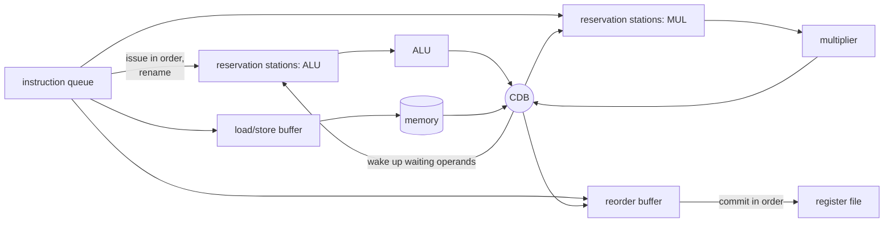

# NEY606 Computer Architecture: study guide

**What this course is about:** how a modern core can complete *more than one instruction per cycle* and hide slow
operations: superscalar issue, dynamic scheduling (scoreboard, Tomasulo), speculation, static scheduling
(VLIW, software pipelining) and smarter memory.

Each section: **the point**, a **picture**, a **real example** (output from the tools), **where the code is**. Build first (see the [README](../../README.md)); commands run from the repository folder.

First recall [EY321's pipeline](EY321.md#4-pipelining-and-hazards): stage overlap, a load-use stall,
and a wrong-path flush. This course asks which independent operations can fill those waiting cycles.
Start with the six-instruction examples before opening the longer performance experiments.

**Connection to the whole:** keep EY321's correct execution, then exploit independent operations.
The compiler can expose opportunities; the hardware must respect dependencies. NEY704 extends
the question to multiple workers. See [scheduling in the shared flow](../FLOW.md#5-find-available-overlap--ney606).

---

## 1. Measuring performance and Amdahl's law

**The point:** speeding up one part helps only as much as that part matters. If a fraction `f` of the time is
sped up `s` times:

```
speedup = 1 / ((1 - f) + f / s)        and never more than 1 / (1 - f)
```

| f (part we speed up) | s = 2 | s = 10 | s = infinity |
| --- | --- | --- | --- |
| 50% | 1.33 | 1.82 | 2 |
| 90% | 1.82 | 5.26 | 10 |
| 99% | 1.98 | 9.17 | 100 |

Use benchmarks (real programs), not peak numbers, and compare with `time = instructions x CPI x clock`
(see [EY321 section 1](EY321.md#1-performance-the-equation-behind-everything)). Every run below prints cycles,
CPI and IPC with `--stats`.

Derive the formula once: a 100 ms task spends 80 ms in a loop and 20 ms elsewhere. Making the loop
four times faster gives `20 + 80/4 = 40 ms`, so speedup is 2.5. Even an infinitely fast loop leaves
20 ms, so speedup cannot exceed 5. Report the workload and configuration: winning on one benchmark
does not imply winning on a different memory or branch pattern.

If the loop is only 20% of the runtime, the same improvement gives `80 + 20/4 = 85 ms`, a speedup of
`100/85 = 1.18`: the part that was not improved now dominates.

---

## 2. Superscalar issue

**The point:** fetch and issue two or more instructions per cycle when they are independent. The limit is
*instruction-level parallelism* (ILP): dependent instructions still wait.

With two ALUs, `a=b+c` and `d=e+f` can execute together; `d=a+f` must wait for `a`.
Dependencies, ports, cache misses and branches can leave slots empty. A pipelined multiplier can
accept a new operation before an earlier one finishes: **latency** and **initiation interval** differ.
More pipeline stages can shorten a clock period but increase misprediction recovery time.

```bash
build/bin/mips-sim run examples/basics/mips/10_scheduling.s --mode advanced --scheduler inorder --issue-width 1 --trace --stats
build/bin/mips-sim run examples/basics/mips/10_scheduling.s --mode advanced --scheduler inorder --issue-width 2 --trace --stats
```

Only independent instructions can share an issue packet; a dependent pair cannot. Increasing the width keeps
the result 16 and changes only the timing. This simple in-order mode does not
charge full operand latencies: use it for width experiments, not as a calibrated baseline for Tomasulo.

<details><summary>Larger example: superscalar issue on matrix multiplication</summary>

```bash
build/bin/nexusc compile tests/programs/matrix_multiply.nx -S --regalloc linear-scan -o mm.s
build/bin/mips-sim run mm.s --mode advanced --scheduler inorder --issue-width 1 --stats
build/bin/mips-sim run mm.s --mode advanced --scheduler inorder --issue-width 2 --stats
```

| issue width | cycles | IPC |
| --- | --- | --- |
| 1 | 2144 | 0.95 |
| 2 | 1776 | 1.15 |

Doubling the width gives only ~20% here: much of the code is chains of dependent instructions.
(This in-order model charges no extra latency for operands, so use it to compare widths, not against
the scoreboard and Tomasulo below.)
</details>

---

## 3. Dynamic scheduling: scoreboard and Tomasulo

**The point:** let independent instructions go *around* a stalled one. The **scoreboard** issues in order and
executes out of order, but stops on WAR/WAW name conflicts. **Tomasulo** renames registers into *reservation
stations*, so only true (RAW) dependences remain; results are broadcast on the *common data bus* (CDB), and a
**reorder buffer** (ROB) commits them in program order so exceptions and mispredictions stay precise.

### Dependencies before scheduling

| Dependence | Example, in program order | Why it matters |
| --- | --- | --- |
| RAW: read after write | `a=b+c; d=a+1` | `d` needs the new `a`: a true data dependence |
| WAR: write after read | `d=a+1; a=7` | the first operation must read the old `a` |
| WAW: write after write | `a=slow(); a=7` | the final `a` must be 7 even if `slow()` finishes later |

Renaming gives the two versions of `a` different destinations. It removes WAR/WAW name conflicts,
but cannot manufacture the value needed by a RAW consumer. A scoreboard tracks busy units and
pending reads/writes; reservation stations keep ready values or tags naming their producers.
A result broadcast satisfies waiting tags. The original Tomasulo algorithm did not itself include
a modern ROB; the NEXUS model adds retirement and speculation.

The complete [10_scheduling.s](../../examples/basics/mips/10_scheduling.s) contains:

```asm
  addiu $t0, $zero, 3
  mult  $t0, $t0
  mflo  $t1
  addiu $t2, $zero, 7
  addu  $v0, $t1, $t2
  jr    $ra
```

The `mflo` waits for the product 9; the independent `addiu` can execute before it.

```bash
build/bin/mips-sim run examples/basics/mips/10_scheduling.s --mode advanced --scheduler scoreboard --trace --stats
build/bin/mips-sim run examples/basics/mips/10_scheduling.s --mode advanced --scheduler tomasulo --trace --stats
```

Selected **execution-start** cycles with default settings:

| Instruction | Scoreboard EX | Tomasulo EX |
| --- | --- | --- |
| I0 `addiu` | 2 | 2 |
| I1 `mult` | 3 | 4 |
| I2 `mflo` | 6 | 7 |
| I3 independent `addiu` | 5 | 5 |
| I4 `addu` | 7 | 9 |
| I5 `jr` | 8 | 7 |

Both execute I3 before I2. Tomasulo commits I2 before I3 despite their execution order.
Its extra dispatch/broadcast/commit steps cost time: 12 cycles here, versus scoreboard's 9.
If I3 read `$t1` instead of `$zero`, it would depend on the multiply too and would have to wait for it
(the result would change to 25): out-of-order execution only helps independent instructions.

**Read the implementation in small steps:** in
[model.cpp](../../src/sim/advanced/src/model.cpp), search `wait-raw` for operand waiting,
`cdb(` for result broadcast, and `commit(` for retirement. Inspect those branches first.
A ROB holds speculative results until they can update the architectural state in order.



<details><summary>Larger example: scheduling and prediction across a longer loop</summary>

**Example:** [examples/cpu/out_of_order.s](../../examples/cpu/out_of_order.s): a slow `mult` followed by work that
does not depend on it.

```bash
build/bin/mips-sim run examples/cpu/out_of_order.s --mode advanced --scheduler scoreboard --stats
build/bin/mips-sim run examples/cpu/out_of_order.s --mode advanced --scheduler tomasulo --stats
build/bin/mips-sim run examples/cpu/out_of_order.s --mode advanced --scheduler tomasulo --predictor 2bit --stats
```

| core | cycles | CPI |
| --- | --- | --- |
| scoreboard | 809 | 1.99 |
| Tomasulo | 657 | 1.62 |
| Tomasulo + 2-bit branch predictor | 419 | 1.03 |

With `--trace` you can watch it happen (shortened):

```text
cycle=8   cdb(I4 mult)
cycle=9   commit(I4 mult), ex(I5 mflo), ex(I7 addiu)      <- I7 executes before I6
cycle=11  commit(I5 mflo), cdb(I7 addiu), ex(I6 addu)
cycle=13  commit(I6 addu)                                  <- but commits in order
cycle=14  commit(I7 addiu)
```
</details>

**Where the code is:** [src/sim/advanced/src/model.cpp](../../src/sim/advanced/src/model.cpp) (scoreboard, Tomasulo,
ROB, renaming, CDB, speculation).

---

## 4. Branch prediction and speculation

**The point:** a deep pipeline fetches many instructions before a branch is resolved, so it must guess.
A **2-bit saturating counter** predicts taken in states 2/3 and not taken in states 0/1.
Taken increments it, not-taken decrements it, saturating at 0 and 3. From a strong state it takes
two contrary outcomes to reverse prediction; from a weak state it takes one.


For outcomes `taken, taken, taken, not-taken`, starting at state 1:

| State before | Prediction | Outcome | State after | Correct? |
| --- | --- | --- | --- | --- |
| 1 | not taken | taken | 2 | no |
| 2 | taken | taken | 3 | yes |
| 3 | taken | taken | 3 | yes |
| 3 | taken | not taken | 2 | no |

This is the actual update in `TwoBitPredictor::update` in
[predictor.cpp](../../src/sim/advanced/src/predictor.cpp):

```cpp
if (taken) {
  value = std::min<std::uint8_t>(3U, static_cast<std::uint8_t>(value + 1U));
} else if (value > 0U) {
  value = static_cast<std::uint8_t>(value - 1U);
}
```

The table is per branch PC, initially 1. A warmed-up loop usually misses at exit; training and
short or irregular loops can add misses. An alternating pattern `T,N,T,N` from state 1 is mispredicted every time: a two-bit counter cannot learn
every pattern; that is what history-based predictors are for.

```bash
build/bin/mips-sim run examples/basics/mips/04_sum.s --mode advanced --scheduler tomasulo --predictor 2bit --trace --stats
```

The longer experiment in section 3 cuts mispredictions from 49 to 2 and cycles from 657 to 419.
Speculative instructions sit in the ROB until the branch resolves; a misprediction flushes them. A
*return-address stack* predicts `jr $ra` using saved call return addresses, rather than a direction counter.

### Predication: select a result without a control-flow branch

Predicated instructions update a destination only when a predicate is true. For `if (c) x=a; else x=b`,
a predicated move selects a value without guessing a branch. This can help short unpredictable
conditions; reserving resources for both alternatives can also waste work. Speculation guesses and
may roll back; predication controls whether an operation has an effect.

```text
p = (a < b)
(p)  x = b       # effective only if p is true
(!p) x = a       # effective only if p is false
```

The same rule is executable in the small [predication.py](../../examples/basics/predication.py) model:

```bash
python examples/basics/predication.py
```

For inputs 3 and 7, the first guarded write sets x=7 and the second preserves it. Swapping the
inputs makes the first predicate false and the second true; the result is still 7.
The actual state-changing function is short:

```python
def write_if(registers, destination, predicate, expression, trace=False):
    if predicate:
        registers[destination] = expression()
        action = "write"
    else:
        action = "keep"
    if trace:
        print(f"  predicate={int(predicate)}: {action} {destination}={registers[destination]}")
```

`expression` is a callable, such as `lambda: b`. Calling it only inside the true case models a
guarded effect; passing an already computed value would evaluate that value before checking the guard.
The program also guards division by a nonzero denominator. With 12 and 3 it writes q=4; with
denominator 0 it retains the previous q=99 and does not evaluate the division. It then shows that
eager division by zero fails before any later selection could discard its result.

This defines the semantics of this little model. Python's `if` implements the rule; it does not
prove that Python compiled the example into branchless hardware instructions. Real predicated ISAs
specify which effects and exceptions a false predicate suppresses. Such instructions can still
consume fetch/decode/issue resources, so predication does not guarantee fewer cycles. The NEXUS
MIPS subset has no predicated-move opcode, and this separate model makes no CPU timing claim.

**Where the code is:** [src/sim/advanced/src/predictor.cpp](../../src/sim/advanced/src/predictor.cpp).

---

## 5. Static scheduling: VLIW and software pipelining

**The point:** let the *compiler* find the parallelism. A VLIW machine issues one long word of independent
operations per cycle, filled by the compiler. **Software pipelining** overlaps iterations of a loop: a new
iteration starts every **II** cycles (*initiation interval*), long before the previous one ends.
`MII = max(ResMII, RecMII)`: resources (how many units) and recurrences (dependence cycles) bound II from below.

Begin with independent additions packed in one VLIW word: `[a=b+c | d=e+f]`. If the second needs
`a`, it belongs in a later word. Unused slots are NOPs. `vliw-lite` illustrates issue packets,
not a complete VLIW ISA/binary format.

For a loop with a 2-cycle load, 1-cycle add and 1-cycle store, one iteration takes 4 cycles.
Independent iterations can overlap: load iteration 1 while adding iteration 0. The **prologue**
fills the schedule, the **kernel** repeats, and the **epilogue** drains it. A recurrence such as
`sum[i]=sum[i-1]+a[i]` limits overlap even with unlimited units. Scheduling reorders operations;
unrolling copies bodies; software pipelining overlaps iterations.

**Example:** DAXPY (`y[i] = a*x[i] + y[i]`) with one memory port.

```bash
build/bin/nexusc modsched examples/schedules/daxpy.ddg
```

```text
ResMII 3, RecMII 1, MII 3
II 3 (= MII), 3 stages
kernel (one row per cycle of the steady state; [k] = operation of the iteration started k stages ago):
  0: ldx[0] inc[0]
  1: ldy[0] br[0]
  2: mul[0] add[1] st[2]
one iteration takes 9 cycles; software pipelining starts a new one every 3 cycle(s), 3x the rate
```

```
time ->     0 1 2 | 3 4 5 | 6 7 8 | 9 ...
iteration 0 [ stage 0 ][ stage 1 ][ stage 2 ]
iteration 1           [ stage 0 ][ stage 1 ][ stage 2 ]
iteration 2                     [ stage 0 ][ stage 1 ] ...
```

ResMII is 3 because there are three memory operations (two loads, one store) and one memory port.

With two memory ports (`mem 2` in [daxpy.ddg](../../examples/schedules/daxpy.ddg)) the resource bound
drops to `ceil(3/2) = 2`. The resource bound, the recurrence bound and the achieved II are different things:
a lower bound is not always achievable.

**Where the code is:** [src/compiler/passes/src/modulo_schedule.cpp](../../src/compiler/passes/src/modulo_schedule.cpp)
(iterative modulo scheduling); the VLIW issue model is `--scheduler vliw-lite --issue-width 2` in the advanced
model.

---

## 6. Advanced memory: non-blocking caches and prefetching

**The point:** a **non-blocking** cache keeps working on hits while misses are outstanding; *MSHRs* track the
misses in flight, and a second miss to a line already being fetched is merged. **Prefetching** fetches a line
before it is asked for (next-line, or stride for regular steps through arrays).

For accesses to distinct lines A, B, A, a blocking cache must finish the first miss before doing
anything else. With multiple MSHRs, A and B can be outstanding together; the second request for A
merges with its outstanding miss. Useful prefetches hide latency; inaccurate ones consume bandwidth
and can evict useful lines. The standalone cache command replays the program's access stream;
it does not model every interaction of a full out-of-order core with a cache.

```bash
build/bin/mips-sim cache examples/basics/mips/11_cache.s --mshr 1 --prefetch none
build/bin/mips-sim cache examples/basics/mips/11_cache.s --mshr 2 --prefetch next
```

The interesting numbers are the misses, the merged requests and the stall cycles: more MSHRs help only
when independent requests can overlap.
For high-rate I/O, DMA and bus arbitration also consume memory bandwidth: revisit
[EY321's I/O example](EY321.md#7-inputoutput-polling-interrupts-dma).

<details><summary>Larger example: replay matrix multiplication accesses</summary>

Create `mm.s` using section 2's matrix experiment first.

```bash
build/bin/mips-sim cache mm.s --mshr 1 --prefetch none
build/bin/mips-sim cache mm.s --mshr 4 --prefetch stride
```

```text
1 MSHRs, prefetcher none:   170 accesses: 159 hits, 5 misses, 6 merged; 2065 cycles, 23 stall cycles
4 MSHRs, prefetcher stride: 170 accesses: 160 hits, 4 misses, 6 merged; 1 prefetches (1 useful); 2042 cycles, 0 stall cycles
```

This small program has few misses; try your own programs with large arrays to see bigger effects.
</details>

**Where the code is:** [src/sim/memory/src/nonblocking_cache.cpp](../../src/sim/memory/src/nonblocking_cache.cpp).

---

## 7. Towards parallel machines

Multithreading, multiprocessors, coherence and consistency are introduced here and studied in depth in
[NEY704](NEY704.md) (sections 1-5 there).

A thread has its own register state and next instruction. Hardware multithreading shares one core's
execution resources; multiple cores have distinct execution resources. Shared-memory multiprocessors
communicate by loads/stores, while distributed-memory computers exchange messages. Coherence agrees
on one address's writes; consistency constrains ordering across addresses; synchronisation coordinates work.
Two threads on one stalled core and two physical cores are not equivalent resources: the threads share one
core's units, while two cores duplicate them (see the multithreading and coherence sections of NEY704).

---

## How this course connects

- **Before it:** the five-stage pipeline, hazards and caches of [EY321](EY321.md).
- **With the compiler:** static scheduling is the compiler's side of the same problem: software pipelining and
  loop unrolling ([NEY709](NEY709.md)) give a VLIW machine its independent operations.
- **After it:** [NEY704](NEY704.md) moves from parallelism inside one core (instruction-level) to parallelism
  across threads and cores, where the coherence and consistency of section 7 become central.

The [architecture reading list](../literature/architecture_readings.md) gives the classic paper behind each mechanism.

---

**Previous:** [EY321](EY321.md)  /  **Next:** [NEY704 Parallel Systems](NEY704.md) puts many cores together.
