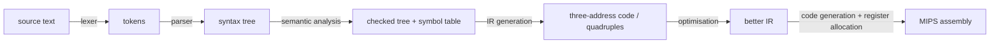
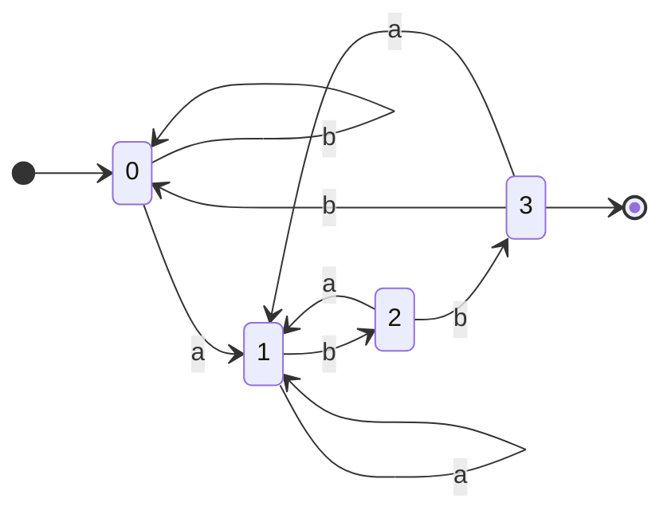

# NEY613 Compilers: study guide

**What this course is about:** how a program in a high-level language becomes machine code, one phase after
another. NEXUS has a complete compiler for a small language, **NexusLang**, down to MIPS assembly, and you can
stop it after any phase and look at what that phase produced.

Each section: **the point**, a **picture**, a **real example** (output from the tools), **where the code is**,
**check yourself**. Build first (see the [README](../../README.md)); commands run from the repository folder.



The running example ([examples/source_lang/tiny.nx](../../examples/source_lang/tiny.nx)):

```rust
fn main() -> int {
  var x: int = 2 + 3 * 4;
  return x;
}
```

Language reference: [docs/compiler/language_spec.md](../compiler/language_spec.md).

---

## 1. Foundations: grammars, automata, data structures

**The point:** *regular expressions* describe tokens and are recognised by finite automata (DFA);
*context-free grammars* describe syntax and are recognised by parsers (pushdown automata).
Regex -> NFA (Thompson) -> DFA (subset construction) -> minimal DFA.

```bash
build/bin/nexusc regex "(a|b)*abb" --match abb aabb ab
```

```text
minimal DFA: 4 states (start 0)
   0:  [b]->0  [a]->1
   1:  [a]->1  [b]->2
   2:  [a]->1  [b]->3
  *3:  [b]->0  [a]->1
match "abb": accept
match "aabb": accept
match "ab": reject
```



The compiler also needs classic data structures: a **hash table** for the symbol table, **trees** for the program,
**graphs** for control flow.

```bash
build/bin/nexusc tree "a(b(d e) c)"
build/bin/nexusc hash if else while x y count total
build/bin/nexusc graph examples/graphs/loop_nest.graph
```

```text
preorder:    a b d e c
inorder:     d b e a c
postorder:   d e b c a
entries 7, buckets 16, load factor 0.44, longest chain 1, rehashes 2, probes 2
edges: entry->outer(tree) outer->inner(tree) inner->body(tree) body->inner(back) inner->outer(back) outer->exit(tree)
strongly connected components: {exit} {outer inner body} {entry}
```

The *back* edges found by DFS are exactly the loops of the program (used again in [NEY709](NEY709.md)).

**Where the code is:** [src/compiler/formal/src/automata.cpp](../../src/compiler/formal/src/automata.cpp),
[src/compiler/foundations/src/foundations.cpp](../../src/compiler/foundations/src/foundations.cpp); worked examples on
paper in [examples/formal](../../examples/formal/README.md).

---

## 2. Lexical analysis

**The point:** the lexer groups characters into **tokens** (keyword, identifier, number, operator) and drops
spaces and comments. It is a DFA, written by hand or generated by **flex** from regular expressions.

```bash
build/bin/nexusc lex examples/source_lang/tiny.nx
```

```text
1:1  fn              "fn"
1:4  identifier      "main"
1:8  left_paren      "("
...
2:16  integer         "2"
2:18  plus            "+"
```

**Where the code is:** by hand: [src/compiler/frontend/src/lexer.cpp](../../src/compiler/frontend/src/lexer.cpp);
with flex: [flex_bison_lexer.l](../../src/compiler/experimental_parallel_parsing/src/flex_bison_lexer.l).

**Check yourself**
<details><summary>How does the lexer decide that "while1" is one identifier and not "while" + "1"?</summary>
Longest match: it keeps reading while the characters can still extend a token, and only then checks the
keyword table.
</details>

---

## 3. Syntax analysis: LL and LR parsing

**The point:** the parser builds the tree. **Top-down (LL):** start from the start symbol and predict which rule
to use from the next token; needs FIRST/FOLLOW sets and a grammar without left recursion.
**Bottom-up (LR):** shift tokens onto a stack and *reduce* when the top matches a rule's right side; handles
more grammars (left recursion is fine) and is what **bison** generates.

**LL(1):** after removing left recursion (`E -> T E2`, `E2 -> + T E2 | ε`, ...):

```bash
build/bin/nexusc grammar examples/grammars/expr_ll1.g first-follow
```

```text
nonterminal   nullable  FIRST / FOLLOW
E             no        FIRST = {(, num}  FOLLOW = {$, )}
E2            yes       FIRST = {+}  FOLLOW = {$, )}
T             no        FIRST = {(, num}  FOLLOW = {$, +, )}
T2            yes       FIRST = {*}  FOLLOW = {$, +, )}
F             no        FIRST = {(, num}  FOLLOW = {$, +, *, )}
```

**LR:** the classic left-recursive grammar, parsed step by step (stack | remaining input | action):

```bash
build/bin/nexusc grammar examples/grammars/expr.g slr "2 + 3 * 4"
```

```text
  0 | 2 + 3 * 4 $ | shift 6
  0 num 6 | + 3 * 4 $ | reduce F -> num
  0 F 3 | + 3 * 4 $ | reduce T -> F
  0 T 2 | + 3 * 4 $ | reduce E -> T
  0 E 1 | + 3 * 4 $ | shift 7
  ...
  0 E 1 + 7 T 13 | * 4 $ | shift 9          <- * binds tighter: shift, do not reduce E + T yet
  ...
  0 E 1 + 7 T 13 * 9 F 15 | $ | reduce T -> T * F
  0 E 1 + 7 T 13 | $ | reduce E -> E + T
accepted, synthesized value = 14
E  [val=14]
 |-- E  [val=2]
 |-- + '+'
 `-- T  [val=12]
     |-- T  [val=3]
     |-- * '*'
     `-- F  [val=4]
```

| table | states for this grammar | conflicts |
| --- | --- | --- |
| SLR(1) | 18 | 0 |
| LALR(1) | 18 | 0 |
| canonical LR(1) | 34 | 0 |

LALR(1) merges LR(1) states with the same core: the power of LR(1) for most grammars at the size of SLR.
A grammar with a real ambiguity shows a conflict, e.g. the dangling `else`:

```bash
build/bin/nexusc grammar examples/grammars/dangling_else.g slr
```

```text
state 6:  $:r1  else:s7/r1!          <- shift/reduce conflict on "else"
```

(bison resolves it by shifting: the `else` belongs to the nearest `if`.)

**Where the code is:** recursive descent by hand [src/compiler/frontend/src/parser.cpp](../../src/compiler/frontend/src/parser.cpp);
table construction for LL(1), LR(0), SLR, LR(1), LALR [src/compiler/formal/src/grammar.cpp](../../src/compiler/formal/src/grammar.cpp);
bison grammar [flex_bison_parser.y](../../src/compiler/experimental_parallel_parsing/src/flex_bison_parser.y).

**Check yourself**
<details><summary>Why can't an LL(1) parser use E -> E + T?</summary>
Left recursion: to expand E it would predict E -> E + T and again expand E without consuming a token, forever.
</details>

---

## 4. Semantic analysis and attribute grammars

**The point:** a tree can be syntactically correct and still wrong: undefined names, wrong types. The
semantic analyser walks the tree with a **symbol table** (scopes) and computes **attributes**: *synthesized*
ones flow up the tree (the value 14 above), *inherited* ones flow down (the type of a declaration to its
variables).

```bash
build/bin/nexusc check examples/source_lang/invalid_semantics.nx
```

```text
invalid_semantics.nx:2:16: error: initializer for 'x' has type 'bool' but variable type is 'int'
  var x: int = flag;
               ^
invalid_semantics.nx:3:7: error: if condition must have type 'bool'
invalid_semantics.nx:4:12: error: return expression has type 'bool' but function expects 'int'
invalid_semantics.nx:6:10: error: use of undefined identifier 'missing'
```

Knuth's classic example, the value of a binary number, needs attributes flowing in both directions:

```bash
build/bin/nexusc attr knuth 1101.01
```

```text
one left-to-right pass: cannot compute L#14.scale: L#14.len is not available yet
value: 13.25
```

It is not L-attributed, so one left-to-right pass fails; evaluating along the *dependency graph* works.

**Where the code is:** [src/compiler/semantics/src/semantic_analyzer.cpp](../../src/compiler/semantics/src/semantic_analyzer.cpp),
[src/compiler/formal/src/attributes.cpp](../../src/compiler/formal/src/attributes.cpp).

---

## 5. Intermediate code: syntax trees and quadruples

**The point:** the tree is lowered to simple *three-address* instructions `result = arg1 op arg2`, stored as
**quadruples**, grouped into basic blocks. Every later phase works on this form.

```bash
build/bin/nexusc ast examples/source_lang/tiny.nx
build/bin/nexusc quads examples/source_lang/tiny.nx
```

```text
Program
  Function main() -> int
    Block
      VarDecl x: int
        Binary plus
          Integer 2
          Binary star
            Integer 3
            Integer 4
      Return
        Identifier x

  #    op          arg1          arg2          result
  0    =           2                           %0
  1    =           3                           %1
  2    =           4                           %2
  3    mul         %1            %2            %3
  4    add         %0            %3            %4
  5    =           %4                          x
  6    =           x                           %5
  7    return      %5
```

The tree already encodes precedence (`*` is below `+`), so the quadruples compute `3 * 4` first.

**Where the code is:** [src/compiler/ir/src/lowering.cpp](../../src/compiler/ir/src/lowering.cpp); IR description
[docs/compiler/ir.md](../compiler/ir.md).

---

## 6. Code generation: instruction selection and register allocation

**The point:** each IR instruction becomes one or a few MIPS instructions (*instruction selection*), and the
unlimited temporaries `%0, %1, ...` must be mapped to the 32 real registers (*register allocation*). Linear
scan sorts the *live intervals* and gives each a free register; if none is free, a value is *spilled* to memory.

```bash
build/bin/nexusc analysis regalloc examples/source_lang/factorial.nx
```

```text
func factorial linear-scan:
  intervals: 11, in registers: 11, spilled: 0, callee-saved used: 1
  n [0, 14] crosses-call -> $s0
  %0 [2, 4] -> $t4
  %1 [3, 4] -> $t5
  ...
```

`n` lives across the recursive call, so it gets a callee-saved `$s0`; short temporaries reuse `$t4-$t6`.
The effect on factorial (from `nexusc isa`, see [NEY221](NEY221.md)): 203 -> 145 instructions and 67 -> 17
memory reads.

```bash
build/bin/nexusc compile examples/source_lang/tiny.nx -S --regalloc linear-scan -o tiny.s
build/bin/mips-sim run tiny.s --mode functional
```

**Where the code is:** [src/compiler/backend_mips/src/codegen.cpp](../../src/compiler/backend_mips/src/codegen.cpp),
[src/compiler/backend_mips/src/regalloc.cpp](../../src/compiler/backend_mips/src/regalloc.cpp).

**Check yourself**
<details><summary>Why must a value that lives across a call go in an $s register (or be saved)?</summary>
The called function may overwrite every $t register; $s registers are preserved by the callee.
</details>

---

## 7. A first look at optimisation

**The point:** a better program with the same result: **constant folding** (`2 + 3 * 4` -> `14` at compile
time), dead-code elimination, **loop unrolling** (fewer branches per useful instruction).

```bash
build/bin/nexusc opt examples/source_lang/fixed_trip_unroll.nx --pass unroll
build/bin/nexusc analysis sccp tests/programs/constant_branches.nx
```

All of this is developed fully in [NEY709 Advanced Compiler Topics](NEY709.md).

---

**Next:** [NEY709](NEY709.md) analyses and optimises the code; [NEY221](NEY221.md) explains the MIPS code it produces.
