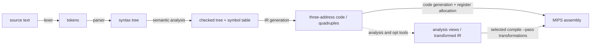
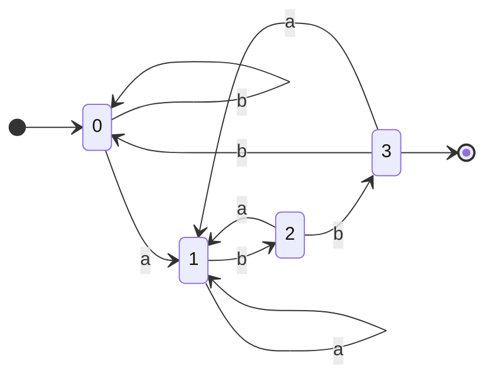

# NEY613 Compilers: study guide

**What this course is about:** how a program in a high-level language becomes machine code, one phase after
another. NEXUS has a complete compiler for a small language, **NexusLang**, down to MIPS assembly, and you can
stop it after any phase and look at what that phase produced.

Each section: **the point**, a **picture**, a **real example** (output from the tools), **where the code is**. Build first (see the [README](../../README.md)); commands run from the repository folder.

**Connection to the whole:** turn a source computation into IR and MIPS instructions. NEY709 reasons
about those IR values; NEY221 explains the target instructions; EY321 executes them in a datapath.
See [one sum through the frontend and backend](../FLOW.md#1-express-the-computation--ney613).



The running example ([examples/source_lang/tiny.nx](../../examples/source_lang/tiny.nx)):

```rust
fn main() -> int {
  var x: int = 2 + 3 * 4;
  return x;
}
```

Language reference: [docs/compiler/language_spec.md](../compiler/language_spec.md).

### Follow this one program through every phase

```bash
build/bin/nexusc lex examples/source_lang/tiny.nx
build/bin/nexusc ast examples/source_lang/tiny.nx
build/bin/nexusc check examples/source_lang/tiny.nx
build/bin/nexusc quads examples/source_lang/tiny.nx
build/bin/nexusc ir examples/source_lang/tiny.nx
build/bin/nexusc compile examples/source_lang/tiny.nx -S -o tiny.s
build/bin/mips-sim run tiny.s --mode functional
```

The answer is 14 throughout: tokens describe the spelling, the tree describes grouping, types describe
valid operations, IR describes computation, and MIPS describes executable machine operations.
With `(2 + 3) * 4` the result is 20: the parentheses change the tree, and with it the order of the
operations. All file-generating commands in this guide run from the repository root.

---

## 1. Foundations: grammars, automata, data structures

**The point:** *regular expressions* describe tokens and are recognised by finite automata (DFA);
*context-free grammars* describe syntax and are recognised by parsers (pushdown automata).
Regex -> NFA (Thompson) -> DFA (subset construction) -> minimal DFA.

### A language, a grammar and a recogniser

An **alphabet** is a set of symbols; a **language** is a set of finite strings over it.
A grammar generates strings with production rules. Terminals are input symbols, nonterminals name
structures, the start symbol names a whole input, and epsilon means the empty string.
A finite automaton remembers one state. A pushdown automaton also has an unbounded stack,
which is needed for arbitrary nesting such as balanced parentheses.

For the language `a b*`, draw two states: start q0, accepting q1; `q0 --a--> q1`, `q1 --b--> q1`.
An absent transition rejects. `a` and `abb` are accepted; `b` and `aba` are rejected.
An NFA can have several next states and epsilon moves; a DFA has one next state per symbol.
Subset construction makes each DFA state a set of NFA states after epsilon closure.
Minimisation merges states that no future input suffix can distinguish.

```bash
build/bin/nexusc regex "ab*" --match a abb b aba
```

This is `Dfa::matches` from [automata.cpp](../../src/compiler/formal/src/automata.cpp):

```cpp
std::size_t state = start;
for (const char ch : text) {
  const auto found = transitions[state].find(ch);
  if (found == transitions[state].end()) {
    return false;
  }
  state = found->second;
}
return accepting[state];
```

The loop consumes one character and updates the state. Acceptance is tested **after the complete
input**, not when an accepting state is first visited. With `ab+` instead, `a` is rejected, because `+` requires one or more repetitions, while `*` allows zero.

<details><summary>Further automata example: recognise strings ending in abb</summary>

```bash
build/bin/nexusc regex "(a|b)*abb" --match abb aabb ab
```

```text
minimal DFA: 4 states (start 0)
   0:  [b]->0  [a]->1
   1:  [a]->1  [b]->2
   2:  [a]->1  [b]->3
  *3:  [b]->0  [a]->1
match "abb": accept
match "aabb": accept
match "ab": reject
```


</details>

The compiler also needs classic data structures: a **hash table** for the symbol table, **trees** for the program,
**graphs** for control flow.

A tree has one parent per non-root node; a graph can have joins and cycles. Preorder visits a node
before its children; postorder visits children first, useful for evaluating expressions. DFS follows
a path deeply, BFS proceeds by distance from the start. A hash table maps names to declarations;
collisions need handling, and a scope stack makes inner declarations shadow outer ones.
A **closure** repeatedly adds consequences until nothing new is found: from reachable state A,
add its successors, then their successors. The same pattern appears in automata and parsing.

```bash
build/bin/nexusc tree "a(b(d e) c)"
build/bin/nexusc hash if else while x y count total
build/bin/nexusc graph examples/graphs/loop_nest.graph
```

```text
preorder:    a b d e c
inorder:     d b e a c
postorder:   d e b c a
entries 7, buckets 16, load factor 0.44, longest chain 1, rehashes 2, probes 2
edges: entry->outer(tree) outer->inner(tree) inner->body(tree) body->inner(back) inner->outer(back) outer->exit(tree)
strongly connected components: {exit} {outer inner body} {entry}
```

DFS back edges reveal cycles. For the natural loops used in [NEY709](NEY709.md), also check that
the target dominates the source; arbitrary graph cycles are not automatically single-entry natural loops.

Looking up `x` stops at the nearest enclosing declaration (see the
[scope example](../../examples/formal/scope_graph_and_hash_tables.md)); without the inner `x`, lookup would find
the outer binding, a different storage location.

**Where the code is:** [src/compiler/formal/src/automata.cpp](../../src/compiler/formal/src/automata.cpp),
[src/compiler/foundations/src/foundations.cpp](../../src/compiler/foundations/src/foundations.cpp); worked examples on
paper in [examples/formal](../../examples/formal/README.md).

---

## 2. Lexical analysis

**The point:** the lexer groups characters into **tokens** (keyword, identifier, number, operator) and drops
spaces and comments. It is a DFA, written by hand or generated by **flex** from regular expressions.

A token has a **kind** (`identifier`), a **lexeme** (`count`) and a source location. The lexer
does not decide whether `count` was declared or whether addition is type-correct. For `x = 12 + y`,
its output is `identifier, =, integer, +, identifier`.
In `Lexer::scan_token` in [lexer.cpp](../../src/compiler/frontend/src/lexer.cpp), read just this branch:

```cpp
if (is_identifier_start(character)) {
  std::string lexeme(1, character);
  while (is_identifier_continue(peek())) {
    lexeme.push_back(advance());
  }
  const auto keyword = keywords.find(lexeme);
  emit(keyword == keywords.end() ? TokenKind::Identifier : keyword->second, std::move(lexeme), begin);
  return;
}
```

It consumes the longest identifier before testing whether the whole spelling is a keyword.
`std::move` transfers the string to the token; it does not change the recognition rule.
So `while1` is one identifier, while `while` alone is a keyword: a variable named `while` would be rejected
by the parser.

```bash
build/bin/nexusc lex examples/source_lang/tiny.nx
```

```text
1:1  fn              "fn"
1:4  identifier      "main"
1:8  left_paren      "("
...
2:16  integer         "2"
2:18  plus            "+"
```

**Where the code is:** by hand: [src/compiler/frontend/src/lexer.cpp](../../src/compiler/frontend/src/lexer.cpp);
with flex: [flex_bison_lexer.l](../../src/compiler/experimental_parallel_parsing/src/flex_bison_lexer.l).

---

## 3. Syntax analysis: LL and LR parsing

**The point:** the parser builds the tree. **Top-down (LL):** start from the start symbol and predict which rule
to use from the next token; needs FIRST/FOLLOW sets and a grammar without left recursion.
**Bottom-up (LR):** shift tokens onto a stack and *reduce* when the top matches a rule's right side; handles
more grammars (left recursion is fine) and is what **bison** generates.

### Construct one small LL(1) table yourself

Use [addition.g](../../examples/basics/compiler/addition.g):

```text
E    -> num Tail
Tail -> + num Tail | epsilon
```

`FIRST(A)` contains terminals that can start strings derived from A; `FOLLOW(A)` contains terminals
that can come immediately after A. `$` means end of input. Here:

| Nonterminal | FIRST | FOLLOW | Table on `num` | Table on `+` | Table on `$` |
| --- | --- | --- | --- | --- | --- |
| E | num | $ | E → num Tail | error | error |
| Tail | +, epsilon | $ | error | Tail → + num Tail | Tail → epsilon |

Fill a rule in FIRST's columns; for an epsilon rule, use FOLLOW's columns. Two rules in one cell
are a conflict. For `2+3`, expand E, match 2, expand Tail, match + and 3, then choose epsilon at `$`.

```bash
build/bin/nexusc grammar examples/basics/compiler/addition.g first-follow
build/bin/nexusc grammar examples/basics/compiler/addition.g ll1 "2 + 3"
```

`2 +` is a syntax error (the number is missing), and `2 + 3 + 4` gives 9. Left factoring delays a decision until enough input is known; eliminating left recursion allows
recursive descent to consume input instead of recursing forever.

For precedence, `parse_additive` in [parser.cpp](../../src/compiler/frontend/src/parser.cpp) first calls
`parse_multiplicative`; its loop then consumes `+`/`-` and builds a binary node around each right operand.
Consequently `2+3*4` builds `+(2, *(3,4))`. A concrete parse tree also contains grammar punctuation;
an AST keeps the structure needed by later phases.

**LL(1):** after removing left recursion (`E -> T E2`, `E2 -> + T E2 | epsilon`, ...):

```bash
build/bin/nexusc grammar examples/grammars/expr_ll1.g first-follow
```

```text
nonterminal   nullable  FIRST / FOLLOW
E             no        FIRST = {(, num}  FOLLOW = {$, )}
E2            yes       FIRST = {+}  FOLLOW = {$, )}
T             no        FIRST = {(, num}  FOLLOW = {$, +, )}
T2            yes       FIRST = {*}  FOLLOW = {$, +, )}
F             no        FIRST = {(, num}  FOLLOW = {$, +, *, )}
```

**LR:** the classic left-recursive grammar, parsed step by step (stack | remaining input | action):

```bash
build/bin/nexusc grammar examples/grammars/expr.g slr "2 + 3 * 4"
```

```text
  0 | 2 + 3 * 4 $ | shift 6
  0 num 6 | + 3 * 4 $ | reduce F -> num
  0 F 3 | + 3 * 4 $ | reduce T -> F
  0 T 2 | + 3 * 4 $ | reduce E -> T
  0 E 1 | + 3 * 4 $ | shift 7
  ...
  0 E 1 + 7 T 13 | * 4 $ | shift 9          <- * binds tighter: shift, do not reduce E + T yet
  ...
  0 E 1 + 7 T 13 * 9 F 15 | $ | reduce T -> T * F
  0 E 1 + 7 T 13 | $ | reduce E -> E + T
accepted, synthesized value = 14
E  [val=14]
 |-- E  [val=2]
 |-- + '+'
 `-- T  [val=12]
     |-- T  [val=3]
     |-- * '*'
     `-- F  [val=4]
```

| table | states for this grammar | conflicts |
| --- | --- | --- |
| SLR(1) | 18 | 0 |
| LALR(1) | 18 | 0 |
| canonical LR(1) | 34 | 0 |

LR parsing uses an ACTION table to shift, reduce or accept and a GOTO table after reductions.
LR(0) uses no lookahead in reduction items, SLR uses FOLLOW sets, canonical LR(1) tracks lookahead
per item, and LALR merges LR(1) states with the same core. Merging saves space but can introduce
reduce/reduce conflicts; LALR and canonical LR(1) do not recognise exactly the same grammar class.
A grammar with a real ambiguity shows a conflict, e.g. the dangling `else`:

```bash
build/bin/nexusc grammar examples/grammars/dangling_else.g slr
```

```text
state 6:  $:r1  else:s7/r1!          <- shift/reduce conflict on "else"
```

(bison resolves it by shifting: the `else` belongs to the nearest `if`.)

### Hand-written versus generated frontend

Flex turns token regex rules into a scanner. Bison turns grammar rules and semantic actions into a
parser: a reduction can build an AST node or synthesise a value. NEXUS builds these generated sources
with CMake, alongside its hand-written frontend.

```bash
build/bin/nexusc experimental-parse examples/source_lang/tiny.nx --mode bison-lr
```

This generated frontend is a parsing demonstration; the normal `compile` command uses the hand-written
frontend. The `.l` file decides token spelling (the number and identifier rules); the `.y` file decides grouping
(the expression productions).

**Where the code is:** recursive descent by hand [src/compiler/frontend/src/parser.cpp](../../src/compiler/frontend/src/parser.cpp);
table construction for LL(1), LR(0), SLR, LR(1), LALR [src/compiler/formal/src/grammar.cpp](../../src/compiler/formal/src/grammar.cpp);
bison grammar [flex_bison_parser.y](../../src/compiler/experimental_parallel_parsing/src/flex_bison_parser.y).

---

## 4. Semantic analysis and attribute grammars

**The point:** a tree can be syntactically correct and still wrong: undefined names, wrong types. The
semantic analyser walks the tree with a **symbol table** (scopes) and computes **attributes**: *synthesized*
ones flow up the tree (the value 14 above), *inherited* ones flow down (the type of a declaration to its
variables).

The symbol table connects each use to its declaration and type. For `var x: int = flag`, lookup may
successfully find `flag`, yet type checking still rejects a boolean initializer for an integer.
Lexical, syntax and semantic errors belong to different phases: an unknown character, a missing `;`,
and an undeclared name are three different failures.

In a **synthesized** attribute, `E -> E1 + T` computes `E.val = E1.val + T.val` from children.
An **inherited** attribute can carry an enclosing declaration's type down to its names.
Draw an edge from each input attribute to the attribute that needs it; evaluate in dependency order.
S-attributed grammars use synthesized attributes only; L-attributed grammars allow restricted
inherited dependencies that a left-to-right traversal can satisfy.

```bash
build/bin/nexusc check examples/source_lang/invalid_semantics.nx
```

```text
invalid_semantics.nx:2:16: error: initializer for 'x' has type 'bool' but variable type is 'int'
  var x: int = flag;
               ^
invalid_semantics.nx:3:7: error: if condition must have type 'bool'
invalid_semantics.nx:4:12: error: return expression has type 'bool' but function expects 'int'
invalid_semantics.nx:6:10: error: use of undefined identifier 'missing'
```

Knuth's classic example, the value of a binary number, needs attributes flowing in both directions:

```bash
build/bin/nexusc attr knuth 1101.01
```

```text
one left-to-right pass: cannot compute L#14.scale: L#14.len is not available yet
value: 13.25
```

It is not L-attributed, so one left-to-right pass fails; evaluating along the *dependency graph* works.

Each error is found by a separate check: fixing the initializer does not fix the wrong return type,
because each check compares the type of one expression with what its context expects.

**Where the code is:** [src/compiler/semantics/src/semantic_analyzer.cpp](../../src/compiler/semantics/src/semantic_analyzer.cpp),
[src/compiler/formal/src/attributes.cpp](../../src/compiler/formal/src/attributes.cpp).

---

## 5. Intermediate code: syntax trees and quadruples

**The point:** the tree is lowered to simple *three-address* instructions `result = arg1 op arg2`, stored as
**quadruples**, grouped into basic blocks. Every later phase works on this form.

```bash
build/bin/nexusc ast examples/source_lang/tiny.nx
build/bin/nexusc quads examples/source_lang/tiny.nx
```

```text
Program
  Function main() -> int
    Block
      VarDecl x: int
        Binary plus
          Integer 2
          Binary star
            Integer 3
            Integer 4
      Return
        Identifier x

  #    op          arg1          arg2          result
  0    =           2                           %0
  1    =           3                           %1
  2    =           4                           %2
  3    mul         %1            %2            %3
  4    add         %0            %3            %4
  5    =           %4                          x
  6    =           x                           %5
  7    return      %5
```

The tree already encodes precedence (`*` is below `+`), so the quadruples compute `3 * 4` first.

A quadruple stores `(operator, argument1, argument2, result)`. A unary operation needs one argument;
a constant has no input value. A basic block is a straight-line sequence ending in a jump, branch
or return. `if` introduces two paths and a join; `while` introduces a condition and a back edge.

```bash
build/bin/nexusc ir examples/basics/compiler/diamond.nx
```

The two assignments to `y` are in the two branches, and the block after the join reads it. With `false` in
`main`, the run follows the other path, but both paths still appear in the unoptimised IR.

**Where the code is:** [src/compiler/ir/src/lowering.cpp](../../src/compiler/ir/src/lowering.cpp); IR description
[docs/compiler/ir.md](../compiler/ir.md).

---

## 6. Code generation: instruction selection and register allocation

**The point:** each IR instruction becomes one or a few MIPS instructions (*instruction selection*), and the
unlimited temporaries `%0, %1, ...` must be mapped to the 32 real registers (*register allocation*). Linear
scan sorts the *live intervals* and gives each a free register; if none is free, a value is *spilled* to memory.

For `t1=a+b; t2=t1*c; return t2`, `t1` is needed until the multiply reads it. Its register can then
be reused if nothing else needs that value. A value is **live** if it may be used before being
overwritten. Overlapping live intervals compete for registers; spilling inserts loads/stores.
Not all 32 registers are available to the allocator: some are reserved or required by the calling convention.

In `emit_binary` in [codegen.cpp](../../src/compiler/backend_mips/src/codegen.cpp), this actual branch
selects an instruction after obtaining registers for the inputs and result:

```cpp
case BinaryOp::Add:
  mips::assembler_support::append_instruction(
      program, "addu", {reg(target), reg(lhs), reg(rhs)});
  break;
```

Other IR operations need several instructions: multiplication produces HI/LO, then `mflo` reads the
low result. A call must place arguments and preserve live values according to the convention.

```bash
build/bin/nexusc analysis regalloc examples/source_lang/tiny.nx
build/bin/nexusc compile examples/source_lang/tiny.nx -S --regalloc linear-scan -o tiny-registers.s
build/bin/mips-sim run tiny-registers.s --mode functional --stats
```

Both this version and `tiny.s` from the opening walkthrough return 14; the difference is the stack loads and
stores that disappear. Optimisation is about equivalent computation with changed cost.

<details><summary>Larger example: values live across a recursive call</summary>

```bash
build/bin/nexusc analysis regalloc examples/source_lang/factorial.nx
```

```text
func factorial linear-scan:
  intervals: 11, in registers: 11, spilled: 0, callee-saved used: 1
  n [0, 14] crosses-call -> $s0
  %0 [2, 4] -> $t4
  %1 [3, 4] -> $t5
  ...
```

`n` lives across the recursive call, so it gets a callee-saved `$s0`; short temporaries reuse `$t4-$t6`.
The effect on factorial (from `nexusc isa`, see [NEY221](NEY221.md)): 203 -> 145 instructions and 67 -> 17
memory reads.
</details>

**Where the code is:** [src/compiler/backend_mips/src/codegen.cpp](../../src/compiler/backend_mips/src/codegen.cpp),
[src/compiler/backend_mips/src/regalloc.cpp](../../src/compiler/backend_mips/src/regalloc.cpp).

---

## 7. A first look at optimisation

**The point:** a better program with the same result: **constant folding** (`2 + 3 * 4` -> `14` at compile
time), dead-code elimination, **loop unrolling** (fewer branches per useful instruction).

```bash
build/bin/nexusc opt examples/source_lang/fixed_trip_unroll.nx --pass unroll
build/bin/nexusc analysis sccp tests/programs/constant_branches.nx
```

All of this is developed fully in [NEY709 Advanced Compiler Topics](NEY709.md).

**Before/after:** `x=2+3*4; return x` can become `return 14`. An unused pure arithmetic result can be
deleted; a store to an output device cannot simply be deleted because no variable reads it.
Replacing `a/a` by 1 requires a nonzero `a` and compatible arithmetic rules. Correctness
conditions belong beside an optimisation, not just its shorter output.

---

## How this course connects

- **The target:** the MIPS instructions, registers and calling convention of [NEY221](NEY221.md).
- **The machine:** the generated code runs on the CPUs of [EY321](EY321.md) and [NEY606](NEY606.md); register
  allocation, for example, decides how many loads and stores reach their caches.
- **After it:** [NEY709](NEY709.md) works on the same IR: control flow, data flow, SSA and loop transformations.

---

**Next:** [NEY709](NEY709.md) analyses and optimises the code; [NEY221](NEY221.md) explains the MIPS code it produces.
