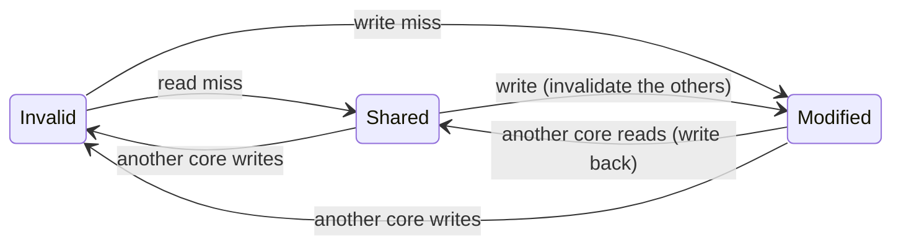
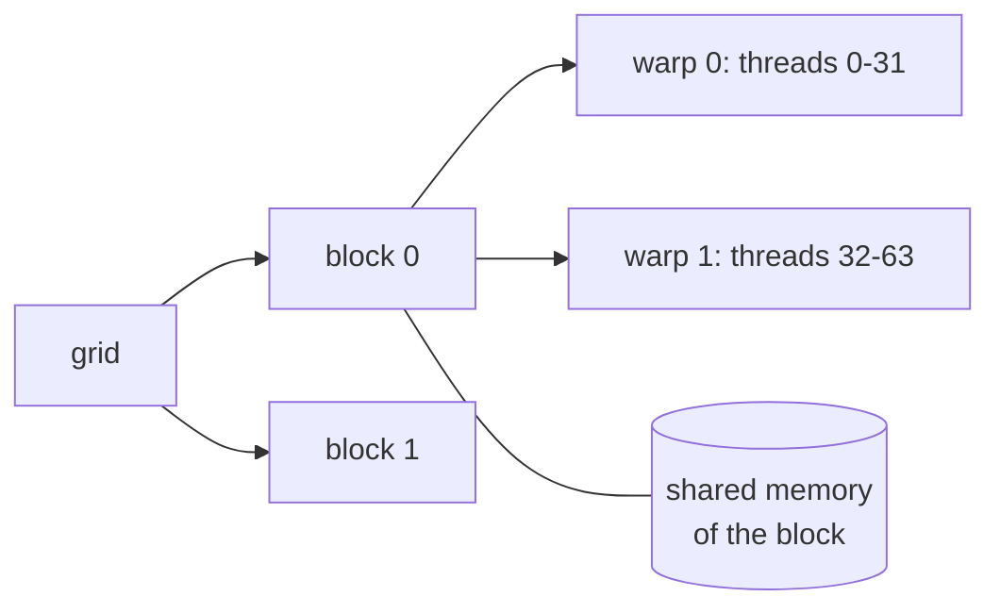

# NEY704 Parallel Systems and Parallel Programming: study guide

**What this course is about:** many processors working on one problem: how they share (or do not share) memory,
how they keep caches consistent, how they communicate, and how we program them (OpenMP, MPI, SIMD, GPUs).

Each section: **the point**, a **picture**, a **real example** (output from the tools), **where the code is**,
**check yourself**. Build first (see the [README](../../README.md)); commands run from the repository folder.

---

## 1. Kinds of parallel machines (Flynn)

**The point:** classify by how many instruction streams and data streams run at once.

| | single data | multiple data |
| --- | --- | --- |
| **single instruction** | SISD: a classic CPU | SIMD: vector units, SSE/AVX, GPU warps |
| **multiple instruction** | MISD: (rare) | MIMD: multicores, clusters |

And by memory: **shared memory** (all cores load/store one address space: OpenMP, threads) or **distributed
memory** (each node has private memory; data moves only in messages: MPI). Cores can be identical
(*symmetric*) or different (*asymmetric*, big.LITTLE; try `--core-cpi 1,1,4,4` in the parallel model).

---

## 2. Multithreading: hide stalls with other threads

**The point:** while one thread waits for memory, run another.

```
cycle:      1 2 3 4 5 6 7 8 9 ...
coarse      A A A A(miss) - B B B B B ...   switch only on a long stall
fine        A B A B A B A B A ...           switch every cycle
SMT         AB AB AB ...                     several threads issue in the same cycle
```

**Example:** a memory-bound thread (`stream.s`, a miss on every load) with a compute thread (`compute.s`).

```bash
build/bin/mips-sim mt single examples/multithreading/stream.s examples/multithreading/compute.s
build/bin/mips-sim mt fine   examples/multithreading/stream.s examples/multithreading/compute.s
```

| policy | cycles | switches |
| --- | --- | --- |
| single (one after the other) | 6011 | 0 |
| coarse-grained | 5997 | 2 |
| fine-grained | 5174 | 0 |
| SMT | 5174 | 0 |

Coarse-grained switches at the first miss to the compute thread, but that thread never stalls, so it runs to
its end and hides only one miss. Fine-grained interleaves every cycle and hides many misses.

**Where the code is:** [src/sim/advanced/src/multithreading.cpp](../../src/sim/advanced/src/multithreading.cpp).

---

## 3. Shared memory: cache coherence

**The point:** each core caches the same address; when one core writes, the other copies must be
*invalidated* (or updated). **Snooping:** every cache watches a shared bus (simple, does not scale).
**Directory:** a table per memory block records who has a copy and sends messages only to them (scales).



```bash
build/bin/mips-sim run tests/golden/parallel_coherence_demo.s --mode parallel --cores 2 --coherence snoop --stats
```

```text
coherence[snoop]: core0 invalidated 1 sharer(s) at address 0 penalty=3
Invalidations: 1
```

Same with `--coherence directory-lite`. **False sharing:** two cores write *different* words of the *same*
line and keep invalidating each other, although they share no data.

**Where the code is:** [src/sim/parallel/src/model.cpp](../../src/sim/parallel/src/model.cpp).

**The same protocol in hardware (Verilog).** [src/hdl/multicore/nexus_msi_system.v](../../src/hdl/multicore/nexus_msi_system.v)
is a 4-core memory system: four private caches, a shared bus with a round-robin arbiter, and MSI snooping. One
cache wins the bus per cycle; the others watch the transaction and flush or invalidate their copies. Its
testbench sends 400 random reads and writes per core to a few shared addresses and checks every cycle that each
read returns the last value written and that a line is never Modified in two caches.

```bash
python scripts/test_hdl.py msi        # needs Icarus Verilog
```

```text
4 cores x 400 requests in 1335 cycles: 266 hits, 1334 bus transactions, 492 invalidations, 378 flushes, 232 writebacks
PASS
```

So much sharing means few hits: every write takes the line away from everyone else. Try `REQUESTS`,
`SHARED` (how many addresses the cores fight over) and `LINES` in the testbench and watch the counters change.
If you delete the invalidation or the flush in the Verilog, the testbench reports the broken invariant at once.

---

## 4. Memory consistency and synchronisation

**The point:** coherence is about one address; *consistency* is about the *order* of accesses to different
addresses. **Sequential consistency (SC):** all cores see one interleaving of all accesses in program order.
Real CPUs relax it (store buffers), so a program must use **fences**, **locks** and **barriers**, built on
atomic instructions (`ll/sc`, test-and-set).

**Example:** core 0 writes data then a flag; core 1 waits for the flag and reads the data.

```bash
build/bin/mips-sim run tests/golden/parallel_consistency_demo.s --mode parallel --cores 2 --consistency weak-lite --stats
```

```text
consistency[weak-lite]: core0 buffered store address=0 value=1
consistency[weak-lite]: core0 buffered store address=4 value=1
consistency[weak-lite]: drain core0 address=0 value=1
consistency[weak-lite]: drain core0 address=4 value=1
```

Under weak ordering the stores wait in a store buffer; the program is correct only because the buffer drains
in order before core 1 can see the flag.

**Scaling with a lock and a barrier:** [examples/parallel/spmd_sum.s](../../examples/parallel/spmd_sum.s) gives each
core 8 numbers to add, then each adds its partial sum to a shared total under a lock and waits at a barrier.

```bash
build/bin/mips-sim run examples/parallel/spmd_sum.s --mode parallel --cores 8 --stats
```

| cores | numbers added | cycles | invalidations |
| --- | --- | --- | --- |
| 1 | 8 | 40 | 0 |
| 2 | 16 | 53 | 1 |
| 4 | 32 | 71 | 3 |
| 8 | 64 | 107 | 7 |

8 times more work in only 2.7 times the time: the loop runs in parallel, but the lock lets one core at a time
update the total, and that serial part grows with the cores (Amdahl again).

**Check yourself**
<details><summary>Why is "x = x + 1" on a shared x wrong without a lock?</summary>
It is a load, an add and a store. Two cores can both load the old value and both store old+1: one increment
is lost.
</details>

---

## 5. Programming shared memory: OpenMP

**The point:** add a directive and the compiler splits the loop among threads; `reduction` gives each thread a
private partial sum and combines them at the end.

```cpp
#pragma omp parallel for reduction(+ : total) schedule(static)
for (std::ptrdiff_t index = 0; index < static_cast<std::ptrdiff_t>(size); ++index) {
  total += static_cast<long long>((index % 7) + 1);
}
```

Full program: [benchmarks/openmp/openmp_bench.cpp](../../benchmarks/openmp/openmp_bench.cpp) (vector add, reduction,
matrix multiply). It is built when the compiler supports OpenMP (gcc, clang).

---

## 6. Programming distributed memory: MPI

**The point:** the same program runs as P processes (*ranks*); each computes on its own data and they exchange
**messages**. Collective operations (broadcast, reduce, allreduce) are built from point-to-point messages.

```cpp
long long local = 0;
for (int index = 0; index < size; ++index) local += (rank + 1) * (index + 1);
MPI_Reduce(&local, &global, 1, MPI_LONG_LONG, MPI_SUM, 0, MPI_COMM_WORLD);   // rank 0 gets the sum
```

Full program: [benchmarks/mpi/mpi_bench.cpp](../../benchmarks/mpi/mpi_bench.cpp), run with
`mpiexec -n 4 build/bin/mpi-bench --kernel all`.

**Cost of a message:** `time = alpha + beta x words` (start-up latency + per-word cost). A binomial-tree
broadcast needs log2(P) rounds instead of P-1 sends, but each round pays alpha again:

```bash
build/bin/mips-sim msg bcast-linear --nodes 16 --topology hypercube --words 256
build/bin/mips-sim msg bcast-tree   --nodes 16 --topology hypercube --words 256
```

| message size | linear broadcast | tree broadcast |
| --- | --- | --- |
| 4 words | **290** cycles | 316 cycles |
| 256 words | 4070 cycles | **1324** cycles |

Short messages: the root's 15 cheap sends beat 4 rounds of latency. Long messages: the tree wins because the
root no longer injects all the data alone.

**Where the code is:** [src/sim/parallel/src/message_passing.cpp](../../src/sim/parallel/src/message_passing.cpp).

---

## 7. Vector computers and SIMD

**The point:** one instruction operates on a whole vector. Long vectors are processed in pieces of at most
MVL elements (**strip-mining**); **chaining** starts a dependent vector operation as soon as the first element
is ready; more **lanes** process several elements per cycle.

```bash
build/bin/mips-sim vector examples/vector/daxpy.vasm --n 64
build/bin/mips-sim vector examples/vector/daxpy.vasm --n 64 --no-chaining
build/bin/mips-sim vector examples/vector/daxpy.vasm --n 64 --lanes 4
```

| configuration | cycles |
| --- | --- |
| chaining, 1 lane | 208 |
| no chaining | 303 |
| chaining, 4 lanes | 66 |

Modern CPUs have short-vector SIMD units (SSE/AVX). The same vector add with SSE intrinsics, 4 floats at a time:

```cpp
const __m128 va = _mm_loadu_ps(&a[index]);
const __m128 vb = _mm_loadu_ps(&b[index]);
_mm_storeu_ps(&c[index], _mm_add_ps(va, vb));
```

**Where the code is:** [src/sim/vector/src/model.cpp](../../src/sim/vector/src/model.cpp),
[benchmarks/simd/simd_bench.cpp](../../benchmarks/simd/simd_bench.cpp).

---

## 8. GPUs and their programming

**The point:** a GPU runs thousands of threads in groups of 32 (**warps**) that execute the same instruction
(SIMT). Two rules decide performance:

1. **No divergence:** if threads of a warp take different branches, both paths run one after the other.
2. **Coalesced memory:** neighbouring threads should read neighbouring addresses, so one transaction serves the
   whole warp.



```bash
build/bin/mips-sim run examples/gpu/coalesced.s --mode simt --threads 64 --stats
build/bin/mips-sim run examples/gpu/strided.s   --mode simt --threads 64 --stats
```

| example | result |
| --- | --- |
| coalesced reads | 4 memory transactions (1 per request) |
| strided reads | 128 memory transactions (32 per request) |
| uniform loop (`uniform.nx`) | SIMD efficiency 100% |
| Collatz loop, different trip count per thread (`collatz.nx`) | SIMD efficiency 10.4%, 74 divergent branches |
| shared-memory bank conflicts (`bank_conflict.s`) | 62 extra cycles for 2 requests |

The CUDA reduction in [benchmarks/gpu_optional/gpu_optional_bench.cu](../../benchmarks/gpu_optional/gpu_optional_bench.cu)
uses shared memory and barriers exactly like `block_reduce.s`:

```cuda
__shared__ int partial[128];
partial[tid] = index < count ? input[index] : 0;
__syncthreads();
for (int stride = blockDim.x / 2; stride > 0; stride >>= 1) {
  if (tid < stride) partial[tid] += partial[tid + stride];
  __syncthreads();
}
```

**Where the code is:** [src/sim/simt/src/model.cpp](../../src/sim/simt/src/model.cpp). The CUDA program builds with
`-DNEXUS_ENABLE_CUDA=ON` on a machine with an NVIDIA GPU (for example Google Colab).

---

## 9. Interconnection networks: bus, switch, network on chip

**The point:** a **bus** is cheap but carries one transfer at a time; a **crossbar** connects any input to any
free output; **networks on chip** (ring, 2-D mesh, torus, hypercube) connect routers with short links. Latency
grows with the number of hops, and when packets want the same link they wait: **contention**.

```
ring (8)         2-D mesh 4x4             torus = mesh + wrap-around links
0-1-2-3          o-o-o-o                  every node has 4 neighbours,
|     |          | | | |                  half the worst-case distance
7-6-5-4          o-o-o-o   (XY routing: first along x, then along y)
```

**Example:** a 64-node mesh with uniform random traffic, rising load.

```bash
build/bin/mips-sim net mesh --nodes 64 --sweep
```

```text
bisection bound on uniform throughput: 0.492 flits/node/cycle
offered  accepted  avg latency  zero-load  busiest channel (utilisation)
   0.10     0.100         18.0       16.8  25->17 (25.31%)
   0.30     0.296         23.3       16.7  44->43 (67.72%)
   0.40     0.386         31.2       16.6  19->20 (88.39%)
   0.50     0.434         80.4       16.7  60->59 (96.18%)
   1.00     0.460        969.4       16.7  3->4 (99.59%)
```

Below saturation the network delivers what is offered and latency stays near the zero-load value. Near the
*bisection bound* (the links that cross the middle of the network are full) the accepted traffic stops growing
and latency explodes.

| pattern (load 0.3) | average latency |
| --- | --- |
| neighbour (i to i+1) on the mesh | 10.6 cycles |
| transpose on the mesh | 570.7 cycles |
| transpose on the torus | 225.4 cycles |
| everyone to node 0 (hotspot) on a crossbar | node 0's output port busy 99.9% of the time |

**Where the code is:** [src/sim/parallel/src/network.cpp](../../src/sim/parallel/src/network.cpp) (routing, link
contention, traffic patterns).

**Check yourself**
<details><summary>Why does the torus beat the mesh on transpose traffic?</summary>
Its wrap-around links double the links across the middle (the bisection) and shorten the routes, so the
same traffic is spread over more links.
</details>

---

**Previous:** [NEY606](NEY606.md) · Related: [NEY709](NEY709.md) shows how a compiler finds parallel loops.
