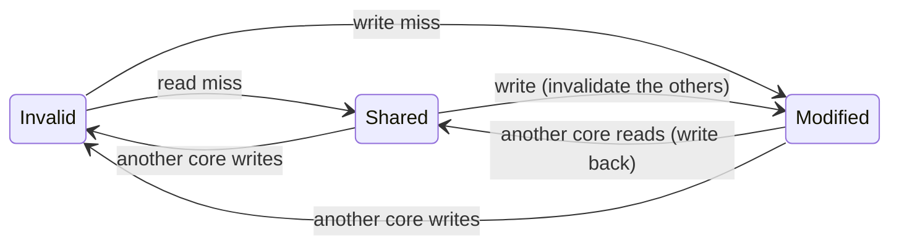
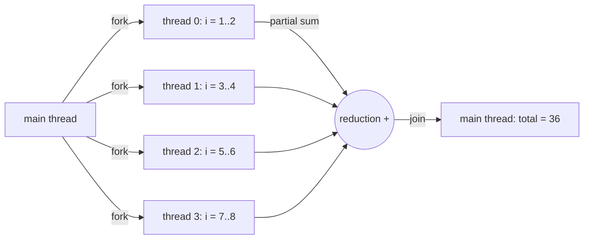
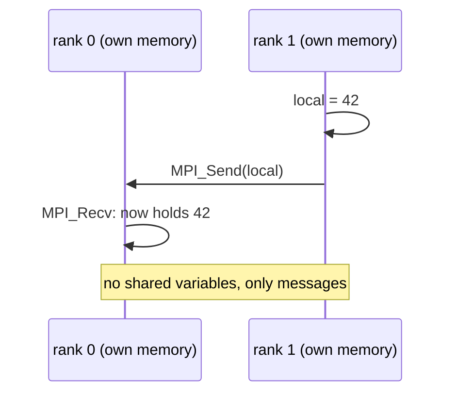
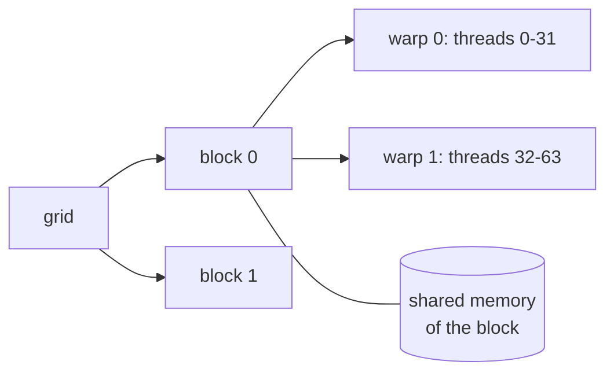

# NEY704 Parallel Systems and Parallel Programming: study guide

**What this course is about:** many processors working on one problem: how they share (or do not share) memory,
how they keep caches consistent, how they communicate, and how we program them (OpenMP, MPI, SIMD, GPUs).

Each section: **the point**, a **picture**, a **real example** (output from the tools), **where the code is**. Build first (see the [README](../../README.md)); commands run from the repository folder.

First recall [a load, a cache miss and a pipeline stall](EY321.md). A process owns an address space;
threads of a process share that space but have separate register/stack state. More workers help only
when work can overlap safely. Start with two workers and eight inputs; larger experiments are folded below.

**Connection to the whole:** NEY606 overlaps instructions within a core; here we divide a problem
among workers and account for shared data and communication. Follow [the same fixed sum](../FLOW.md#6-divide-the-same-work-explicitly--ney704)
in parallel MIPS, OpenMP and MPI. The work is divided explicitly, not by merely choosing more cores.

---

## 1. Kinds of parallel machines (Flynn)

**The point:** classify by how many instruction streams and data streams run at once.

| | single data | multiple data |
| --- | --- | --- |
| **single instruction** | SISD: a classic CPU | SIMD: vector units, SSE/AVX, GPU warps |
| **multiple instruction** | MISD: (rare) | MIMD: multicores, clusters |

And by memory: **shared memory** (all cores load/store one address space: OpenMP, threads) or **distributed
memory** (each node has private memory; data moves only in messages: MPI). Cores can be identical
(*symmetric*) or different (*asymmetric*, big.LITTLE; the parallel model gives cores different speeds with `--core-cpi 1,1,4,4`).

An ISA, a core and a system are different levels: one CPU can have SIMD instructions inside each of
many MIMD cores. A CPU+GPU machine is heterogeneous; differing core speeds alone are only a simplified
model of asymmetry. Uniform/nonuniform shared-memory access describes whether all memory regions
have similar latency from every core. Distributed memory requires explicit data communication.

Eight CPU cores each using vector instructions are MIMD at system level, while each vector operation is
SIMD. Two MPI ranks exchange messages even if they run on the same physical machine.

---

## 2. Multithreading: hide stalls with other threads

**The point:** while one thread waits for memory, run another.

```
cycle:      1 2 3 4 5 6 7 8 9 ...
coarse      A A A A(miss) - B B B B B ...   switch only on a long stall
fine        A B A B A B A B A ...           switch every cycle
SMT         AB AB AB ...                     several threads issue in the same cycle
```

**Example:** a memory-bound thread (`stream.s`, a miss on every load) with a compute thread (`compute.s`).

```bash
build/bin/mips-sim mt single examples/multithreading/stream.s examples/multithreading/compute.s
build/bin/mips-sim mt fine   examples/multithreading/stream.s examples/multithreading/compute.s
```

| policy | cycles | switches |
| --- | --- | --- |
| single (one after the other) | 6011 | 0 |
| coarse-grained | 5997 | 2 |
| fine-grained | 5174 | 0 |
| SMT | 5174 | 0 |

Coarse-grained switches at the first miss to the compute thread, but that thread never stalls, so it runs to
its end and hides only one miss. Fine-grained interleaves every cycle and hides many misses.

**Where the code is:** [src/sim/advanced/src/multithreading.cpp](../../src/sim/advanced/src/multithreading.cpp).

**Example:** A has `load, add`, where the load waits three cycles; B has two independent adds.
With one issue slot, fine-grained scheduling can issue B while A waits. SMT needs at least two
available issue slots to issue two threads in the *same* cycle. Neither creates more ALUs or bandwidth.
The difference comes from two separate effects: spare issue slots (`--width`) and latency hiding
(a larger `--miss` penalty makes it matter more). The `mt` tool schedules recorded
instruction streams with a cache model; it is not a complete operating-system thread scheduler.

---

## 3. Shared memory: cache coherence

**The point:** each core caches the same address; when one core writes, the other copies must be
*invalidated* (or updated). **Snooping:** every cache watches a shared bus (simple, does not scale).
**Directory:** a table per memory block records who has a copy and sends messages only to them (scales).

### Two caches and one word

Begin with word `x=0`, and both caches Invalid. A read must obtain a valid copy; a write must obtain
exclusive permission and prevent another core from continuing to use stale data.

| Event | Core 0's copy | Core 1's copy | Meaning |
| --- | --- | --- | --- |
| core 0 reads x | Shared, 0 | Invalid | a clean copy is fetched |
| core 1 reads x | Shared, 0 | Shared, 0 | both may read |
| core 0 writes x=7 | Modified, 7 | Invalid | core 1's old copy is invalidated |
| core 1 reads x | Shared, 7 | Shared, 7 | the newest value is supplied |

This is a conceptual MSI trace, independent of timing. Snooping broadcasts transactions on a bus;
a directory tracks sharers and targets messages, avoiding a broadcast to every cache on each miss.
In both, the writer must ensure that conflicting old copies stop being used.



```bash
build/bin/mips-sim run tests/golden/parallel_coherence_demo.s --mode parallel --cores 2 --coherence snoop --stats
```

```text
coherence[snoop]: core0 invalidated 1 sharer(s) at address 0 penalty=3
Invalidations: 1
```

Same with `--coherence directory-lite`. **False sharing:** two cores write *different* words of the *same*
line and keep invalidating each other, although they share no data.

**Where the code is:** [src/sim/parallel/src/model.cpp](../../src/sim/parallel/src/model.cpp).

Read `invalidate_other_caches` there. After checking that a different core has a valid copy, the
actual state-changing part is:

```cpp
it->second.state = CacheState::Invalid;
invalidated_cores.push_back(core);
result.coherence_events += 1;
result.invalidations += 1;
```

Snooping (`--coherence snoop`) and a directory (`--coherence directory-lite`) give the same value 7;
only the communication events and their costs differ. The C++ model is word-granular,
updates shared memory eagerly and approximates coherence costs. It does not implement a complete
write-back MSI cache or demonstrate cache-line false sharing. False sharing is the line-level
effect described above; the Verilog model below has the line state machine.

<details><summary>In hardware: the MSI state machine in Verilog</summary>

**The same protocol in hardware (Verilog).** [src/hdl/multicore/nexus_msi_system.v](../../src/hdl/multicore/nexus_msi_system.v)
is a 4-core memory system: four private caches, a shared bus with a round-robin arbiter, and MSI snooping. One
cache wins the bus per cycle; the others watch the transaction and flush or invalidate their copies. Its
testbench sends 400 random reads and writes per core to a few shared addresses and checks every cycle that each
read returns the last value written and that a line is never Modified in two caches.

```bash
python scripts/test_hdl.py msi        # needs Icarus Verilog
```

```text
4 cores x 400 requests in 1335 cycles: 266 hits, 1334 bus transactions, 492 invalidations, 378 flushes, 232 writebacks
PASS
```

So much sharing means few hits: every write takes the line away from everyone else. Without the invalidation
or the flush the protocol would break, and the testbench reports the broken invariant at once.
</details>

Two cores can never both hold Modified permission for x at the same time: that would allow conflicting
writes without a single agreed latest value.

---

## 4. Memory consistency and synchronisation

**The point:** coherence is about one address; *consistency* is about the *order* of accesses to different
addresses. **Sequential consistency (SC):** all cores see one interleaving of all accesses in program order.
Real CPUs relax it (store buffers), so a program must use **fences**, **locks** and **barriers**, built on
atomic instructions (`ll/sc`, test-and-set).

### First see a lost update

```bash
python examples/basics/parallel/race.py
```

The [complete program](../../examples/basics/parallel/race.py) deliberately executes this interleaving:

| Event | A's local value | B's local value | Shared x |
| --- | --- | --- | --- |
| both load x | 0 | 0 | 0 |
| A stores local+1 | 0 | 0 | 1 |
| B stores local+1 | 0 | 0 | 1 |

Expected output is `overlapping increments: 1`, then `increments under a lock: 2`.
The example models events explicitly, so its result does not depend on Python thread timing.
A **lock** protects a whole read/modify/write critical section; an **atomic increment** provides
one indivisible operation; a **barrier** waits for every participant to reach a phase boundary.
A barrier alone does not protect two simultaneous increments.

Real implementations use atomic primitives such as test-and-set, compare-and-swap or load-linked /
store-conditional. A fence orders memory accesses but does not itself make a multi-step increment
atomic. NEXUS exposes teaching locks, barriers and atomic increment through memory-mapped addresses
at `0x20000`; those are simulator services, not MIPS `ll/sc` opcodes or a complete real-ISA model.

### Ordering across two addresses

Initially `x=y=0`: core 0 does `x=1; r0=y`, while core 1 does `y=1; r1=x`.
If stores remain private in buffers while both loads run, `(r0,r1)=(0,0)` is possible in a
store-buffering model. Under sequential consistency it is impossible: either store must precede
the other core's later read in the single global order.

```bash
python examples/basics/parallel/store_buffer.py
```

It prints `(0, 0)` for the chosen buffered interleaving and `(1, 1)` when both buffers drain before
either load. If core 0's buffer drains before its load, and core 1's afterwards, the outcome is `(0,1)`: fences do not force every run to return `(1,1)`.
This small executable event model explains the mechanism without pretending to emulate all CPU rules.

**Example:** core 0 writes data then a flag; core 1 waits for the flag and reads the data.

```bash
build/bin/mips-sim run tests/golden/parallel_consistency_demo.s --mode parallel --cores 2 --consistency weak-lite --stats
```

```text
consistency[weak-lite]: core0 buffered store address=0 value=1
consistency[weak-lite]: core0 buffered store address=4 value=1
consistency[weak-lite]: drain core0 address=0 value=1
consistency[weak-lite]: drain core0 address=4 value=1
```

In NEXUS's `weak-lite` example stores wait in a FIFO buffer. Its data-before-flag stores drain in
order, so the reader observes the data after the flag. This illustrates that particular model;
it does not establish that plain flag polling is correct on every weak-memory machine or in C/C++.
Real language-level communication needs atomics and suitable acquire/release ordering.

**Scaling with a lock and a barrier:** [examples/parallel/spmd_sum.s](../../examples/parallel/spmd_sum.s) gives each
core 8 numbers to add, then each adds its partial sum to a shared total under a lock and waits at a barrier.

```bash
build/bin/mips-sim run examples/parallel/spmd_sum.s --mode parallel --cores 8 --stats
```

| cores | numbers added | cycles | invalidations |
| --- | --- | --- | --- |
| 1 | 8 | 40 | 0 |
| 2 | 16 | 53 | 1 |
| 4 | 32 | 71 | 3 |
| 8 | 64 | 107 | 7 |

This is a **scaled-work** experiment: eight times more work takes about 2.7 times the time.
It is not a fixed-size speedup measurement. The lock serialises shared updates, while the barrier
coordinates completion. Each worker uses `$a0` as its ID to select the eight inputs it owns; the acquire, release and barrier
appear in the source as stores to special addresses.

---

## 5. Programming shared memory: OpenMP

**The point:** add a directive and the compiler splits the loop among threads; `reduction` gives each thread a
private partial sum and combines them at the end.



Start with the complete small [sum_openmp.c](../../examples/basics/parallel/sum_openmp.c), which adds 1 to 8:

```bash
gcc -std=c11 -fopenmp examples/basics/parallel/sum_openmp.c -o sum-openmp
./sum-openmp 1
./sum-openmp 2
./sum-openmp 4
```

Each run prints `sum=36`. The critical lines are:

```c
int total = 0;
#pragma omp parallel for num_threads(threads) reduction(+:total)
for (int i = 1; i <= 8; ++i) {
  total += i;
}
```

Loop index `i` is private to each worker; reduction gives each worker a private subtotal and combines
them at the end. The input range is fixed, independent of worker count. `shared` and `private`
describe variable storage; `schedule(static)` assigns predictable chunks, while `dynamic` gives
workers more chunks as they finish. An `atomic` can protect one update, and `critical` a larger block.

Without `reduction`, all threads would update the shared `total` at the same time: a race. An
unsynchronised run that happens to print the right answer is not evidence of correctness. Eight
iterations show correctness, not meaningful performance scaling.

<details><summary>Larger example: larger shared-memory kernels</summary>

```cpp
#pragma omp parallel for reduction(+ : total) schedule(static)
for (std::ptrdiff_t index = 0; index < static_cast<std::ptrdiff_t>(size); ++index) {
  total += static_cast<long long>((index % 7) + 1);
}
```

Full program: [benchmarks/openmp/openmp_bench.cpp](../../benchmarks/openmp/openmp_bench.cpp) (vector add, reduction,
matrix multiply). It is built when the compiler supports OpenMP (gcc, clang).
</details>

---

## 6. Programming distributed memory: MPI

**The point:** the same program runs as P processes (*ranks*); each computes on its own data and they exchange
**messages**. Collective operations (broadcast, reduce, allreduce) are built from point-to-point messages.



First run the complete [hello_mpi.c](../../examples/basics/parallel/hello_mpi.c):

```bash
mpicc examples/basics/parallel/hello_mpi.c -o hello-mpi
mpiexec -n 2 ./hello-mpi
```

Expected: `rank 0 received 42 from rank 1`. Each process starts at `main`; its rank chooses a branch.
`MPI_Send` sends a count, datatype, destination, tag and communicator; `MPI_Recv` specifies matching
source/tag information and stores the data in the receiving process's own variable.
`MPI_COMM_WORLD` is the initial group. `MPI_Init` and `MPI_Finalize` bracket MPI use.

Each rank has its own memory: a change to rank 1's local variable does not update rank 0's variable
without a message. A blocking receive waits for its match;
making both ranks receive first is a deadlock. A two-way exchange can use `MPI_Sendrecv`.
Collectives must be called by every participating rank: broadcast copies one value to all,
reduce combines values at a root, and allreduce makes the combined result available to all.

<details><summary>Larger example: reduction and collective communication costs</summary>

```cpp
long long local = 0;
for (int index = 0; index < size; ++index) local += (rank + 1) * (index + 1);
MPI_Reduce(&local, &global, 1, MPI_LONG_LONG, MPI_SUM, 0, MPI_COMM_WORLD);   // rank 0 gets the sum
```

Full program: [benchmarks/mpi/mpi_bench.cpp](../../benchmarks/mpi/mpi_bench.cpp), run with
`mpiexec -n 4 build/bin/mpi-bench --kernel all`.

**Cost of a message:** `time = alpha + beta x words` (start-up latency + per-word cost). A binomial-tree
broadcast needs log2(P) rounds instead of P-1 sends, but each round pays alpha again:

```bash
build/bin/mips-sim msg bcast-linear --nodes 16 --topology hypercube --words 256
build/bin/mips-sim msg bcast-tree   --nodes 16 --topology hypercube --words 256
```

| message size | linear broadcast | tree broadcast |
| --- | --- | --- |
| 4 words | **290** cycles | 316 cycles |
| 256 words | 4070 cycles | **1324** cycles |

Short messages: the root's 15 cheap sends beat 4 rounds of latency. Long messages: the tree wins because the
root no longer injects all the data alone.

**Where the code is:** [src/sim/parallel/src/message_passing.cpp](../../src/sim/parallel/src/message_passing.cpp).
</details>

OpenMP and MPI require their toolchains; the race/store-buffer examples and message simulator run
without them. Build/run commands above target Linux or WSL; on native Windows use the corresponding
compiler/runtime and executable names. A simulator run is not a substitute for running the MPI API example.

---

## 7. Vector computers and SIMD

**The point:** one instruction operates on a whole vector. Long vectors are processed in pieces of at most
MVL elements (**strip-mining**); **chaining** starts a dependent vector operation as soon as the first element
is ready; more **lanes** process several elements per cycle.

For `y[i]=3*x[i]+y[i]`, inputs `x=[0,1,2,3]`, `y=[2,2,2,2]` give `[2,5,8,11]`.
Read `LV, MULVS, LV, ADDVV, SV` in [daxpy.vasm](../../examples/vector/daxpy.vasm): load x,
multiply by scalar 3, load y, add vectors, store y. With maximum vector length 4 and 10 elements,
strip-mining selects lengths 4, 4, 2; the last chunk must not overrun the array.

```bash
build/bin/mips-sim vector examples/vector/daxpy.vasm --n 10 --mvl 4 --trace
```

With `--n 9` the last length becomes 1. In the same way, a SIMD loop using 4-wide CPU intrinsics needs
a scalar tail for leftover elements; loading 4 values past the end is not safe.

```bash
build/bin/mips-sim vector examples/vector/daxpy.vasm --n 64
build/bin/mips-sim vector examples/vector/daxpy.vasm --n 64 --no-chaining
build/bin/mips-sim vector examples/vector/daxpy.vasm --n 64 --lanes 4
```

| configuration | cycles |
| --- | --- |
| chaining, 1 lane | 208 |
| no chaining | 303 |
| chaining, 4 lanes | 66 |

Modern CPUs have short-vector SIMD units (SSE/AVX). The same vector add with SSE intrinsics, 4 floats at a time:

```cpp
const __m128 va = _mm_loadu_ps(&a[index]);
const __m128 vb = _mm_loadu_ps(&b[index]);
_mm_storeu_ps(&c[index], _mm_add_ps(va, vb));
```

**Where the code is:** [src/sim/vector/src/model.cpp](../../src/sim/vector/src/model.cpp),
[benchmarks/simd/simd_bench.cpp](../../benchmarks/simd/simd_bench.cpp).

---

## 8. GPUs and their programming

**The point:** a GPU runs thousands of threads in groups of 32 (**warps**) that execute the same instruction
(SIMT). Two rules decide performance:

1. **No divergence:** if threads of a warp take different branches, both paths run one after the other.
2. **Coalesced memory:** neighbouring threads should read neighbouring addresses, so one transaction serves the
   whole warp.

The 32-thread warp is the NVIDIA-style organisation used by this model, not a universal GPU width.
A thread has an index; a block groups cooperating threads with shared memory and a block barrier.
Global memory is accessible across blocks, but an ordinary block barrier does not synchronise the grid.
Blocks are distributed among execution units, so launch order is not a cross-block ordering guarantee.

In [coalesced.s](../../examples/gpu/coalesced.s), `$a0` holds a thread's global index and `sll ... ,2`
multiplies it by four to address consecutive words. In `strided.s`, shifting by seven gives each
thread a 128-byte stride. The arithmetic result is still correct; the number of memory transactions changes.
For threads 0, 1, 2, 3 the coalesced kernel reads consecutive words, while the strided one reads addresses
128 bytes apart: one transaction against four.



```bash
build/bin/mips-sim run examples/gpu/coalesced.s --mode simt --threads 64 --stats
build/bin/mips-sim run examples/gpu/strided.s   --mode simt --threads 64 --stats
```

| example | result |
| --- | --- |
| coalesced reads | 4 memory transactions (1 per request) |
| strided reads | 128 memory transactions (32 per request) |
| uniform loop (`uniform.nx`) | SIMD efficiency 100% |
| Collatz loop, different trip count per thread (`collatz.nx`) | SIMD efficiency 10.4%, 74 divergent branches |
| shared-memory bank conflicts (`bank_conflict.s`) | 62 extra cycles for 2 requests |

For a branch `if (thread_id < 16)` in one 32-thread warp, two paths each use only half the lanes.
Divergence serialises active paths; it does not mean the threads produce incorrect results.
A shared-memory bank conflict similarly changes access cost, not the intended arithmetic.

<details><summary>On a GPU: a CUDA shared-memory reduction</summary>

The CUDA reduction in [benchmarks/gpu_optional/gpu_optional_bench.cu](../../benchmarks/gpu_optional/gpu_optional_bench.cu)
uses shared memory and barriers exactly like `block_reduce.s`:

```cuda
__shared__ int partial[128];
partial[tid] = index < count ? input[index] : 0;
__syncthreads();
for (int stride = blockDim.x / 2; stride > 0; stride >>= 1) {
  if (tid < stride) partial[tid] += partial[tid + stride];
  __syncthreads();
}
```

**Where the code is:** [src/sim/simt/src/model.cpp](../../src/sim/simt/src/model.cpp). The CUDA program builds with
`-DNEXUS_ENABLE_CUDA=ON` on a machine with an NVIDIA GPU (for example Google Colab).
</details>

`__syncthreads()` is outside the `if (tid < stride)` because all participating threads must reach the
barrier, including threads inactive for that reduction step. A barrier reached by only
some required threads can hang the block.

---

## 9. Interconnection networks: bus, switch, network on chip

**The point:** a **bus** is cheap but carries one transfer at a time; a **crossbar** connects any input to any
free output; **networks on chip** (ring, 2-D mesh, torus, hypercube) connect routers with short links. Latency
grows with the number of hops, and when packets want the same link they wait: **contention**.

```
ring (8)         2-D mesh 4x4             torus = mesh + wrap-around links
0-1-2-3          o-o-o-o                  every node has 4 neighbours,
|     |          | | | |                  half the worst-case distance
7-6-5-4          o-o-o-o   (XY routing: first along x, then along y)
```

Start with four routers in a 2x2 mesh: `0--1` above `2--3`, with vertical links `0--2` and `1--3`.
XY routing takes 0→1→3 to reach 3 from 0. A bus serialises transfers; a crossbar permits simultaneous
transfers to distinct outputs; a mesh routes over local links. Bandwidth measures data per unit time,
latency the time for one delivery. Two packets requesting the same busy link cause contention.

```bash
build/bin/mips-sim net mesh --nodes 4 --traffic neighbor --rate 0.1 --cycles 32
build/bin/mips-sim net bus --nodes 4 --traffic neighbor --rate 0.1 --cycles 32
```

At a higher rate (e.g. 0.8 with the same seed) there is more queueing, not different delivered message
contents. Offered load, accepted throughput and latency measure different things.

<details><summary>Larger example: saturation and topology in a larger network</summary>

**Example:** a 64-node mesh with uniform random traffic, rising load.

```bash
build/bin/mips-sim net mesh --nodes 64 --sweep
```

```text
bisection bound on uniform throughput: 0.492 flits/node/cycle
offered  accepted  avg latency  zero-load  busiest channel (utilisation)
   0.10     0.100         18.0       16.8  25->17 (25.31%)
   0.30     0.296         23.3       16.7  44->43 (67.72%)
   0.40     0.386         31.2       16.6  19->20 (88.39%)
   0.50     0.434         80.4       16.7  60->59 (96.18%)
   1.00     0.460        969.4       16.7  3->4 (99.59%)
```

Below saturation the network delivers what is offered and latency stays near the zero-load value. Near the
*bisection bound* (the links that cross the middle of the network are full) the accepted traffic stops growing
and latency explodes.

| pattern (load 0.3) | average latency |
| --- | --- |
| neighbour (i to i+1) on the mesh | 10.6 cycles |
| transpose on the mesh | 570.7 cycles |
| transpose on the torus | 225.4 cycles |
| everyone to node 0 (hotspot) on a crossbar | node 0's output port busy 99.9% of the time |

**Where the code is:** [src/sim/parallel/src/network.cpp](../../src/sim/parallel/src/network.cpp) (routing, link
contention, traffic patterns).

</details>

---

## How this course connects

- **Before it:** caches from [EY321](EY321.md) (coherence exists because each core has its own) and
  instruction-level parallelism inside one core from [NEY606](NEY606.md).
- **With the compiler:** a loop can be split among threads (`#pragma omp parallel for`) only when its
  iterations are independent, which is exactly what dependence analysis in [NEY709](NEY709.md) decides.
- **The same ideas at different scales:** forwarding inside a pipeline, coherence between caches and messages
  between nodes all move a value from where it is produced to where it is needed.

The [parallel-systems reading list](../literature/parallel_readings.md) gives the classic paper behind each mechanism.

---

**Previous:** [NEY606](NEY606.md)  /  Related: [NEY709](NEY709.md) shows how a compiler finds parallel loops.
