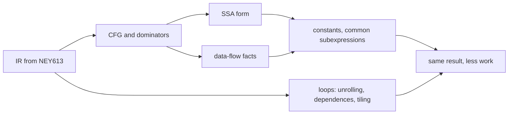
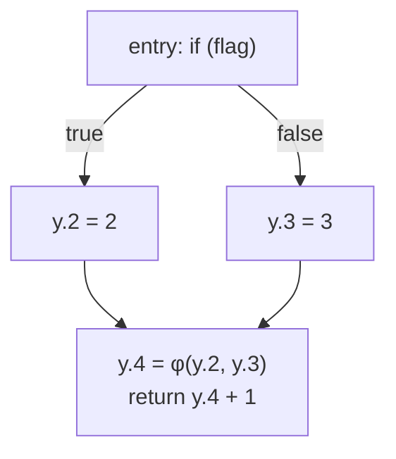
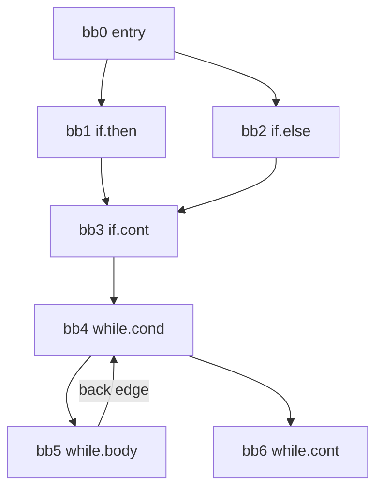

# NEY709 Advanced Compiler Topics: study guide

**What this course is about:** what a modern compiler does *after* parsing: analyse the program (control flow,
data flow, dependences) and transform it into faster code that computes exactly the same result.

Each section: **the point**, a **picture**, a **real example** (output from the tools), **where the code is**. Build first (see the [README](../../README.md)); commands run from the repository folder.
It helps to know [NEY613](NEY613.md) first.

Review NEY613 by sending `tiny.nx` through lexer, AST, type checking, IR and MIPS again.
For sections 2–5, keep [diamond.nx](../../examples/basics/compiler/diamond.nx) open: one function,
one `if`, two assignments and a return. Use [sum.nx](../../examples/basics/compiler/sum.nx)
when a loop is needed. Prediction and hand calculation come before larger analysis dumps.

**Connection to the whole:** NEY613 provides the IR; analyses establish facts that justify changes.
Those changes can affect the work and memory traffic seen by EY321/NEY606, and dependence analysis
constrains parallelism in NEY704. See [analysis in the shared flow](../FLOW.md#2-reason-about-the-loop--ney709).



---

## 1. Front end extras: generalised parsing and type systems

**The point:** deterministic LL/LR tables need an unambiguous action at each decision. Ambiguous grammars
cause conflicts that require a policy or a more general algorithm. **Earley** recognises arbitrary
context-free grammars and retains competing derivations; GLR generalises LR by retaining competing stacks.
NEXUS implements Earley recognition and parse-tree counting, not GLR or tree enumeration.
**Parallel parsing** splits input at safe boundaries (here, top-level functions) and parses parts concurrently.

For `1+2*3` under `E -> E+E | E*E | num`, two trees mean 7 and 9. Generalised parsing preserves
the ambiguity; it does not choose the language's intended meaning. A precedence rule can choose it.
Parallel parsing addresses how to share work among workers. NEXUS partitions complete top-level
functions, so it is a bounded prototype rather than arbitrary token-stream splitting.

```bash
build/bin/nexusc grammar examples/grammars/ambiguous.g earley "1 + 2 * 3"
build/bin/nexusc experimental-parse tests/programs/matrix_multiply.nx --mode parallel
```

```text
accepted, chart items: 31, parse trees: 2          <- (1+2)*3 and 1+(2*3)
  part0: lines 2-18 (17 line(s))
  part1: lines 20-36 (17 line(s))
Experimental parallel parse succeeded: 2 function(s)
```

**Type inference (Hindley-Milner):** the compiler finds the most general type without annotations, using
*unification*; `let` makes a definition polymorphic.

For `fun x -> x`, assign unknown type `'a` to x; returning x gives `'a -> 'a`. Applying it to 1
unifies `'a` with `int`. A polymorphic `let id` can be instantiated separately at `int` and `bool`;
a single monomorphic variable cannot simultaneously have both types. The occurs check rejects
equations such as `'a = 'a -> 'b`, which would require an infinite type.
The `infer` command uses a separate expression language; it does not add polymorphism to NexusLang.

```bash
build/bin/nexusc infer "let id = fun x -> x in (id 1, id true)"
build/bin/nexusc infer "fun f -> fun x -> f (f x)"
build/bin/nexusc infer "fun x -> x x"
```

```text
(int * bool)
('a -> 'a) -> 'a -> 'a
type error: occurs check failed: cannot construct the infinite type 'a = 'a -> 'b
```

With `id 2` instead of `id true` the pair type would be `(int * int)`. The occurs-check error is a type
error: it has nothing to do with undeclared names or syntax.

**Where the code is:** [src/compiler/formal/src/grammar.cpp](../../src/compiler/formal/src/grammar.cpp) (Earley),
[src/compiler/types/src/hindley_milner.cpp](../../src/compiler/types/src/hindley_milner.cpp).

---

## 2. Intermediate representations and SSA

**The point:** in **SSA form** every variable is assigned exactly once; where control paths meet, a
**phi-function** picks the value from the path actually taken. Each use then has exactly one definition, which
makes most optimisations simple.

An AST preserves source structure; three-address IR makes operations explicit; a CFG makes execution
paths explicit; SSA makes each scalar value's origin explicit. Each supports a different question.
NEXUS SSA is an analysis view: printing it does not itself replace the normal IR or emit optimised MIPS.

```bash
build/bin/nexusc analysis ssa examples/basics/compiler/diamond.nx
```

The real output has **one phi** in `choose`:

```text
y.4 = phi [bb1.if.then: y.2] [bb2.if.else: y.3]
```

For `flag=true`, y.2 is 2 and the function returns 3; for false, y.3 is 3 and it returns 4.
Phi selects by the incoming edge, not by adding values or testing another condition at runtime.
Passing `false` in `main` changes the run, but `choose` still needs both phi inputs: intraprocedural SSA
does not assume all callers pass the same argument.

<details><summary>Further example: phi nodes at a branch and a loop</summary>

```
before                       SSA
if (c) y = x + 1;            if (c) y.2 = x.1 + 1;
else   y = 99;               else   y.3 = 99;
use(y);                      y.4 = phi(y.2, y.3);  use(y.4)
```

```bash
build/bin/nexusc analysis ssa tests/programs/constant_branches.nx
```

```text
func main ssa: 3 phi node(s)
    y.4 = phi [bb1.if.then: y.2] [bb2.if.else: y.3]
    i.2 = phi [bb3.if.cont: i.1] [bb5.while.body: i.3]
    sum.2 = phi [bb3.if.cont: sum.1] [bb5.while.body: sum.3]
```
</details>



SSA construction places phi nodes at the **iterated dominance frontiers** of definition blocks,
then renames definitions and uses by walking the dominator tree with a version stack per variable.
The frontend's temporary values are already single-assignment; this analysis renames scalar locals.

**Where the code is:** [src/compiler/analysis/src/ssa.cpp](../../src/compiler/analysis/src/ssa.cpp).

---

## 3. Control-flow graph, dominators, lattices

**The point:** a **basic block** is straight-line code (one entry, one exit); the **CFG** connects blocks. Block
`d` **dominates** `n` if every path from the entry to `n` passes through `d`. An edge `n -> h` where `h` dominates
`n` is a **back edge**, and it marks a **loop** with header `h`.

### Use the same four blocks first

```text
       E: y=0; branch flag
           /       \
       T: y=2     F: y=3
           \       /
          J: return y+1
```

```bash
build/bin/nexusc cfg examples/basics/compiler/diamond.nx
build/bin/nexusc dom examples/basics/compiler/diamond.nx
```

Every route to J passes E; one skips T, another skips F. J's dominators are `{E,J}` and its
immediate dominator is E. T's **dominance frontier** includes J: T dominates a predecessor of J
but does not strictly dominate J. This is where T's and F's versions of y must be reconciled.
Every block dominates itself; the entry dominates all reachable blocks.

A **fixed point** is an analysis state where another application of all equations changes nothing.
A lattice organises facts and defines how paths combine: union answers "may happen on some path";
intersection answers "must hold on every path". TOP/BOTTOM names are conventions that other books
may reverse; use the ordering stated for the analysis.

If y were assigned again right after the `if`, the returned value would come from that later assignment. An earlier phi may be removable, but NEXUS does not implement full dead-phi elimination,
so an unused phi can remain in this analysis view.

<details><summary>Further example: a CFG containing a loop</summary>



```bash
build/bin/nexusc dom tests/programs/constant_branches.nx
```

```text
  bb3.if.cont: {bb0.entry, bb3.if.cont}  idom = bb0.entry
  bb4.while.cond: {bb0.entry, bb3.if.cont, bb4.while.cond}  idom = bb3.if.cont
  bb5.while.body: {bb0.entry, bb3.if.cont, bb4.while.cond, bb5.while.body}  idom = bb4.while.cond
```

bb3 is dominated only by the entry (it can be reached through bb1 *or* bb2). bb4 dominates bb5 and bb5 -> bb4
exists: that is the `while` loop.
</details>

A **lattice** orders the facts an analysis can know. For constants: `TOP` (no information yet) above every
constant `1, 2, 3, ...`, and those above `BOTTOM` (not a constant). Facts only move down, and the lattice has
finite height, so the analysis must stop.

**Where the code is:** [src/compiler/analysis/src/cfg.cpp](../../src/compiler/analysis/src/cfg.cpp),
[src/compiler/analysis/src/dominators.cpp](../../src/compiler/analysis/src/dominators.cpp).

---

## 4. Data-flow analysis: iterative and region-based

**The point:** compute, for every block, facts such as "which variables are **live**" (backward) or "which
definitions **reach** here" (forward). Each block has a *transfer function* `out = gen ∪ (in − kill)`; blocks are
joined by a *meet* (∪ for "may" problems).

### Calculate reaching definitions before running the optimiser

A **definition** is an assignment site: label `y=0` as d0, `y=2` as d1 and `y=3` as d2.
Assigning y generates its new definition and kills older definitions of y. At the diamond's join,
`IN[J] = OUT[T] union OUT[F] = {d1,d2}`. d0 cannot reach J because both paths overwrite it.

Run the complete small [reaching_definitions.py](../../examples/basics/compiler/reaching_definitions.py):

```bash
python examples/basics/compiler/reaching_definitions.py
build/bin/nexusc opt examples/basics/compiler/diamond.nx --analysis regions
```

| Synchronous round | OUT[E] | OUT[T] | OUT[F] | OUT[J] |
| --- | --- | --- | --- | --- |
| 0, initial | empty | empty | empty | empty |
| 1 | d0 | d1 | d2 | empty |
| 2, fixed point | d0 | d1 | d2 | d1,d2 |

Each Python round reads the preceding round's sets. The C++ solver in
[data_flow.cpp](../../src/compiler/analysis/src/data_flow.cpp) updates in place, so its iteration count
can differ. Its forward transfer is exactly:

```cpp
result.out_sets[block] = subtract(result.in_sets[block], problem.kill_sets[block]);
result.out_sets[block].insert(
    problem.gen_sets[block].begin(), problem.gen_sets[block].end());
```

Predecessor sets are combined before this code. The enclosing loop stops when no IN/OUT set changes.
Without F's assignment, d0 would survive the false path and reach J together with d1.

**Liveness** goes backward: `OUT[b]` is the union of successor IN sets, and
`IN[b] = USE[b] union (OUT[b] - DEF[b])`. A read before any definition of that variable in the block
is USE; an assignment is DEF. At `return y+1`, y is live on entry. Before a predecessor's assignment,
the old y is not live merely because the newly assigned y will be used later.

```bash
build/bin/nexusc analysis liveness examples/basics/compiler/diamond.nx
build/bin/nexusc opt examples/basics/compiler/sum.nx --analysis regions
```

Loop assignments can reach the header around a back edge. An iterative solver propagates these
until stable. A region solver summarises straight-line regions, branches and loops, then propagates
information through that hierarchy. Both must agree on the resulting sets.

<details><summary>Further example: inspect a loop's region tree and closure</summary>

**Iterative:** repeat over all blocks until nothing changes.

```bash
build/bin/nexusc analysis liveness examples/source_lang/arrays_and_loops.nx
```

```text
func sum4 liveness:
  iterations: 4
  bb2.while.body:
    use: {values: int[4], i: int, total: int}
    def: {i: int, total: int}
    in:  {values: int[4], i: int, total: int}
```

**Region-based (no iteration):** build a tree of regions (blocks -> loop bodies -> loops -> whole program),
summarise each region as **one** transfer function bottom-up, then push the values down. For a loop the summary
is the *closure* `f* = id ∧ f`, computed once instead of iterating.

```bash
build/bin/nexusc opt examples/source_lang/arrays_and_loops.nx --analysis regions
```

```text
func sum4 regions:
  R6 body header bb0.entry {bb0, bb1, bb2, bb3}
    R0 block header bb0.entry
    R5 loop header bb1.while.cond {bb1, bb2} back edge bb2->bb1
      R4 body header bb1.while.cond {bb1, bb2}
        R1 block header bb1.while.cond
        R2 block header bb2.while.body
    R3 block header bb3.while.cont
reaching definitions (by regions):
  bb0.entry  in {}  out {d0:i, d1:total}
  bb1.while.cond  in {d0:i, d1:total, d2:total, d3:i}  ...
region solver: 8 compositions, 1 meets, 1 closures, no iteration; iterative solver (3 passes) agrees
```

The definitions `d2`, `d3` made in the loop body reach the loop header around the back edge, and the region
solver gets this from the closure, with no iteration. It needs a *reducible* graph (every loop has a single
entry); irreducible graphs are reported.
</details>

The closed-form loop closure in that example applies to the supported distributive GEN/KILL functions;
arbitrary analyses need not have the same shortcut. Read `compose`, `meet_of` and
`solve_forward_by_regions` in `region_flow.cpp` after working out the diamond manually.

**Where the code is:** [src/compiler/analysis/src/data_flow.cpp](../../src/compiler/analysis/src/data_flow.cpp),
[liveness.cpp](../../src/compiler/analysis/src/liveness.cpp),
[region_flow.cpp](../../src/compiler/analysis/src/region_flow.cpp).

---

## 5. Using the analyses: constants, common subexpressions, symbolic analysis

**The point:** **sparse conditional constant propagation (SCCP)** runs on SSA, finds constants and the branches
they decide, and so finds **unreachable** code. **Symbolic analysis** goes further and expresses values as
formulas of other variables (`i + 1`, `n`), which loop transformations need.

First use [constant_branch.nx](../../examples/basics/compiler/constant_branch.nx), where `flag=true`
is visible inside the function being analysed:

```bash
build/bin/nexusc analysis sccp examples/basics/compiler/constant_branch.nx
```

Expect one resolved branch, one unreachable block and `y.4 (phi) = 2`. Conceptually the program can
become `return 3`. This command reports facts; it does not claim to have rewritten MIPS or removed
every dead instruction. With `flag=false` the other path becomes unreachable and the result is 4.
In `diamond.nx`, `choose` has an unknown parameter, so intraprocedural SCCP cannot assume it is true.

For CSE, reuse of `a+b` requires unchanged inputs and relevant memory. In `x=a+b; a=7; y=a+b`,
the expressions have identical spelling but potentially different values. Symbolic analysis describes
unknown values as formulas such as `n-1`, useful for bounds without a known runtime n.

```bash
build/bin/nexusc analysis sccp tests/programs/constant_branches.nx
```

```text
func main sccp: 7 computed value(s) constant, 1 branch(es) resolved, 1 unreachable block(s)
  bb1.if.then
    y.2 = 5
  bb2.if.else   ; unreachable              <- x * 2 == 8 is always true
  bb3.if.cont
    y.4 (phi) = 5                           <- only one path is executable
  bb4.while.cond
    i.2 (phi) = BOTTOM                      <- changes around the loop: not a constant
```

```bash
build/bin/nexusc opt examples/source_lang/symbolic_unroll.nx --analysis symbolic
```

**Common subexpressions.** If `a * b` was already computed and neither `a` nor `b` changed since, the value can
be reused. *Inside a block*, **local value numbering** gives every computed value a number; an instruction with
the same operator and the same operand numbers gets the same number and is deleted (a load right after a store
of the same variable is replaced by the stored value). *Across blocks*, **available expressions** (a forward
"must" problem: meet = ∩) tells which expressions have been computed on *every* path to a point.

[examples/source_lang/common_subexpressions.nx](../../examples/source_lang/common_subexpressions.nx):

```rust
var x: int = (a + b) * (a + b);      // a + b twice in one block
if (a > b) { y = a * b; } else { y = a * b + 1; }
var z: int = a * b;                  // computed on both paths before: redundant
a = a + 1;
var w: int = a + b;                  // a changed: a new value
```

```bash
build/bin/nexusc opt examples/source_lang/common_subexpressions.nx --analysis available
build/bin/nexusc opt examples/source_lang/common_subexpressions.nx --pass cse
```

```text
  bb3.if.cont  in {a + b, (a + b) * (a + b), a > b, a * b}  out {a + b, x + y, ...}
redundant computations: 2
  bb0.entry: a + b  (computed earlier in the same block)
  bb3.if.cont: a * b  (available on every path into the block)
region solver (intersection meet): 4 compositions, 1 meets, 0 closures; iterative solver (2 passes) agrees
; value numbering: f: 10 redundant instruction(s) removed (3 load(s) replaced by the value just stored)
```

The tests run every program of the repository and 120 random ones before and after value numbering: the
checks require the same results. Local value numbering performs the implemented elimination;
the cross-block available-expression report identifies opportunities rather than implementing full global CSE.

To execute the local transformation, rather than only inspect its IR, use:

```bash
build/bin/nexusc compile examples/flow/sum.nx -S --pass cse --regalloc linear-scan -o flow-cse.s
build/bin/mips-sim run flow-cse.s --mode pipeline --stats
```

It returns 36. The [connected flow](../FLOW.md#4-build-a-machine-that-executes-it--ey321) compares it
with the same source compiled without the pass, showing how an IR change reaches actual CPU execution.

If an input changes between two occurrences, the second occurrence can no longer be reused. Stores and calls need conservative treatment when
their effects are unknown; matching arithmetic syntax alone is insufficient.

**Where the code is:** [src/compiler/analysis/src/ssa.cpp](../../src/compiler/analysis/src/ssa.cpp) (SCCP),
[src/compiler/analysis/src/symbolic.cpp](../../src/compiler/analysis/src/symbolic.cpp),
[src/compiler/passes/src/value_numbering.cpp](../../src/compiler/passes/src/value_numbering.cpp) (local value numbering),
[src/compiler/analysis/src/region_flow.cpp](../../src/compiler/analysis/src/region_flow.cpp) (available expressions).

---

## 6. Loop unrolling: concrete and symbolic

**The point:** copy the loop body k times so the loop branch, the counter update and the test run k times less
often, and the copies can be scheduled together. With a **known** trip count the loop can be unrolled exactly;
with an **unknown** `n` the compiler adds a **remainder loop** for the last `n mod k` iterations.

For five iterations and factor 2, execute `(0,1)`, `(2,3)`, then remainder `(4)`. Every original
update still occurs in order. Unrolling reduces loop-control overhead and may expose independent
work, but increases code size and register pressure. It does not automatically remove loop-carried
dependencies or make a loop parallel. Never omit a remainder because one example has an even bound.

```
for (i = 0; i < n; i++)          for (i = 0; i + 3 < n; i += 4) {    // main loop: 4 copies
  s += a[i];                        s += a[i]; s += a[i+1];
                                    s += a[i+2]; s += a[i+3];
                                 }
                                 for (; i < n; i++) s += a[i];       // remainder: at most 3
```

```bash
build/bin/nexusc opt examples/source_lang/fixed_trip_unroll.nx --pass unroll
build/bin/nexusc opt examples/source_lang/symbolic_unroll.nx --pass unroll-remainder --factor 4
```

For a supported **fixed** loop, the existing concrete pass can also feed the backend:

```bash
build/bin/nexusc compile examples/flow/sum.nx -S --pass unroll --regalloc linear-scan -o flow-unrolled.s
build/bin/mips-sim run flow-unrolled.s --mode pipeline --stats
```

The result remains 36, with eight copies of the original iteration's work. `compile --pass unroll`
supports the concrete pass; symbolic/remainder transformations remain available as IR demonstrations
through `opt`. Keeping that distinction visible prevents an analysis dump being mistaken for emitted code.

When the bound is not divisible by 4, the remainder loop runs the last iterations: for n = 0, 1, 4, 5
every original index occurs exactly once in the transformed structure. `loop_unroll.cpp` checks the supported loop shape before rewriting it.

**Where the code is:** [src/compiler/passes/src/loop_unroll.cpp](../../src/compiler/passes/src/loop_unroll.cpp).

---

## 7. Iteration spaces and polyhedral transformations

**The point:** the iterations of a loop nest are the integer points of a **polyhedron**. A dependence between
iterations has a **distance vector**; a transformation (interchange, skewing, tiling) is **legal** if every
dependence still points forward (lexicographically positive) afterwards. The best schedule can be found with
**linear programming**.

### Draw a tiny iteration space

For `for i=0..1, for j=0..2`, draw `(0,0),(0,1),(0,2),(1,0),(1,1),(1,2)`.
Interchange changes their order to `(0,0),(1,0),(0,1),(1,1),(0,2),(1,2)`, preserving the set.
If every iteration writes an independent element, either order is legal. For `A[i]=A[i-1]+1`,
iteration i needs i-1, so reversing execution is illegal. Flow/RAW dependencies preserve produced
values; anti/WAR and output/WAW dependencies preserve memory ordering too.

Affine expressions are constants plus constant multiples of indices/parameters, e.g. `2*i+j+1`;
`i*j` is not affine. Bounds define an iteration domain. Subscripts relate iterations touching the
same location. A dependence vector is target minus source: its first nonzero component must remain
positive under a legal sequential transformation.

**Illegal interchange:** with distance `(1,-1)`, swapping the loops would reverse it.

```bash
build/bin/nexusc poly examples/loops/interchange_illegal.loop interchange 1 2
```

```text
  flow A: S1 -> S1  carried by loop i  direction (<,>)  distance (1,-1)
illegal: flow dependence on A with distance (1,-1) would be reversed
```

**Wavefront by linear programming:** `A[i][j] = A[i-1][j] + A[i][j-1]`: both loops carry a dependence, so neither
is parallel. The LP finds a time vector `pi` with `pi dot d ≥ 1` for every distance `d`:

```bash
build/bin/nexusc poly examples/loops/wavefront.loop schedule
```

```text
  constraints pi.d >= 1 for the loop-carried distances: (0,1) (1,0)
  time vector pi = (1,1): 12 wavefronts for 42 iterations
  parallel loops after the transformation: 1:no 2:yes
for c1 = 2 to 13 {
  for c2 = max(c1 - 6, 1) to min(c1 - 1, 7) {
    i = c1 - c2
    j = c2
    A[i][j] = A[i - 1][j] + A[i][j - 1]
  }
}
```

```
j ->         all points with the same i + j (a diagonal) are independent:
i  1 2 3 4   they form one wavefront and can run in parallel
|  2 3 4 5
v  3 4 5 6
```

**Tiling for locality:** run the loops in small blocks that fit in the cache. Legal when the nest is *fully
permutable* (every distance has no negative component); otherwise skew first.

For the wavefront example, use time `t=pi_i*i+pi_j*j`. Distances `(1,0)` and `(0,1)` require
`pi_i >= 1` and `pi_j >= 1`. Minimising `pi_i+pi_j` over positive integers gives `(1,1)`:
equal `i+j` means the same time step, and points in a diagonal are independent. These inequalities
are the scheduling problem; simplex and branch-and-bound are ways to solve it, not prerequisites
for understanding this example. The tool finds an optimum of its stated restricted scheduling
objective, not a universally fastest program.

For a 4x4 array, 2x2 tiling visits one block's neighbouring elements before moving to the next.
Work is unchanged, while reuse can improve. Tile sizes matter: `tile 4 4 4` and `tile 8 8 8` give different miss counts, and a larger tile need not be better if its working set exceeds the cache.

<details><summary>Larger example: generated tiled loops and cache statistics</summary>

```bash
build/bin/nexusc poly examples/loops/matmul_tiling.loop tile 8 8 8
build/bin/nexusc poly examples/loops/stencil_skew.loop tile 4 4             # refused: distance (1,-1)
build/bin/nexusc poly examples/loops/stencil_skew.loop autoskew tile 4 4    # skew j by i, then tile
```

```text
for t1 = 0 to 47 step 8 {
  for t2 = 0 to 47 step 8 {
    for t3 = 0 to 47 step 8 {
      for c1 = max(0, t1) to min(47, t1 + 7) {
        ...
verification: 110592 of 110592 instances executed in 216 tiles, arrays identical to the original nest
cache (8-element lines, 16 sets, 4 ways, LRU): original 117810 misses / 442368 accesses (26.63%), tiled 3636 misses (0.82%)
```

Matrix multiplication 48x48: the same arithmetic, 32 times fewer cache misses.
</details>

The `.loop` frontend supports perfect nests, affine expressions and concretely valued parameters;
it is separate from arbitrary NexusLang loop optimisation. Read `analyze_dependences` and the
transformation legality checks in `polyhedral.cpp` before the solver internals.

**Where the code is:** [src/compiler/polyhedral/src/polyhedral.cpp](../../src/compiler/polyhedral/src/polyhedral.cpp)
(dependences by Fourier-Motzkin, transformations, tiling, cache model),
[schedule.cpp](../../src/compiler/polyhedral/src/schedule.cpp) (simplex, branch and bound, hyperplane schedule).

---

## 8. Pointers, calls and interprocedural optimisation

**The point:** two references **alias** when they access the same memory location. Static analysis asks
whether that can happen; potentially conflicting loads/stores need conservative treatment before
reordering. **Interprocedural analysis** summarises each
function (pure? what does it return?) so calls can be folded or inlined.

### One pointer example explains why aliasing matters

This is the working function in [alias.c](../../examples/basics/compiler/alias.c):

```c
int read_after_writes(int *p, int *q) {
  *p = 1;
  *q = 2;
  return *p;
}
```

```bash
cc examples/basics/compiler/alias.c -o alias-demo
./alias-demo
```

Passing two different objects returns 1; passing the same object for p and q returns 2.
Replacing the load `*p` by constant 1 is therefore unsafe without proof that q cannot overwrite p.
**NoAlias** proves disjoint locations, **MustAlias** proves the same location, and **MayAlias**
means uncertainty, not proof that they alias. A points-to analysis approximates objects a pointer
can reference; a conservative answer sacrifices an optimisation rather than a correct execution.

### Compute the points-to sets

The small executable [points_to.py](../../examples/basics/compiler/points_to.py) shows where that
information comes from. It accepts explicit constraints for this C-like sequence:

```c
p = &x;
q = &y;
s = q;
pp = &p;
r = *pp;
*pp = q;
```

`Pt(p)` is a set of objects whose addresses may be stored in p. The object named p is the memory
cell holding pointer p; x and y are distinct scalar objects. This lets `pp` point to the cell p,
and lets an indirect load/store transfer the pointer value held in that cell.

| Statement | Information added |
| --- | --- |
| `p = &x` | add object x to `Pt(p)` |
| `p = q` | include `Pt(q)` in `Pt(p)` |
| `p = *q` | for every cell o in `Pt(q)`, include `Pt(o)` in `Pt(p)` |
| `*p = q` | for every cell o in `Pt(p)`, include `Pt(q)` in `Pt(o)` |

```bash
python examples/basics/compiler/points_to.py
```

The final sets are `Pt(p)={x,y}`, `Pt(q)={y}`, `Pt(s)={y}`, `Pt(pp)={p}` and `Pt(r)={x,y}`.
Here are the solver's essential operations from the actual example:

```python
elif operation == "load":
    for cell in tuple(points[source]):
        changed |= include(destination, points[cell])
elif operation == "store":
    for cell in tuple(points[destination]):
        changed |= include(cell, points[source])
```

`include` adds objects to a set and reports whether it grew. The outer loop repeats all constraints
until none grows. In the first pass, `r` obtains x; the later indirect store adds y to p's set.
The second pass carries y through the indirect load into r. Finite objects and only-growing sets
give a terminating fixed-point computation, connecting pointer analysis to section 4's data flow.

This is **flow-insensitive**: assignments add possibilities without preserving program order or
killing old ones. Concrete execution of the shown sequence gives r=&x and finally p=&y. The analysis
retains both possibilities for p and r. Its reported overlap between r and q is therefore a false
positive, illustrating the cost of conservative approximation. Removing `*pp=q` leaves r pointing
only to x, disjoint from q's y. Reordering the constraints changes propagation rounds, not their
least fixed-point solution.

The model supports only the four explicit constraint forms and named objects in a closed program.
It does not parse C or handle general heap allocation, fields, calls, casts, null or unknown pointers.
An empty set here is not a proof of safety for an uninitialised pointer in a real language.
This separate example explains general pointer propagation; the NexusLang compiler below continues
to use its bounded array-reference analysis.

NexusLang has array references but no general pointer syntax. Its `analyze_aliases` in
[alias_analysis.cpp](../../src/compiler/analysis/src/alias_analysis.cpp) compares local bases and
constant indices; it is a bounded array-reference analysis, not a full C pointer/heap analysis.
The exact index decision for a shared base includes:

```cpp
if (all_known && all_equal) {
  relation = AliasKind::MustAlias;
} else if (all_known && any_different) {
  relation = AliasKind::NoAlias;
} else {
  relation = AliasKind::MayAlias;
}
```

Read the surrounding base/reference checks before applying this rule. With `&y` instead of the second `&x`, the two pointers name different objects and the result is 1.

A call graph links callers to callees. Interprocedural summaries describe return expressions and
memory effects; unknown calls and recursion need conservative treatment. Inlining replaces a call
with its body, allowing further local optimisation but increasing code size. These are different
from simply folding a known pure call. NEXUS implements restricted call folding, not general inlining.

```bash
build/bin/nexusc opt examples/source_lang/interproc_fold.nx --analysis interproc
build/bin/nexusc opt tests/programs/array_rows.nx --analysis alias
```

```text
interprocedural summaries:
  func inc: pure=yes, tiny=yes, writes-memory=no, calls=no, return=(arg0 add 1)
  func main: pure=no, tiny=yes, writes-memory=no, calls=yes, return=(? add ?)
```

Because `inc` is pure and returns `arg0 + 1`, the calls in `inc(4) + inc(2)` are replaced by the constants
`5` and `3` at compile time, and no call is left:

```bash
build/bin/nexusc opt examples/source_lang/interproc_fold.nx --pass interproc-constfold
```

```text
func main() -> int {
  bb0.entry:
    %1: int = const_int 5
    %3: int = const_int 3
    %4: int = add %1, %3
    return %4
}
```

(shortened; constant folding then turns `5 + 3` into `8`.)

A function that prints a character cannot be removed merely because its return value is unused:
observable I/O is an effect. A summary used for call elimination must account for it.

**Where the code is:** [src/compiler/analysis/src/alias_analysis.cpp](../../src/compiler/analysis/src/alias_analysis.cpp),
[interprocedural.cpp](../../src/compiler/analysis/src/interprocedural.cpp),
[src/compiler/passes/src/interprocedural_pass.cpp](../../src/compiler/passes/src/interprocedural_pass.cpp).

---

## 9. Optimisations inside a real compiler (LLVM)

**The point:** real compilers are built the same way, as a sequence of passes over an IR. In LLVM a pass can
be loaded into `opt` as a plugin. [src/llvm_pass/NexusPasses.cpp](../../src/llvm_pass/NexusPasses.cpp)
has two small ones:

- `nexus-strength`: strength reduction: `x * 8` -> `x << 3`, `x / 4` -> `x >> 2`, `x % 16` -> `x & 15` (unsigned).
- `nexus-loops`: uses LLVM's own analyses (LoopInfo, ScalarEvolution) to print every loop with its depth and trip
  count.

For unsigned `x*8 -> x<<3` with x=5, both produce 40 in the relevant integer width.
Signed division needs extra care: `-3/2` rounds toward zero, unlike an arithmetic right shift on
common machines. This pass intentionally leaves signed division/remainder alone. It also handles
LLVM instruction semantics and analysis preservation; copying an algebraic identity is not enough.

**One real pass step:** `StrengthReduce::run` in [NexusPasses.cpp](../../src/llvm_pass/NexusPasses.cpp) checks
for a power-of-two constant, creates `LShr` in the `Instruction::UDiv` case, then calls `replaceAllUsesWith`
and `eraseFromParent`. Those steps prove the shape, build a replacement, redirect consumers and remove the
old operation.

<details><summary>In practice: the plugin inside opt</summary>

```bash
# Linux or macOS with LLVM installed (Ubuntu: sudo apt install llvm-dev clang); the build makes build/lib/NexusPasses.so
clang -O0 -Xclang -disable-O0-optnone -S -emit-llvm tests/llvm/strength_loops.c -o s.ll
opt -passes=mem2reg s.ll -S -o s2.ll
opt -load-pass-plugin=build/lib/NexusPasses.so -passes='nexus-strength,nexus-loops' s2.ll -S -o s3.ll
```

The test (`ctest -R nexus_llvm_pass`) checks that no multiplication, division or remainder by a power of two is
left, that the program prints the same number before and after, and that the 100 x 10 loop nest is found with
100 and 10 iterations:

```text
nexus-loops: main: depth 1, header %1, 7 block(s), trip count 101, backedge-taken count 100
nexus-loops: main: depth 2, header %8, 3 block(s), trip count 11, backedge-taken count 10
```

("trip count 101" because a `for` loop tests its condition at the top: the test runs 101 times, the body 100.)
The repository's GitHub Actions run it on Linux. LLVM plugins load only on Unix-like hosts (on Windows,
through WSL).
</details>

LLVM contains its own versions of the optimisations of this guide: `sccp` (constant propagation), `gvn`
(common subexpressions) and `loop-unroll`.

---

## Papers to read

A short reading list with the classic papers of each topic: [docs/literature/compiler_readings.md](../literature/compiler_readings.md).

Each paper is linked to the section of this guide that shows its mechanism.

---

## How this course connects

- **Before it:** the front end and IR of [NEY613](NEY613.md).
- **The hardware it serves:** loop tiling uses the caches of [EY321](EY321.md); software pipelining and unrolling
  feed the VLIW and superscalar cores of [NEY606](NEY606.md); dependence analysis decides which loops can run in
  parallel on the machines of [NEY704](NEY704.md).

---

**Previous:** [NEY613](NEY613.md)  /  Related: [NEY606](NEY606.md) (software pipelining is a compiler
schedule for the hardware).
