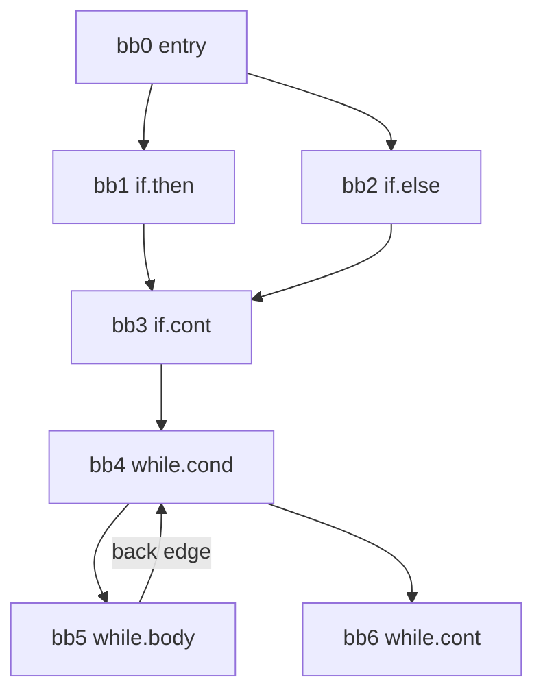

# NEY709 Advanced Compiler Topics: study guide

**What this course is about:** what a modern compiler does *after* parsing: analyse the program (control flow,
data flow, dependences) and transform it into faster code that computes exactly the same result.

Each section: **the point**, a **picture**, a **real example** (output from the tools), **where the code is**,
**check yourself**. Build first (see the [README](../../README.md)); commands run from the repository folder.
It helps to know [NEY613](NEY613.md) first.

---

## 1. Front end extras: generalised parsing and type systems

**The point:** LL/LR parsers reject ambiguous grammars. **Earley** (and GLR) parse *any* context-free grammar and
can return all parse trees. **Parallel parsing** splits the input at safe points (here, top-level functions)
and parses the parts at the same time.

```bash
build/bin/nexusc grammar examples/grammars/ambiguous.g earley "1 + 2 * 3"
build/bin/nexusc experimental-parse tests/programs/matrix_multiply.nx --mode parallel
```

```text
accepted, chart items: 31, parse trees: 2          <- (1+2)*3 and 1+(2*3)
  part0: lines 2-18 (17 line(s))
  part1: lines 20-36 (17 line(s))
Experimental parallel parse succeeded: 2 function(s)
```

**Type inference (Hindley-Milner):** the compiler finds the most general type without annotations, using
*unification*; `let` makes a definition polymorphic.

```bash
build/bin/nexusc infer "let id = fun x -> x in (id 1, id true)"
build/bin/nexusc infer "fun f -> fun x -> f (f x)"
build/bin/nexusc infer "fun x -> x x"
```

```text
(int * bool)
('a -> 'a) -> 'a -> 'a
type error: occurs check failed: cannot construct the infinite type 'a = 'a -> 'b
```

**Where the code is:** [src/compiler/formal/src/grammar.cpp](../../src/compiler/formal/src/grammar.cpp) (Earley),
[src/compiler/types/src/hindley_milner.cpp](../../src/compiler/types/src/hindley_milner.cpp).

---

## 2. Intermediate representations and SSA

**The point:** in **SSA form** every variable is assigned exactly once; where control paths meet, a
**φ-function** picks the value from the path actually taken. Each use then has exactly one definition, which
makes most optimisations simple.

```
before                       SSA
if (c) y = x + 1;            if (c) y.2 = x.1 + 1;
else   y = 99;               else   y.3 = 99;
use(y);                      y.4 = φ(y.2, y.3);  use(y.4)
```

```bash
build/bin/nexusc analysis ssa tests/programs/constant_branches.nx
```

```text
func main ssa: 3 phi node(s)
    y.4 = phi [bb1.if.then: y.2] [bb2.if.else: y.3]
    i.2 = phi [bb3.if.cont: i.1] [bb5.while.body: i.3]
    sum.2 = phi [bb3.if.cont: sum.1] [bb5.while.body: sum.3]
```

The φ-functions go exactly at the **dominance frontiers** of the blocks that assign the variable (section 3).

**Where the code is:** [src/compiler/analysis/src/ssa.cpp](../../src/compiler/analysis/src/ssa.cpp); notes in
[docs/compiler/ssa_and_sccp.md](../compiler/ssa_and_sccp.md).

---

## 3. Control-flow graph, dominators, lattices

**The point:** a **basic block** is straight-line code (one entry, one exit); the **CFG** connects blocks. Block
`d` **dominates** `n` if every path from the entry to `n` passes through `d`. An edge `n -> h` where `h` dominates
`n` is a **back edge**, and it marks a **loop** with header `h`.



```bash
build/bin/nexusc dom tests/programs/constant_branches.nx
```

```text
  bb3.if.cont: {bb0.entry, bb3.if.cont}  idom = bb0.entry
  bb4.while.cond: {bb0.entry, bb3.if.cont, bb4.while.cond}  idom = bb3.if.cont
  bb5.while.body: {bb0.entry, bb3.if.cont, bb4.while.cond, bb5.while.body}  idom = bb4.while.cond
```

bb3 is dominated only by the entry (it can be reached through bb1 *or* bb2). bb4 dominates bb5 and bb5 -> bb4
exists: that is the `while` loop.

A **lattice** orders the facts an analysis can know. For constants: `TOP` (no information yet) above every
constant `1, 2, 3, ...`, and those above `BOTTOM` (not a constant). Facts only move down, and the lattice has
finite height, so the analysis must stop.

**Where the code is:** [src/compiler/analysis/src/cfg.cpp](../../src/compiler/analysis/src/cfg.cpp),
[src/compiler/analysis/src/dominators.cpp](../../src/compiler/analysis/src/dominators.cpp).

---

## 4. Data-flow analysis: iterative and region-based

**The point:** compute, for every block, facts such as "which variables are **live**" (backward) or "which
definitions **reach** here" (forward). Each block has a *transfer function* `out = gen ∪ (in − kill)`; blocks are
joined by a *meet* (∪ for "may" problems).

**Iterative:** repeat over all blocks until nothing changes.

```bash
build/bin/nexusc analysis liveness examples/source_lang/arrays_and_loops.nx
```

```text
func sum4 liveness:
  iterations: 4
  bb2.while.body:
    use: {values: int[4], i: int, total: int}
    def: {i: int, total: int}
    in:  {values: int[4], i: int, total: int}
```

**Region-based (no iteration):** build a tree of regions (blocks -> loop bodies -> loops -> whole program),
summarise each region as **one** transfer function bottom-up, then push the values down. For a loop the summary
is the *closure* `f* = id ∧ f`, computed once instead of iterating.

```bash
build/bin/nexusc opt examples/source_lang/arrays_and_loops.nx --analysis regions
```

```text
func sum4 regions:
  R6 body header bb0.entry {bb0, bb1, bb2, bb3}
    R0 block header bb0.entry
    R5 loop header bb1.while.cond {bb1, bb2} back edge bb2->bb1
      R4 body header bb1.while.cond {bb1, bb2}
        R1 block header bb1.while.cond
        R2 block header bb2.while.body
    R3 block header bb3.while.cont
reaching definitions (by regions):
  bb0.entry  in {}  out {d0:i, d1:total}
  bb1.while.cond  in {d0:i, d1:total, d2:total, d3:i}  ...
region solver: 8 compositions, 1 meets, 1 closures, no iteration; iterative solver (3 passes) agrees
```

The definitions `d2`, `d3` made in the loop body reach the loop header around the back edge, and the region
solver gets this from the closure, with no iteration. It needs a *reducible* graph (every loop has a single
entry); irreducible graphs are reported.

**Where the code is:** [src/compiler/analysis/src/data_flow.cpp](../../src/compiler/analysis/src/data_flow.cpp),
[liveness.cpp](../../src/compiler/analysis/src/liveness.cpp),
[region_flow.cpp](../../src/compiler/analysis/src/region_flow.cpp).

**Check yourself**
<details><summary>Why is liveness a backward problem?</summary>
Whether a variable is live at a point depends on future uses, so information flows from the uses back
towards the definitions.
</details>
<details><summary>Why does the iterative algorithm always terminate?</summary>
The transfer functions are monotone and the lattice of sets is finite, so every set can only grow (or only
shrink) a bounded number of times.
</details>

---

## 5. Using the analyses: constants, common subexpressions, symbolic analysis

**The point:** **sparse conditional constant propagation (SCCP)** runs on SSA, finds constants and the branches
they decide, and so finds **unreachable** code. **Symbolic analysis** goes further and expresses values as
formulas of other variables (`i + 1`, `n`), which loop transformations need.

```bash
build/bin/nexusc analysis sccp tests/programs/constant_branches.nx
```

```text
func main sccp: 7 computed value(s) constant, 1 branch(es) resolved, 1 unreachable block(s)
  bb1.if.then
    y.2 = 5
  bb2.if.else   ; unreachable              <- x * 2 == 8 is always true
  bb3.if.cont
    y.4 (phi) = 5                           <- only one path is executable
  bb4.while.cond
    i.2 (phi) = BOTTOM                      <- changes around the loop: not a constant
```

```bash
build/bin/nexusc opt examples/source_lang/symbolic_unroll.nx --analysis symbolic
```

**Common subexpressions.** If `a * b` was already computed and neither `a` nor `b` changed since, the value can
be reused. *Inside a block*, **local value numbering** gives every computed value a number; an instruction with
the same operator and the same operand numbers gets the same number and is deleted (a load right after a store
of the same variable is replaced by the stored value). *Across blocks*, **available expressions** (a forward
"must" problem: meet = ∩) tells which expressions have been computed on *every* path to a point.

[examples/source_lang/common_subexpressions.nx](../../examples/source_lang/common_subexpressions.nx):

```rust
var x: int = (a + b) * (a + b);      // a + b twice in one block
if (a > b) { y = a * b; } else { y = a * b + 1; }
var z: int = a * b;                  // computed on both paths before: redundant
a = a + 1;
var w: int = a + b;                  // a changed: a new value
```

```bash
build/bin/nexusc opt examples/source_lang/common_subexpressions.nx --analysis available
build/bin/nexusc opt examples/source_lang/common_subexpressions.nx --pass cse
```

```text
  bb3.if.cont  in {a + b, (a + b) * (a + b), a > b, a * b}  out {a + b, x + y, ...}
redundant computations: 2
  bb0.entry: a + b  (computed earlier in the same block)
  bb3.if.cont: a * b  (available on every path into the block)
region solver (intersection meet): 4 compositions, 1 meets, 0 closures; iterative solver (2 passes) agrees
; value numbering: f: 10 redundant instruction(s) removed (3 load(s) replaced by the value just stored)
```

The tests run every program of the repository and 120 random ones before and after value numbering: the
results never change.

**Where the code is:** [src/compiler/analysis/src/ssa.cpp](../../src/compiler/analysis/src/ssa.cpp) (SCCP),
[src/compiler/analysis/src/symbolic.cpp](../../src/compiler/analysis/src/symbolic.cpp),
[src/compiler/passes/src/value_numbering.cpp](../../src/compiler/passes/src/value_numbering.cpp) (local value numbering),
[src/compiler/analysis/src/region_flow.cpp](../../src/compiler/analysis/src/region_flow.cpp) (available expressions).

---

## 6. Loop unrolling: concrete and symbolic

**The point:** copy the loop body k times so the loop branch, the counter update and the test run k times less
often, and the copies can be scheduled together. With a **known** trip count the loop can be unrolled exactly;
with an **unknown** `n` the compiler adds a **remainder loop** for the last `n mod k` iterations.

```
for (i = 0; i < n; i++)          for (i = 0; i + 3 < n; i += 4) {    // main loop: 4 copies
  s += a[i];                        s += a[i]; s += a[i+1];
                                    s += a[i+2]; s += a[i+3];
                                 }
                                 for (; i < n; i++) s += a[i];       // remainder: at most 3
```

```bash
build/bin/nexusc opt examples/source_lang/fixed_trip_unroll.nx --pass unroll
build/bin/nexusc opt examples/source_lang/symbolic_unroll.nx --pass unroll-remainder --factor 4
```

**Where the code is:** [src/compiler/passes/src/loop_unroll.cpp](../../src/compiler/passes/src/loop_unroll.cpp).

---

## 7. Iteration spaces and polyhedral transformations

**The point:** the iterations of a loop nest are the integer points of a **polyhedron**. A dependence between
iterations has a **distance vector**; a transformation (interchange, skewing, tiling) is **legal** if every
dependence still points forward (lexicographically positive) afterwards. The best schedule can be found with
**linear programming**.

**Illegal interchange:** with distance `(1,-1)`, swapping the loops would reverse it.

```bash
build/bin/nexusc poly examples/loops/interchange_illegal.loop interchange 1 2
```

```text
  flow A: S1 -> S1  carried by loop i  direction (<,>)  distance (1,-1)
illegal: flow dependence on A with distance (1,-1) would be reversed
```

**Wavefront by linear programming:** `A[i][j] = A[i-1][j] + A[i][j-1]`: both loops carry a dependence, so neither
is parallel. The LP finds a time vector `π` with `π·d ≥ 1` for every distance `d`:

```bash
build/bin/nexusc poly examples/loops/wavefront.loop schedule
```

```text
  constraints pi.d >= 1 for the loop-carried distances: (0,1) (1,0)
  time vector pi = (1,1): 12 wavefronts for 42 iterations
  parallel loops after the transformation: 1:no 2:yes
for c1 = 2 to 13 {
  for c2 = max(c1 - 6, 1) to min(c1 - 1, 7) {
    i = c1 - c2
    j = c2
    A[i][j] = A[i - 1][j] + A[i][j - 1]
  }
}
```

```
j ->         all points with the same i + j (a diagonal) are independent:
i  1 2 3 4   they form one wavefront and can run in parallel
|  2 3 4 5
v  3 4 5 6
```

**Tiling for locality:** run the loops in small blocks that fit in the cache. Legal when the nest is *fully
permutable* (every distance has no negative component); otherwise skew first.

```bash
build/bin/nexusc poly examples/loops/matmul_tiling.loop tile 8 8 8
build/bin/nexusc poly examples/loops/stencil_skew.loop tile 4 4             # refused: distance (1,-1)
build/bin/nexusc poly examples/loops/stencil_skew.loop autoskew tile 4 4    # skew j by i, then tile
```

```text
for t1 = 0 to 47 step 8 {
  for t2 = 0 to 47 step 8 {
    for t3 = 0 to 47 step 8 {
      for c1 = max(0, t1) to min(47, t1 + 7) {
        ...
verification: 110592 of 110592 instances executed in 216 tiles, arrays identical to the original nest
cache (8-element lines, 16 sets, 4 ways, LRU): original 117810 misses / 442368 accesses (26.63%), tiled 3636 misses (0.82%)
```

Matrix multiplication 48x48: the same arithmetic, 32 times fewer cache misses.

**Where the code is:** [src/compiler/polyhedral/src/polyhedral.cpp](../../src/compiler/polyhedral/src/polyhedral.cpp)
(dependences by Fourier-Motzkin, transformations, tiling, cache model),
[schedule.cpp](../../src/compiler/polyhedral/src/schedule.cpp) (simplex, branch and bound, hyperplane schedule);
notes in [docs/compiler/polyhedral.md](../compiler/polyhedral.md).

**Check yourself**
<details><summary>Distances (1,0) and (0,1). Is interchanging the two loops legal?</summary>
Yes: they become (0,1) and (1,0), both still lexicographically positive.
</details>
<details><summary>Why does tiling reduce cache misses but not the number of operations?</summary>
It only changes the order of the iterations: data loaded into the cache is reused many times inside a
tile before it is evicted.
</details>

---

## 8. Pointers, calls and interprocedural optimisation

**The point:** two references **alias** if they may touch the same memory; without alias information the
compiler must assume the worst and cannot reorder loads and stores. **Interprocedural analysis** summarises each
function (pure? what does it return?) so calls can be folded or inlined.

```bash
build/bin/nexusc opt examples/source_lang/interproc_fold.nx --analysis interproc
build/bin/nexusc opt tests/programs/array_rows.nx --analysis alias
```

```text
interprocedural summaries:
  func inc: pure=yes, tiny=yes, writes-memory=no, calls=no, return=(arg0 add 1)
  func main: pure=no, tiny=yes, writes-memory=no, calls=yes, return=(? add ?)
```

Because `inc` is pure and returns `arg0 + 1`, the calls in `inc(4) + inc(2)` are replaced by the constants
`5` and `3` at compile time, and no call is left:

```bash
build/bin/nexusc opt examples/source_lang/interproc_fold.nx --pass interproc-constfold
```

```text
func main() -> int {
  bb0.entry:
    %1: int = const_int 5
    %3: int = const_int 3
    %4: int = add %1, %3
    return %4
}
```

(shortened; constant folding then turns `5 + 3` into `8`.)

**Where the code is:** [src/compiler/analysis/src/alias_analysis.cpp](../../src/compiler/analysis/src/alias_analysis.cpp),
[interprocedural.cpp](../../src/compiler/analysis/src/interprocedural.cpp),
[src/compiler/passes/src/interprocedural_pass.cpp](../../src/compiler/passes/src/interprocedural_pass.cpp).

---

## 9. Project: an optimisation inside a real compiler (LLVM)

**The point:** real compilers are built the same way, as a sequence of passes over an IR. LLVM lets you write
your own pass and load it into `opt` as a plugin. [src/llvm_pass/NexusPasses.cpp](../../src/llvm_pass/NexusPasses.cpp)
has two small ones:

- `nexus-strength`: strength reduction: `x * 8` -> `x << 3`, `x / 4` -> `x >> 2`, `x % 16` -> `x & 15` (unsigned).
- `nexus-loops`: uses LLVM's own analyses (LoopInfo, ScalarEvolution) to print every loop with its depth and trip
  count.

```bash
# Linux or macOS with LLVM installed (Ubuntu: sudo apt install llvm-dev clang); the build makes build/lib/NexusPasses.so
clang -O0 -Xclang -disable-O0-optnone -S -emit-llvm tests/llvm/strength_loops.c -o s.ll
opt -passes=mem2reg s.ll -S -o s2.ll
opt -load-pass-plugin=build/lib/NexusPasses.so -passes='nexus-strength,nexus-loops' s2.ll -S -o s3.ll
```

The test (`ctest -R nexus_llvm_pass`) checks that no multiplication, division or remainder by a power of two is
left, that the program prints the same number before and after, and that the 100 x 10 loop nest is found with
100 and 10 iterations:

```text
nexus-loops: main: depth 1, header %1, 7 block(s), trip count 101, backedge-taken count 100
nexus-loops: main: depth 2, header %8, 3 block(s), trip count 11, backedge-taken count 10
```

("trip count 101" because a `for` loop tests its condition at the top: the test runs 101 times, the body 100.) It runs on every push in the repository's GitHub Actions (Linux). LLVM plugins do not
load on Windows, so use WSL there.

A good group project starts from here: write a pass for one of the optimisations of this guide (constant
propagation, common subexpressions, loop unrolling) and compare it with LLVM's own (`-passes=sccp`, `gvn`,
`loop-unroll`).

---

## Papers to read

A short reading list with the classic papers of each topic: [docs/literature/compiler_readings.md](../literature/compiler_readings.md).

---

**Previous:** [NEY613](NEY613.md) · Related: [NEY606](NEY606.md) (software pipelining is a compiler
schedule for the hardware).
