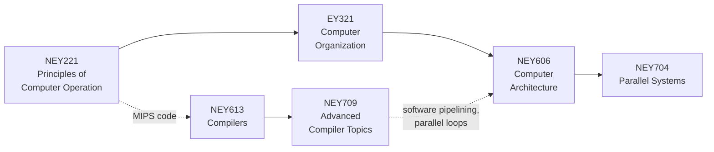

# Study guides

One guide per course. Each section of a guide has the same five parts:

| part | what it gives you |
| --- | --- |
| **The point** | the one idea to remember, in a sentence or two |
| **Picture** | a diagram, table or ASCII sketch of the mechanism |
| **Example** | a command you can run and the real output it prints |
| **Where the code is** | the file that implements it, small enough to read |
| **Check yourself** | short questions; click to see the answer |

## The order that makes sense

| guide | sections |
| --- | --- |
| [NEY221 Principles of Computer Operation](NEY221.md) | organisation of a computer · MIPS assembly and procedures · instruction set styles · number representation · adders, multipliers, dividers |
| [EY321 Computer Organization](EY321.md) | performance · single-cycle datapath · multi-cycle and microprogrammed control · pipelining and hazards · caches · virtual memory · I/O · Verilog lab |
| [NEY606 Computer Architecture](NEY606.md) | Amdahl's law · superscalar · scoreboard and Tomasulo · branch prediction · VLIW and software pipelining · non-blocking caches |
| [NEY704 Parallel Systems](NEY704.md) | Flynn · multithreading · coherence · consistency and synchronisation · OpenMP · MPI · vectors and SIMD · GPUs · networks |
| [NEY613 Compilers](NEY613.md) | automata and data structures · lexical analysis · LL and LR parsing · semantic analysis · quadruples · code generation |
| [NEY709 Advanced Compiler Topics](NEY709.md) | generalised parsing and types · SSA · dominators and lattices · iterative and region-based data flow · constants · unrolling · polyhedral and tiling · alias and interprocedural |

## Tips

- Run the example first, then read the explanation, then open the code: the output tells you what to look for.
- Change the inputs. Every example file is small; edit it and run again.
- `--stats`, `--trace` and `--timeline` show what happens inside the simulators.
- The course outlines are in [../course_outlines](../course_outlines); reading lists for the paper-study part of
  the courses are in [../literature](../literature).
