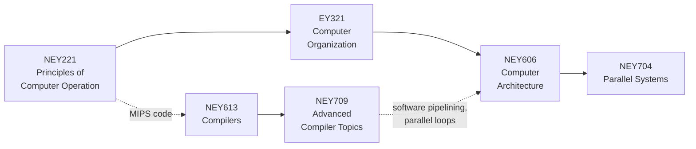

# Study guides

One guide per course: the theory of each topic, a picture, a small program that shows it running, and the
code that implements it. The [glossary](GLOSSARY.md) gives every term in Greek and English.

Read [the connected flow](../FLOW.md) to see why the six subjects belong together: one computation passes
through all of them. Every guide also ends with a section **How this course connects**.

## How to read one topic

Five questions explain any mechanism: **why** it exists, **what state** it keeps, **what changes** that state,
**what must stay true**, and **what it costs** (cycles, memory traffic, communication, code size).

1. Read the explanation and the picture: what problem does the mechanism solve, and what state does it keep?
2. Run the small example and compare its output with the explanation.
3. Read the shown code fragment, then the named function in the implementation.

| part | what it gives you |
| --- | --- |
| **The point** | the one idea to remember, in a sentence or two |
| **Picture** | a diagram, table or ASCII sketch of the mechanism |
| **Example** | a command you can run and the real output it prints |
| **Where the code is** | the implementation file; read the named function/branch before the whole module |

Start at [examples/basics](../../examples/basics/README.md): each file there shows one idea. The arithmetic and
interleaving examples need only Python 3; the MIPS and compiler examples use the two built tools. OpenMP, MPI,
Verilog, CUDA and LLVM need their own toolchains where they are used. Folded **Larger example** sections hold
bigger workloads and hardware details, for after the small case is clear.

Commands run from the repository root. Output excerpts may omit trace lines; exact cycles depend on the
documented model and settings. PC in C++ traces is an instruction index, not a byte address. Analysis reports
describe facts; a report does not necessarily apply an optimisation to generated code.

## The order that makes sense

| guide | sections |
| --- | --- |
| [NEY221 Principles of Computer Operation](NEY221.md) | organisation of a computer  /  MIPS assembly and procedures  /  instruction set styles  /  number representation  /  adders, multipliers, dividers |
| [EY321 Computer Organization](EY321.md) | performance  /  single-cycle datapath  /  multi-cycle and microprogrammed control  /  pipelining and hazards  /  caches  /  virtual memory  /  I/O  /  Verilog |
| [NEY606 Computer Architecture](NEY606.md) | Amdahl's law  /  superscalar  /  scoreboard and Tomasulo  /  branch prediction  /  VLIW and software pipelining  /  non-blocking caches |
| [NEY704 Parallel Systems](NEY704.md) | Flynn  /  multithreading  /  coherence (C++ and Verilog)  /  consistency and synchronisation  /  OpenMP  /  MPI  /  vectors and SIMD  /  GPUs  /  networks |
| [NEY613 Compilers](NEY613.md) | automata and data structures  /  lexical analysis  /  LL and LR parsing  /  semantic analysis  /  quadruples  /  code generation |
| [NEY709 Advanced Compiler Topics](NEY709.md) | generalised parsing and types  /  SSA  /  dominators and lattices  /  iterative and region-based data flow  /  constants and common subexpressions  /  unrolling  /  polyhedral and tiling  /  alias and interprocedural  /  an LLVM pass |

## Tips

- `--stats`, `--trace` and `--timeline` show what happens inside the simulators.
- Reading lists connecting the mechanisms to their original publications are in [../literature](../literature).
